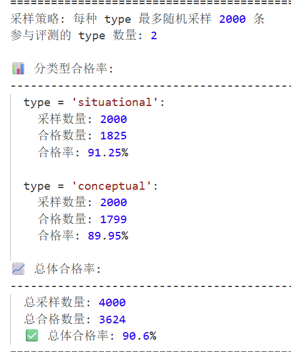
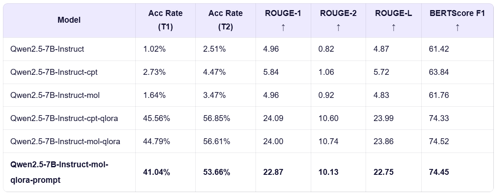
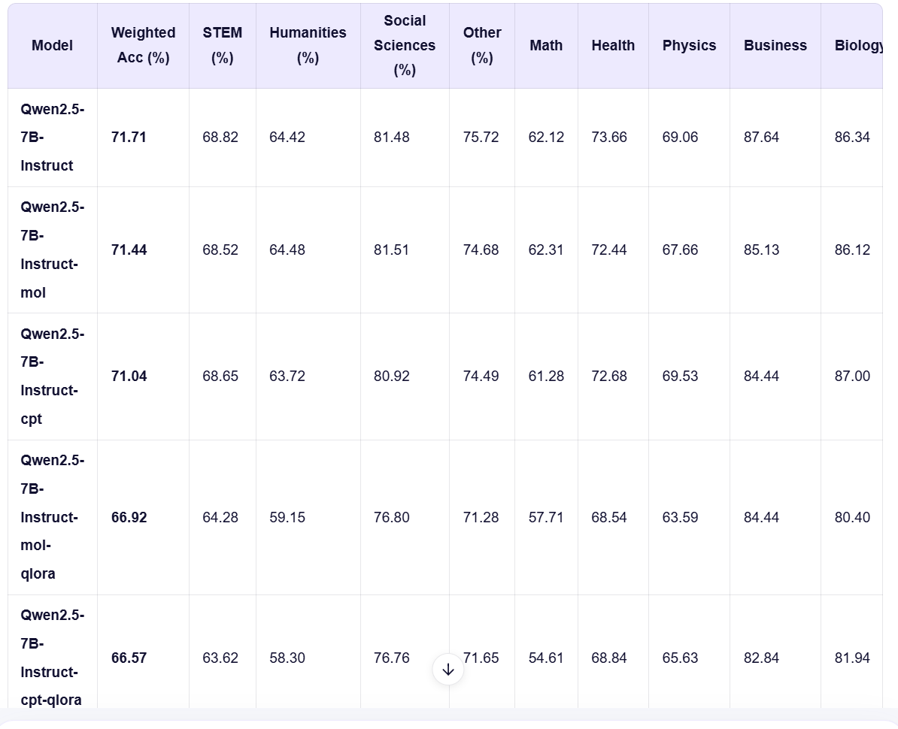
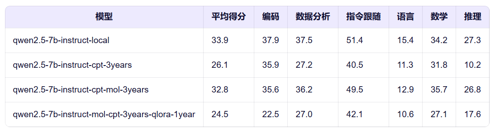

# 微调数据集质量

# 领域评估能力   

# ==================== 新增：置信度提示====================
CONFIDENCE_PROMPT = (
    "请回答以下问题：{question}。只有在你非常确定答案正确时才回答。"
    "如果你不确定、信息不足或无法验证，请回答“我不知道”。"
    "避免猜测，因为错误回答比不回答更糟糕。"
)

{
  "question": "永嘉县截至2024年创成了多少个省级‘一亩山万元钱’示范基地？",
  "answer": "2个",
  "mol_cpt_qlora_model_answer_prompt": "我不知道。",
  "source_id": 797,
  "pub_date": "2024-11-14",
  "context": "本报讯 11月12日上午，由温州市自然资源和规划局主办，浙江省亚热带作物研究所、浙江农林大学林业与生物技术学院、永嘉县自然资源和规划局承办，温州市各县（市区）林业主管部门、市林学会、永嘉县大若岩镇人民政府协办的浙江省第二十一届林业科技周温州分会场启动仪式在我县大若岩镇举行。永嘉县委常委、县政府党组成员黄鹤楼参加活动。 启动仪式上，县自然资源和规划局与浙江省亚热带作物研究所签订了林业产业战略合作框架协议。现场颁发了 2024 年温州市林业主导品种和主推技术证书、第五批 “温州市林业乡土专家” 聘书，并举行了温州市林业共富科技推广服务团授旗仪式。 黄精是温州市山区林业增效、林农增收的主导品种之一。近年来，在政策和技术的双推动下，林农的积极性显著提高。为加快推广黄精标准化栽培技术，本次活动组织了黄精种植技术大比武等活动。经过选拔决赛，2 名选手获得黄精种植工匠奖，其中来自永嘉的麻庆康摘得桂冠。 活动现场还举行了产品展销会，来自温州各地区的十余家企业纷纷拿出自己的特色产品，永嘉的黄精茶、黄精饼、菜头肾、栀子茶等备受喜爱。“我们黄精种植面积算是永嘉最大的，今年黄精面、黄精糕等产品也陆续上市，销量完全不用愁。”永嘉县元复康养有限公司负责人王光初介绍道，除了黄精，菜头肾也成了展销会的焦点，摊位前咨询的顾客络绎不绝。“菜头肾是温州地道的产品，我们现在已经销售到内蒙古甚至是外蒙，目前市场反馈良好，接下来我们想把菜头肾进行深加工，延长其产业链条。”浙江上坪农业科技开发有限公司负责人马奇辉说。 永嘉县作为浙江省第五、温州第一的林业大县，目前全县林下经济面积已达7万亩，近三年新增林下种植面积5535亩，创成省级林下道地中药材种植示范基地1个，省级“一亩山万元钱”示范基地2个，市级示范基地5个。同时，永嘉县高标准推进百万亩国土绿化行动，完成新增国土绿化面积超8万亩，千万亩森林质量精准提升近3万亩。目前，全县林业用地面积达到309万亩，森林覆盖率75%，林木绿化率75.5%，逐步形成了人与自然和谐发展的新格局。 记者 李彩云 刘婷婷",
  "evaluation_results": {
    "basic_metrics": {
      "rouge_1": 0.0,
      "rouge_2": 0.0,
      "rouge_l": 0.0,
      "bertscore_precision": 47.83986806869507,
      "bertscore_recall": 64.95400071144104,
      "bertscore_f1": 55.09856939315796
    },
    "correctness": {
      "correct": false,
      "error_types": [
        "事实错误",
        "遗漏"
      ],
      "score": 1,
      "reason": "模型回答'我不知道'与参考答案'2个'不一致，且遗漏了上下文中的关键信息。"
    }
  }
},

#通用能力
MMLU

LiveBench
