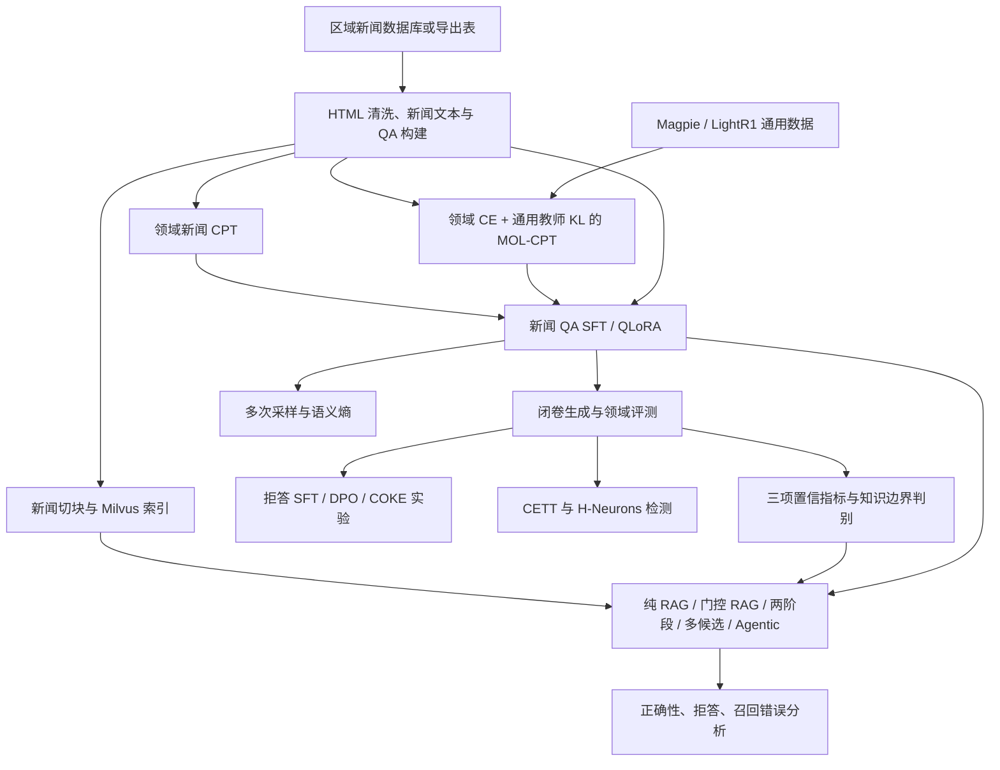

# 面向区域新闻可信问答系统的幻觉抑制方法研究：项目结构与实验全景分析

> 分析日期：2026-11-16。工作区：`/mnt/project`。本报告依据本地文件扫描、205 个业务／参考框架 Python 文件的静态结构解析、核心实现检查、主要数据集实际计数与已保存评测摘要编写。没有执行训练、推理、联网裁判、数据库写入或权重反序列化。现有文档中的方案描述不等于实现或实测结论；本文区分源码事实、产物事实和有待核对的推断。

> 后续结果核对：请结合 [已有实验分块实现与结果汇总](已有实验分块实现与结果汇总.md) 阅读。本次补查找到实际 MMLU 结果与决策器测试日志，新增神经元问题级预测复核，并确认 Agentic 验证异常和 TriviaQA 测试真值缺失；原有特征级摘要不代表问题级最终效果。

## 阅读导航

- 第 1—3 节：项目全貌、目录地图、研究流程。
- 第 4—10 节：数据构建、训练、可信度和 RAG 的职责与依赖。
- 第 11—13 节：已落盘结果、关键问题、复现与论文整理建议。
- 附录 A：205 个 Python 文件逐一说明，包括主要函数、代表性输入输出路径。
- 附录 B—D：数据结构、评测摘要和 notebook 索引。
- [项目逐文件用途索引.md](项目逐文件用途索引.md)：17,842 个文件的独立清单，逐行给出路径、大小、用途／文件类型。大型权重、重复 checkpoint、服务内部文件和第三方库按类别解释；并未宣称逐字人工阅读每个文件。

## 1. 项目性质与核心判断

这不是单一应用仓库，而是一个长期积累的毕业设计实验工作区。它把原始语料、数据集加工程序、训练代码、多个模型版本、模型评测、可信度判别器、检索服务、第三方框架及早期学习实验放在同一个根目录。

毕业设计主干是 `Qwen2.5-7B-Instruct-news/`。其研究逻辑可以概括为：以区域新闻补充模型知识，通过问答微调提高领域回答能力，再通过知识边界识别、拒答训练和外部证据检索，减少缺乏依据的回答。`H-Neurous/` 和 `semantic_entropy/` 分别研究内部神经元特征与多次采样语义不确定性；`milvus/` 为外部新闻证据提供索引基础。`Qwen3-8B-news/` 是另一模型家族上的扩展实验，且与主目录共享数据。

目前有多条可分别运行的实验链，但没有证据证明所有方法已被接入同一个统一系统：尤其不能把神经元检测、语义熵、DPO、Agentic RAG 都当作最终系统同时启用的组件。系统入口以批量 JSON 问答实验脚本为主，尚不能仅凭目录认定存在已部署的完整用户产品。

## 2. 根目录结构与空间分布

扫描记录排除了 `.git`、`__pycache__` 和 notebook checkpoint 目录。文件数量为扫描口径；空间来自 `du -h --max-depth=1` 的实际磁盘占用，采用工具的取整显示，不能与逻辑字节大小直接相加比较。

| 根目录 | 文件数 | 磁盘占用约 | 项目职责 |
|---|---:|---:|---|
| `Qwen2.5-7B-Instruct-news/` | 8,315 | 1.3 T | 新闻数据、CPT／MOL-CPT、SFT、知识边界、拒答、RAG 与主评测 |
| `H-Neurous/` | 287 | 221 G | CETT 神经元特征、幻觉检测器及多种特征筛选对比 |
| `Qwen3-8B-news/` | 465 | 63 G | Qwen3 新闻 SFT 与多目标持续预训练 |
| `deepseek-r1-distill-llama-8b-qlora/` | 3,065 | 39 G | 早期医疗推理 QLoRA 与基线评价 |
| `unknow_test/` | 59 | 30 G | TriviaQA／Llama-2 知识未知性和置信指标实验 |
| `milvus/` | 3,497 | 17 G | 新闻向量索引脚本、BGE-M3、服务持久化 |
| `Qwen2.5-1.5B-lora/` | 1,484 | 14 G | 早期医疗 QA、LoRA 和 GRPO 实验 |
| `llama_grpo/` | 34 | 9.3 G | GSM8K 的 GRPO 示例 |
| `bert-base-multilingual-cased/` | 7 | 2.0 G | 语义评价编码模型资源 |
| `semantic_entropy/` | 33 | 1.9 G | 语义熵、离散语义熵与阈值实验 |
| `bert-base-chinese/` | 7 | 1.2 G | 多个评测脚本实际引用的中文 BERTScore 模型 |
| `unsloth-offline/` | 361 | 12 M | 离线 Unsloth／Unsloth Zoo 框架源码 |
| `metrics/` | 225 | 1.6 M | 离线指标实现与说明，共 54 个指标目录 |
| `paper_test/` | 1 | 24 K | 扫描前已有的 Codex 环境指南；本报告新增在其 `md/` 下 |
| `.vscode/` | 1 | 8 K | 编辑器配置 |
| `recall_analysis_multithread.log` | 1 | 约 150 K | 召回错误分析日志 |

总实际占用约 1.7 T。较大的规模主要来自权重、断点和高维特征，而不是代码量。`H-Neurous/output/saga_chat/cett_features_vectorized.jsonl` 的逻辑大小约 57.2 GB，`train_trivia` 同名文件约 48.6 GB；两者不是普通小型 JSONL，整理时应保留来源与生成配置。

```text
/mnt/project/
├── Qwen2.5-7B-Instruct-news/           # 毕业设计主体
│   ├── create_finetune_dataset/       # 数据库导出、QA 生成与划分
│   ├── data-continued-pretraining/    # 新闻持续预训练数据
│   ├── code-continued-pretraining/    # 标准 CPT
│   ├── MOL-CPT/{code,data,output}/    # 领域学习 + 通用能力保留
│   ├── 1year-news-finetune/           # 一年新闻 QA 与多版 SFT
│   ├── code-2016news-finetune/        # 早期 SFT，当前配置已演变
│   ├── data-2016news-finetune/        # 早期数据和评测
│   ├── domain_test/                  # 主领域推理与评测
│   ├── general_test_dataset/         # MMLU、LiveBench 等
│   ├── refusal_dpo/                  # 拒答 SFT、DPO、反思、分类头
│   ├── coke/                         # 置信一致性方向训练
│   ├── CONQORD/                      # 置信校准参考框架
│   ├── Knowledge_Boundary_Awareness/ # 边界判别 + RAG 主实验区
│   │   ├── code/decision_makers/     # MLP／Attention／Ensemble
│   │   ├── agentic_rag_system/       # 查询改写、HyDE、迭代、验证
│   │   ├── multihop_qa/              # 实体关系链与多跳 QA
│   │   ├── data/                     # 推理、评测、阈值、RAG 对比
│   │   ├── models/                   # 判别器模型
│   │   └── output/                   # 系统方案与分析笔记
│   ├── news_qa_system/code/          # 较早集成管线
│   ├── model/                        # 底座及多个阶段模型
│   └── output*/                      # 各轮训练 checkpoint／adapter
├── H-Neurous/{code,data,output,cache,logs,models}/
├── semantic_entropy/{code,data,model}/
├── milvus/{code,data,models,volumes}/
├── Qwen3-8B-news/{models,sft,mol-cpt,outputs}/
└── paper_test/md/                    # 项目说明文档
```

## 3. 毕业设计研究路线与真实依赖



箭头表示源码可识别的输入依赖或实验衔接，不表示这些方法均在同一次实验里联合使用。CPT 与 MOL-CPT 是训练路线对照；纯 RAG 与带门控 RAG 也是不同方案。

主目录下大量程序硬编码了同一个模型路径：`model/Qwen2.5-7B-Instruct-CPT-MOL-3years-QLORA-1year`。它是知识边界、神经元和语义熵等实验反复使用的模型节点，适合作为整理实验谱系的中心；但具体权重是否由当前脚本、当前配置生成，仍需训练状态和运行日志佐证。

## 4. 新闻与问答数据集

### 4.1 原始数据处理

`create_finetune_dataset/` 的四个脚本覆盖数据库导出、HTML 清洗、QA 生成和数据划分。文件名可能有历史遗留，例如 `mysql_to_csv.py` 中实际配置了 JSON 保存路径，不能直接按扩展名推断输出。

`1year-news-finetune/data/` 保存一年、三年、半年新闻 CSV 与筛选新闻 JSON；`coda/` 是实际保留的代码目录拼写。`news_to_data.py` 为新闻构造情景型、概念型 QA，`qa_test_data.py` 构造事实型 QA。`qa_quality_enhance*` 负责质量增强，`dataset_enhance*` 负责问法扩展及批量请求。`get_data_unmentioned.py` 构造“原文未提及”问题，`get_data_unfinetuned.py` 构造未用于微调的新闻 QA，`huafen.py` 合并回答与拒答数据。

本地原始新闻示例具有 `id/title/content/pub_date`，训练 QA 通常具有 `question/answer/source_id/type`。`source_id` 是把问题、原始新闻与检索证据关联起来的关键字段，应优先保留。

### 4.2 已核实的样本规模

| 文件（相对主目录） | 实际记录数 | 说明 |
|---|---:|---|
| `1year-news-finetune/data/1year_news_filtered.json` | 1,614 | 筛选后新闻 |
| `.../data/datasets/all_processed_news.json` | 1,615 | 已处理新闻记录；与前者多 1 条，尚未逐条对账 |
| `.../data/datasets/situational_qa.json` | 16,120 | 情景型 QA |
| `.../data/datasets/conceptual_qa.json` | 16,120 | 概念型 QA |
| `.../data/datasets/combined_qa.json` | 32,240 | 合并 QA |
| `.../data/datasets/train.json` | 25,792 | 12,896 情景型 + 12,896 概念型 |
| `.../data/datasets/val.json` | 3,224 | 当前 type 全为 `answered`，与原始两类命名不同 |
| `.../data/datasets/test.json` | 3,224 | 1,612 情景型 + 1,612 概念型 |
| `domain_test/domain_fact_qa_4/train_data.json` | 3,219 | 事实 QA，字段为 question/answer/source_id |
| `domain_test/domain_fact_qa_4/test_data.json` | 3,212 | 同上，是多个后续脚本的输入 |

`...` 在表中指 `1year-news-finetune`。这里的记录数是当前磁盘数据，而不是根据文件名估算。

### 4.3 数据划分的实质

实际检查得到：训练、验证、测试三个 QA 集合的唯一 `source_id` 数量均为 **1,612**，三个集合任意两者的来源交集均为 **1,612**。`create_finetune_dataset/split_dataset.py` 的实现也是在每个 `(source_id,type)` 组内部切分问题。

这适合测试“已见新闻上的未见问法”，但不能据此证明“未见新闻泛化”。应在论文中分别定义：同新闻不同问法、按新闻完全隔离、按时间隔离、未微调新闻、无证据问题。当前 `val.json` 的 type 还被统一改为 `answered`，说明数据经历过后处理，原始划分脚本不能完整解释所有现存文件。

32,240 条 QA 对应 1,612 个新闻来源，提示生成阶段倾向于每个来源构造多条问题；不要把 QA 数量误写成独立新闻数量。1,614／1,615／1,612 的差异，以及 3,224／3,219／3,212 的差异，需以 source_id 和 question 对账后再解释为筛选、生成失败或去重，不能直接认定原因。

## 5. 模型训练与领域适配

### 5.1 标准 CPT

`code-continued-pretraining/` 提供新闻 CSV 转文本、文本合并、token 统计、持续预训练与生成评价；数据和输出分别在 `data-continued-pretraining/`、`output-continued-pretraining/`。这是用新闻语料更新模型参数的路线，与推理阶段的 RAG 分开。

### 5.2 MOL-CPT

`MOL-CPT/data/` 同时保存新闻 JSONL、Magpie 通用指令和 LightR1 数据。`MOL-CPT/code/` 保留了 Unsloth、Accelerate、DeepSpeed ZeRO-2／3、FSDP／QLoRA 及 NCCL 排障等多个实现。它们是同一研究目标下的工程变体，不能当作十几种独立论文方法。

核心实现以学生模型、冻结教师模型及两种数据源组成。在 `cpt_unsloth.py:856` 附近，通用批次使用 `alpha*CE + (1-alpha)*KL`，领域批次使用 `(1-alpha)*CE + alpha*KL`；当前 `main()` 中 `alpha=0`，所以通用批次实际优化教师 KL，领域批次优化新闻 CE。当前代码还设置 3 epochs、AdamW lr=1e-5。不同变体应分别核对配置，不能把这一配置泛化给所有 MOL 产物。

KL 与 CE 的位置处理也应单独审查：源码通过 attention_mask 和 labels 选取 KL 位置，而 CE 由模型内部计算，二者的 token 对齐和掩码语义需要在正式复现时核验。此处仅记录实现，未进行数值测试。

### 5.3 新闻 QA SFT 与混合数据

`1year-news-finetune/coda/finetune.py` 当前基于 MOL-CPT 模型，使用增强且含拒答的 `sft_train.json`；实际常量为 LoRA rank=128、alpha=128、dropout=0.15、batch_size=32、lr=2e-4、3 epochs。`finetune_2dataset.py` 则混合新闻 QA 与 Magpie，当前 rank=128、dropout=0.1、batch_size=16、lr=2e-4、5 epochs。

这些是源码当前状态。输出目录中的 `drouput0.05-r64-bs32`、`drouput0.1-r128-bs16-epoch5` 等名称保存了历史配置线索，但目录名不能代替 `trainer_state.json`、adapter_config 和运行日志。`code-2016news-finetune/finetune.py` 当前也引用一年新闻数据及 MOL-CPT 模型，因此“2016news”仅能作为历史目录名理解。

### 5.4 模型产物的阅读方法

| 文件模式 | 用途 |
|---|---|
| `model-0000x-of-0000y.safetensors` | 完整模型权重分片 |
| `model.safetensors.index.json` | 参数名到权重分片的映射 |
| `adapter_model.safetensors` + `adapter_config.json` | LoRA adapter；需匹配正确基础模型 |
| `checkpoint-N/` | 中途训练快照，可能含 adapter、优化器和训练状态 |
| `trainer_state.json` | epoch、global_step、log_history 等，可帮助判定完成程度 |
| `optimizer.pt`、`scheduler.pt`、`rng_state*` | 断点续训状态 |
| `tokenizer*`、`vocab*`、`merges.txt` | 分词器资源 |
| `README.md` | 模型卡，可能由工具自动生成，不是实验复现报告 |

不能仅凭文件夹有 `final_model` 就认定其是正式最佳模型，也不能把 adapter 当成完整权重独立加载。

## 6. 领域与通用能力评价

`domain_test/generate.py` 进行批量闭卷生成，`domain_test/evaluate_result.py` 是主要自动评价与模型裁判入口，`analyze_evaluate_result.py` 重算已有记录的统计。目录内的 `datasets_fact_qa`、`domain_fact_qa_4` 保存了不同代际事实问答、模型回答、裁判结果和重统计结果。

常见逐条结果具有 `source_id/question/standard_answer/model_answer/raw_model_output`；带置信度的记录还具有 `refusal_decision`，评价补充 `evaluation_results.correctness` 和自动文本指标。ROUGE／BERTScore 衡量文本重合或语义相似，不足以单独等同于新闻事实正确性；正确性 score、correct 和 refusal 的裁判口径需保留。

`general_test_dataset/MMLU_test_code/evaluate_hf.py` 和 `categories.py` 支持通用多选知识测试；LiveBench／LiveBench2 则是体量较大的参考框架。保留这些代码说明准备了通用能力评价能力，但不能据此认定所有模型都完成了这些基准。论文需给出具体模型、结果文件和运行日志。

`metrics/` 是离线指标实现集合，54 个目录不意味着论文使用了 54 项评价指标。各实验下重复的 `rouge/bertscore/bleu` 通常是为本地加载指标保留的副本。

## 7. 知识边界、置信度与拒答

### 7.1 三项基础指标

- PPL：由生成 token 的概率计算困惑度；通常越低越确定。
- Min token probability：生成序列中最小 token 概率；用于发现局部不确定。
- Self-reported confidence：通过独立提示让模型自报置信度，再解析输出。

这里的 PPL 来自生成序列及生成 scores，不应与独立测试语料上的语言建模 PPL 混为一谈。它还受到 prompt、长度、特殊 token 和生成策略影响；低 PPL 不保证事实正确。

较早集成入口 `news_qa_system/code/pipeline.py` 采用三项指标同时通过阈值才直接回答，否则调用检索、重新生成或拒答。它使用按永嘉／缙云映射的云端集合；这能证明代码考虑了区域分流，但不能由此断言全体数据只包含这两个地区。

### 7.2 阈值消融与学习型决策器

`Knowledge_Boundary_Awareness/data/train/refusal/code/` 中，`ppl.py/confi.py/min.py` 对应单指标，`ppl_min.py/ppl_confidence.py/min_confi.py` 对应双指标，`three.py` 对应三指标贝叶斯门槛搜索。代码放在 data 下面，整理时不能漏掉。

`.../decision_tree/train.py` 从 3 项基础指标构造 9 维特征。它的注释声称以 `score>=3` 为正确，但实际代码在 score==3 时跳过样本，其他样本以 `score>3` 为正类；内部测试划分当前仅为 1%。`code/decision_makers/decision_makers.py` 则以 `score>=4` 为正类，未按这段逻辑剔除 score==3，并将基础特征扩展为 13 维，含对数、乘积、比值和平方，再训练 MLP、Attention 或集成模型。因此两者正类门槛近似，但训练样本纳入规则不同，不能直接横向比较；决策树的注释也未与实际实现同步。

`train_and_evaluate.py` 负责训练、优化阈值与画图；`predict.py` 把预测写回已有 JSON。注意这一分支的 Attention 是决策网络结构，不是 H-Neurons 的内部神经元贡献方法。

### 7.3 拒答 SFT／DPO 与反思分支

`refusal_dpo/` 是另一类研究：直接改变语言模型的回答／拒答行为。

| 分支 | 用途 |
|---|---|
| `code/sft.py` | 常规拒答生成式 SFT |
| `code/sft_class.py` | 生成损失与拒答分类头联合训练 |
| `code/sft_class_1.py` | refusal-only 分类头方向 |
| `code/refusal_sft.py` | 拒答与 margin contrastive 方向 |
| `code/dpo.py` | chosen/rejected 偏好优化 |
| `code/test/`、`code/test/test1/` | 反思、置信度输出、两类模板、拒答数据构造与多轮 SFT／DPO |
| `new_test/code/1.py` | 由评价记录构建指定比例 SFT／DPO 数据 |
| `new_test/code/sft.py`、`dpo.py` | 当前 10:1 SFT 后 1:1 DPO 的试验链 |
| `decision_mode_data.py`、`decision_train.py` | 外部拒答分类器的数据准备与训练 |

`new_train_test/` 也保留了后续产物和评价，其当前可执行源码不一定仍在对应目录，需按路径回溯。嵌套 test 目录并非单元测试目录，很多文件实际运行训练并写出大模型。

`coke/` 使用 dk／dunk 数据、几何平均置信度、语言模型损失及稳健一致性损失进行另一类知识边界学习。`CONQORD/` 保存置信校准参考项目，分 SFT、奖励模型、PPO、评价四阶段；引用到框架不等于已经完成全部新闻适配。

## 8. H-Neurons／CETT 幻觉检测

实际目录拼写为 `H-Neurous`，本文保留原路径。它使用主项目回答及忠实／幻觉标签，提取答案相关 token 上的神经元贡献特征，再训练检测器。它不等于修改或抑制神经元本身；现有代码的主要证据是检测与筛选实验。

流程为：`1_getdata.py` 抽取样本 → `2_answer_tokens.py` 或本地提取器定位答案片段 → `CETT.py`／`3_train.py` 提取特征 → 特征处理和分类器训练 → `4_*inference.py` 在测试记录上预测 → `evaluate_result.py` 关联正确性结果。

`data_preprocess/` 另有 TriviaQA 翻译、QA 有效性筛选、模型生成、样本选择、答案词元提取的顺序脚本。英文翻译用到 `code/data_preproces/` 路径，这是另一个实际存在的不同拼写，不能未经检查就合并。

`modules/` 提供模型加载、数据处理、答案定位、CETT 提取的模块化版本；多个大型单文件也内嵌同类实现，因此修改模块不一定影响独立脚本。`configs/config.py` 不是全项目唯一配置中心。

| 实验目录／程序 | 方法及产物 |
|---|---|
| `3_train.py`、`output/saga_chat`、`output/all` | 全层 CETT、稀疏分类器、神经元列表和权重分布 |
| `3_second_train.py`、`output/second_train` | 已选神经元的二次训练 |
| `3_PCA_train.py`、`output/pca_results` | PCA 压缩及分类器 |
| `3_SAE_train.py`、`output/sae_results` | 稀疏自编码器及分类器 |
| `3_Elastic_Net_train.py`、`output/elastic_net_reference` | 弹性网络与稳定性选择 |
| `3_Gradient_Boosting_train.py`、`output/gradient_boosting_reference` | LightGBM 特征重要性 |
| `3_Iterative_Pruning_train.py`、`output/iterative_pruning_reference` | 迭代剪枝历史与模型 |
| `output/train_trivia` | TriviaQA 数据上的检测实验 |
| `output/answer_only` | 答案范围特征的独立实验 |

重要的样本单位差异：`3_train.py` 会把一条原始回答展开成 `features_answer` 和 `features_other` 两类特征行；只有幻觉回答的答案特征标为 1，其他特征行均为 0。随后对展开的行进行分层随机切分，并未在此处按原始回答或 source_id 做组隔离。因此摘要中的 4,796／720 等首先是特征行数量，不能未经映射直接解释为独立问题数；同一回答的两个表示可能跨训练和测试。应补充按回答／新闻分组的验证。另一个局限是特征筛选和标准化在交叉验证之前拟合，交叉验证分数可能偏乐观；外部保留测试与内部 CV 需要分别解释。

多个结果记录原始特征维度为 530,432；需要通过保存的模型和配置解释层数与神经元映射。不得只依靠特征数量推断因果机制。“与幻觉相关的检测特征”与“已证明导致幻觉的神经元”是不同强度的结论。

## 9. 语义熵与 TriviaQA 未知性实验

`semantic_entropy/code/train.py` 实际进行生成与聚类，而非训练大模型。它对同一问题多次采样，用本地 LLM 判断回答是否语义等价，再计算各簇的概率和熵；当前活跃实现可见生成模型、判断模型两个路径。`model/deberta-nli/` 的存在不意味着当前活跃代码使用 NLI 聚类。

实现中的 `log_prob` 是回答 token 对数概率的**均值**，随后通过 logsumexp 聚合为簇概率，再计算熵。因此报告应明确这是长度归一化概率构造的语义熵实现，不能不加说明地等同于完整序列概率版本。`discrete.py` 则根据语义簇样本频率计算 DSE；两者不可混用。

`data/` 保存 train/test、base model 对照、clustering_details、all_samples、熵阈值和图表。train 语义熵数据当前均为 3,219 条，test 为 3,212 条，对应主项目事实 QA 数量。`is_hallucination` 与 `is_hallucination_dse` 可能是门槛预测字段，正式计算检测性能前需确认独立真值标签来源。

`unknow_test/` 则在 Llama-2-7b-chat 和 TriviaQA 上探索三项置信指标；`evaluate_inference.py` 使用规范化答案匹配。它是外部知识问答验证分支，不等于区域新闻主测试集。

## 10. RAG 与新闻知识库

### 10.1 Milvus 知识库

`milvus/docker-compose.yml` 提供服务编排；`volumes/minio`、`volumes/milvus`、`volumes/etcd` 是数据库持久化，内部文件不是实验源代码。代码中连接了远端 Milvus 地址，不能据本地 compose 和 volumes 的存在就认为它们是当前所有实验使用的实例。

`1_cerate_collection.py` 的实际活跃代码创建 `news_collection_m3_450`，包括：doc_id、title、content、keywords、publish_time、publish_date_str、year、month、region、content_length、1024 维 dense_embedding 与 sparse_embedding。稠密索引为 IVF_FLAT／IP，稀疏索引为 SPARSE_INVERTED_INDEX／IP；日期和地区另有标量索引。

`2_import_news_data.py` 读取 `milvus/data/100067_news.json`，按句子切块、处理长句、抽取关键词与时间，并用本地 BGE-M3 编码导入。450 在这条链中对应字符切块长度设置，不能随意写成 450 tokens。新闻 JSON 的文件名也不是已核对的样本条数。

### 10.2 RAG 对照方案

| 入口 | 研究变量 |
|---|---|
| `news_qa_system/code/pipeline.py` | 较早云端区域检索 + 三指标门控 |
| `Knowledge_Boundary_Awareness/code/demo_system.py` | 直接回答／检索／拒答的边界门控，混合召回、时间与重排 |
| `.../code/demo_system_nodecide.py` | 移除边界门控的纯 RAG 对照，包含 API 和本地模型实现 |
| `.../code/demo_tiqu.py` | 先证据抽取、后最终回答 |
| `.../code/demo_xuanze.py` | 多次生成、选择最佳答案 |
| `.../agentic_rag_system/code/generate_rag_time.py` | 时间增强检索 |
| `.../agentic_rag_system/code/generate_rag_agentic.py` | Agentic RAG 批量运行 |

Agentic 控制器支持查询类型分析、改写、HyDE、分解、迭代检索和答案验证；`advanced_reranker.py` 比较语义、时间与多样性重排，utils 下拆分关键词、时间、模型和 prompt 工具。代码具备这些能力，不代表所有开关在每次实验中启用。

结果目录 `data/test_rag/my_milvus`、`zmq_milvus`、`test_rag_yuanshi`、`test_rag_2` 体现了不同检索服务、模型、提示、切块、时间规则和生成策略。`test_chunk`、`test_m3` 等名字只能作为线索；实验归因还需原始配置。`code/tool.py` 对错误样本检查证据召回，这是区分“检索不到”和“已经检索到但答错”的关键分析工具。

### 10.3 多跳数据分支

`multihop_qa/` 通过 Neo4j 新闻文档抽取关系，搜索二跳／三跳路径，再生成多文档 QA。当前 `step2_generate_qa.py` 只处理前 3 条样例；可确认有原型和中间产物，不能据此宣称已完成大规模多跳基准。

## 11. 已落盘的实验结果与解释边界

以下数字抄录自本地摘要，不是本次重新运行所得。完整摘要路径及选定字段见附录 C。若模型名仅来自目录，表述为“目录标识”，不自动确认其真实训练谱系。

### 11.1 早期事实 QA 对照

来自 `domain_test/datasets_fact_qa/*/evaluation_summary.json`，各目录摘要均为 3,224 条。

| 目录标识 | 摘要 accuracy |
|---|---:|
| `evaluate-base-model` | 1.02% |
| `evaluate-cpt` | 2.73% |
| `evaluate-mol` | 1.64% |
| `evaluate-cpt-qlora` | 45.56% |
| `evaluate-mol-qlora` | 44.79% |
| `evaluate-mol-qlora-prompt` | 41.04% |

这些产物支持“问答微调后领域 QA 表现发生明显变化”的观察，但不能单凭这组数字断言 MOL 优于标准 CPT。通用能力保留、闭卷正确率与可信拒答应分别评价。

### 11.2 神经元检测器摘要

| output 下实验 | 测试数 | Accuracy | AUC |
|---|---:|---:|---:|
| `saga_chat` | 720 | 81.81% | 0.9083 |
| `all` | 720 | 80.97% | 0.9039 |
| `second_train` | 720 | 82.22% | 0.9011 |
| `elastic_net_reference/...` | 720（分类报告 support 总和） | 82.08% | 0.9086 |
| `gradient_boosting_reference/...` | 720（同上） | 81.67% | 0.8990 |
| `pca_results/...` | 720 | 76.94% | 0.8889 |
| `sae_results` | 720 | 80.14% | 0.8950 |
| `iterative_pruning_reference/...` | 720（同上） | 73.89% | 0.2587 |
| `answer_only` | 360 | 68.89% | 0.7565 |
| `train_trivia` | 611 | 94.76% | 0.9916 |

Trivia 与新闻的测试数、分布不同，不应直接排出共同榜单。迭代剪枝的 AUC 低于 0.5，且摘要中正类 recall 约 2.22%，需要检查类别方向、概率列、剪枝后特征映射与模型退化；不能直接把数值反转后当作修复结果。多个 720 样本结果的正类比例约为 25%，只看 accuracy 会掩盖少数类性能。

### 11.3 RAG 指标的分母问题

例如 `Knowledge_Boundary_Awareness/data/test_rag/my_milvus/test/test_time/evaluation_summary.json` 记录总数 3,221、拒答 108、回答 3,113、正确 2,367，`accuracy_rate=76.04%` 实际是 **2,367 / 3,113**；若以总问题数为分母则约为 **73.49%**。

同目录族 `test_time_relaxed` 的保存值为总数 3,221、拒答 112、正确 2,544、回答条件下正确率 81.83%。名字暗示评判或时间规则有所放宽，但不能只看摘要就认定模型提升。它与 `test_time` 的自动文本指标几乎完全相同，也提示应核验是否是同一回答文件被不同规则重新裁判。

论文建议同时给出：回答覆盖率、已回答问题正确率、全体问题正确回答率、错误回答率、正确拒答率，以及检索证据召回率。拒答全部问题可以得到很低的错误回答数量，但不代表系统有实际问答能力。

已有 `output/analysis.md` 写过带边界与纯 RAG 的幻觉率比较。这是重要实验笔记，应追溯其对应数据和分母；不能跳过逐条记录直接当作最终论文结论。

## 12. 影响复现与结论的已确认问题

| 事项 | 证据与影响 | 整理办法 |
|---|---|---|
| QA 数据跨来源重合 | train/val/test 全部共享 1,612 个 source_id | 将“同新闻问法泛化”单列；另建来源／时间隔离集 |
| 评价样本规则与注释不一致 | 决策树注释写 >=3，实际剔除 score==3 后以 >3 为正；MLP 使用 >=4 | 统一边界样本纳入规则，记录剔除数及分数定义 |
| 多套实际入口拼接 | `demo_system.py` 有 main guards 于 1344、3885 行；nodecide 于 3857、4719 行 | 分离版本，正式运行前确认只执行预期入口 |
| 集合名不一致 | 创建为 m3_450；部分 RAG 活跃版本使用 m3 | 显式记录集合、schema、向量维度、编码模型 |
| 文件夹名与当前配置不同 | 2016news 代码引用一年数据；qu.py 实际操作 Qwen3 | 以配置、日志、hash 为准建立模型谱系 |
| 数据数量与字段变化 | 3,224／3,219／3,212；val.type 全为 answered | 按 source_id+question 对账并保留转换记录 |
| 输出路径／历史路径混合 | 静态抽取发现 73 个字面量绝对路径当前不存在 | 其中包含待生成输出，不能全部判为错误；逐个区分输入与输出 |
| 神经元样本展开后划分 | 一条回答可变成答案／非答案两行，再随机切分 | 按原始回答或 source_id 分组划分，防止相关样本跨集 |
| 特征和权重巨大 | 单个 CETT 特征文件数十 GB | 文档、索引与大文件分离，建立产物登记，不盲目加载 |
| 创建集合会删旧库 | `1_cerate_collection.py:100` 后直接 drop_collection | 重跑前显式确认集合与数据备份，本次未运行 |
| 外部服务与凭据内嵌 | 核心脚本内含数据库／API 配置和明文凭据 | 复现时改为环境变量；本文和附录不复制凭据值 |

多套 `if __name__ == '__main__'` 是活跃 AST 与源码核对的事实，不仅是注释留存：直接执行时，Python 可能先完成第一段流程，再重新定义配置和函数执行第二段。导入该文件与直接执行还会产生不同效果。

本次没有删除、迁移、修复任何实验脚本，问题说明用于理解现状，不代表已经修复。缺失路径的 73 个计数仅覆盖静态解析收集的部分字面量，并非完整可运行性测试。

## 13. 后续整理与论文对应建议

### 13.1 建议的论文主线

第一部分介绍区域新闻及可回答／证据不足问题的数据构建，明确时间跨度、地区、来源与数据划分。第二部分比较基础模型、标准 CPT、MOL-CPT、新闻 SFT 和混合指令 SFT，分别报告领域知识与通用能力。第三部分研究置信度门控、拒答训练、语义熵、神经元检测，说明它们哪些用于模型训练、哪些是后验检测。第四部分比较纯 RAG、边界门控、时间过滤、证据抽取和 Agentic 策略，并拆分检索失败与生成失败。

这是依据现有文件组织的写作建议，不预设所有实验都必须成为论文贡献。优先保留能对齐模型、数据、评价器和结果的完整证据链；原型和排障代码可作为补充材料。

### 13.2 复现顺序

1. 固定原始新闻快照、QA 版本和评价集，记录每一步样本数量及来源交集。
2. 挑选一套已有基础模型、CPT／MOL 与 SFT 产物，核对 adapter 基座、trainer_state 和实际配置。
3. 从单条问题开始验证生成、文本清理和指标字段，再执行闭卷批量实验。
4. 固定裁判模型／prompt／score 门槛，生成独立真值，禁止用预测标签代替真值。
5. 在训练或验证集选门槛，冻结后再评价测试集的置信度、语义熵和神经元检测。
6. 核对检索数据库实例、集合 schema、切块策略、编码模型和时间过滤，优先复现纯 RAG 对照。
7. 在相同问题集合上逐项加入门控、时间和生成策略；保留覆盖率与总体正确率。
8. 用统一实验登记表关联脚本版本、模型路径、数据 hash、结果文件和评判口径。

这里列的是复现检查顺序，不是可直接复制运行的命令；当前脚本含删除集合、联网批处理和训练写入等行为，未经过运行验证，不宜打包成“一键复现”。

### 13.3 建议登记表

| 字段 | 应记录内容 |
|---|---|
| experiment_id | 唯一实验编号，不仅使用 test1/test2 |
| task | 领域生成／边界检测／拒答／RAG／通用评价 |
| model / base_model / adapter | 完整路径、配置、hash 和训练阶段 |
| dataset | 文件、样本数、来源数、切分规则、hash |
| code | 脚本、版本或 hash、入口、配置快照 |
| retrieval | 实例别名、集合、embedding、chunk、top_k、时间与重排 |
| judge | 裁判名称、提示版本、正确／拒答定义及分数阈值 |
| metrics | 分子、分母、覆盖率、总体与条件正确率 |
| artifacts | 逐条回答、裁判记录、摘要、日志和图表 |
| status | 原型／已训练／已评价／已复现；不要由目录名自动决定 |

整理后的逻辑结构可将数据、训练、评价、可信度、检索、配置、报告分开，并保持现存绝对路径的兼容映射；本次只新增说明文件，不移动约 1.7 T 的现有实验资产。

## 附录 A：业务与参考框架 Python 逐文件说明

以下 205 个文件经过 AST 静态解析；不执行模块。函数列表仅列部分主要名字，路径为源码中的字面量，可能包含历史／输出路径，不能据此断言当前输入存在。函数和路径没有命中的脚本仍在全量索引中保留。

### H-Neurous/code/1_getdata.py

汇集领域评测记录，抽取 faithful 与 hallucination 样本。

- 文件：[H-Neurous/code/1_getdata.py](../../H-Neurous/code/1_getdata.py)；总行数：107（包含注释和旧版留存）。
- 主要定义：`extract_qa`、`save_json`。
- 代表性路径：`/mnt/project/H-Neurous/data/faithful.json`；`/mnt/project/H-Neurous/data/hallucination.json`；`/mnt/project/Qwen2.5-7B-Instruct-news/domain_test/domain_fact_qa_4/evaluate_mol_qlora/evaluation_results.json`；`/mnt/project/Qwen2.5-7B-Instruct-news/domain_test/domain_fact_qa_4/evaluate_mol_qlora1/evaluation_results.json`。

### H-Neurous/code/2_answer_tokens.py

调用百炼 API 提取答案片段／位置并映射到词元索引，带缓存和失败重试。

- 文件：[H-Neurous/code/2_answer_tokens.py](../../H-Neurous/code/2_answer_tokens.py)；总行数：2071（包含注释和旧版留存）。
- 主要定义：`DashscopeRealtimeExtractor`、`main`、`extract_answer_position`、`extract_answer_tokens`、`load_data`、`realtime_extract`、`SimpleTokenizer`、`encode`、`encode_plus`。
- 代表性路径：`/mnt/project/H-Neurous/logs`；`/mnt/project/H-Neurous/data/add.json`；`/mnt/project/H-Neurous/data/failed_retry_fixed.json`；`/mnt/project/H-Neurous/cache/locations`。

### H-Neurous/code/3_Elastic_Net_train.py

参考特征筛选后进行 Elastic Net 与稳定性选择。

- 文件：[H-Neurous/code/3_Elastic_Net_train.py](../../H-Neurous/code/3_Elastic_Net_train.py)；总行数：789（包含注释和旧版留存）。
- 主要定义：`Config`、`LoggerSetup`、`StreamingFeatureLoader`、`ElasticNetHNeuronsClassifier`、`ElasticNetTrainer`、`main_elastic_net`、`setup`、`load_features_streaming`、`apply_reference_feature_selection`、`grid_search_cv`、`train_with_stability_selection`、`evaluate`、`analyze_h_neurons`、`save`。
- 代表性路径：`/mnt/project/H-Neurous/output/saga_chat/cett_features_vectorized.jsonl`；`/mnt/project/H-Neurous/output/elastic_net_reference`；`/mnt/project/H-Neurous/logs`。

### H-Neurous/code/3_Gradient_Boosting_train.py

参考特征筛选后训练 LightGBM，分析重要神经元。

- 文件：[H-Neurous/code/3_Gradient_Boosting_train.py](../../H-Neurous/code/3_Gradient_Boosting_train.py)；总行数：869（包含注释和旧版留存）。
- 主要定义：`Config`、`LoggerSetup`、`StreamingFeatureLoader`、`GradientBoostingHNeuronsClassifier`、`GradientBoostingTrainer`、`main_gradient_boosting`、`setup`、`load_features_streaming`、`apply_reference_feature_selection`、`train_with_cv`、`evaluate`、`analyze_feature_importance`、`analyze_h_neurons`、`save`。
- 代表性路径：`/mnt/project/H-Neurous/output/saga_chat/cett_features_vectorized.jsonl`；`/mnt/project/H-Neurous/output/gradient_boosting_reference`；`/mnt/project/H-Neurous/logs`。

### H-Neurous/code/3_Iterative_Pruning_train.py

通过迭代剪枝和再训练压缩神经元特征。

- 文件：[H-Neurous/code/3_Iterative_Pruning_train.py](../../H-Neurous/code/3_Iterative_Pruning_train.py)；总行数：836（包含注释和旧版留存）。
- 主要定义：`Config`、`LoggerSetup`、`StreamingFeatureLoader`、`IterativePruningHNeuronsClassifier`、`IterativePruningTrainer`、`main_iterative_pruning`、`setup`、`load_features_streaming`、`apply_reference_feature_selection`、`iterative_pruning`、`evaluate`、`analyze_pruning_history`、`analyze_h_neurons`、`save`。
- 代表性路径：`/mnt/project/H-Neurous/output/saga_chat/cett_features_vectorized.jsonl`；`/mnt/project/H-Neurous/output/iterative_pruning_reference`；`/mnt/project/H-Neurous/logs`。

### H-Neurous/code/3_PCA_train.py

以 PCA 替换特征选择，训练降维后的分类器。

- 文件：[H-Neurous/code/3_PCA_train.py](../../H-Neurous/code/3_PCA_train.py)；总行数：561（包含注释和旧版留存）。
- 主要定义：`PCATrainConfig`、`PCAFeatureProcessor`、`PCAClassifier`、`PCATrainer`、`main`、`load_features_streaming`、`train`、`save`、`run`。
- 代表性路径：`/mnt/project/H-Neurous/output/saga_chat/cett_features_vectorized.jsonl`；`/mnt/project/H-Neurous/output/pca_results`。

### H-Neurous/code/3_SAE_train.py

以稀疏自编码器进行表示压缩，再训练分类器。

- 文件：[H-Neurous/code/3_SAE_train.py](../../H-Neurous/code/3_SAE_train.py)；总行数：726（包含注释和旧版留存）。
- 主要定义：`SparseAutoencoder`、`SAETrainConfig`、`SAEFeatureProcessor`、`SAEClassifier`、`SAETrainer`、`main`、`forward`、`encode`、`load_features_streaming`、`train_autoencoder`、`extract_features`、`save_ae_info`、`train`、`save`。
- 代表性路径：`/mnt/project/H-Neurous/output/saga_chat/cett_features_vectorized.jsonl`；`/mnt/project/H-Neurous/output/sae_results`。

### H-Neurous/code/3_second_train.py

根据首次筛出的神经元索引，从全维特征提取子集再训练。

- 文件：[H-Neurous/code/3_second_train.py](../../H-Neurous/code/3_second_train.py)；总行数：1728（包含注释和旧版留存）。
- 主要定义：`Config`、`LoggerSetup`、`HNeuronsLoader`、`FullDimensionFeatureProcessor`、`SecondTrainingClassifier`、`SecondTrainingTrainer`、`main`、`setup`、`load_first_training_data`、`validate_indices`、`load_and_filter_features`、`set_neuron_names`、`train`、`evaluate`。
- 代表性路径：`/mnt/project/H-Neurous/output/saga_chat/cett_features_vectorized.jsonl`；`/mnt/project/H-Neurous/output/saga_chat`；`/mnt/project/H-Neurous/output`；`/mnt/project/H-Neurous/logs`。

### H-Neurous/code/3_train.py

完整 H-Neurons 管线：答案词元对齐、全层 CETT 特征、特征筛选、稀疏逻辑回归与神经元权重分析。

- 文件：[H-Neurous/code/3_train.py](../../H-Neurous/code/3_train.py)；总行数：2276（包含注释和旧版留存）。
- 主要定义：`Config`、`LoggerSetup`、`DataLoader`、`ModelLoader`、`MemoryEfficientCETTExtractor`、`PaperFeatureProcessor`、`HNeuronsClassifier`、`HNeuronsTrainer`、`main`、`load_trained_model`、`setup`、`load_data`、`load_model_and_tokenizer`、`extract_features_for_sample`。
- 代表性路径：`/mnt/project/Qwen2.5-7B-Instruct-news/model/Qwen2.5-7B-Instruct-CPT-MOL-3years-QLORA-1year`；`/mnt/project/H-Neurous/data/trivia_qa/inference/answer_tokens.json`；`/mnt/project/H-Neurous/output`；`/mnt/project/H-Neurous/cache`。

### H-Neurous/code/4_Elastic_Net_inference.py

加载对应 Elastic_Net 分类器，提取匹配特征并输出幻觉预测及摘要。

- 文件：[H-Neurous/code/4_Elastic_Net_inference.py](../../H-Neurous/code/4_Elastic_Net_inference.py)；总行数：758（包含注释和旧版留存）。
- 主要定义：`Config`、`GlobalConfig`、`ElasticNetCETTExtractor`、`ElasticNetFeatureProcessor`、`ModelLoader`、`convert_to_python_types`、`main`、`extract_features_for_sample`、`process_features`、`predict`、`load_model_and_tokenizer`。
- 代表性路径：`/mnt/project/H-Neurous/output/saga_chat/cett_features_vectorized.jsonl`；`/mnt/project/H-Neurous/output/elastic_net_reference`；`/mnt/project/Qwen2.5-7B-Instruct-news/model/Qwen2.5-7B-Instruct-CPT-MOL-3years-QLORA-1year`；`/mnt/project/H-Neurous/output/elastic_net_reference/h_neurons_elastic_net_reference_20260118_103645/elastic_net_model.pkl`。

### H-Neurous/code/4_Gradient_Boosting_inference.py

加载对应 Gradient_Boosting 分类器，提取匹配特征并输出幻觉预测及摘要。

- 文件：[H-Neurous/code/4_Gradient_Boosting_inference.py](../../H-Neurous/code/4_Gradient_Boosting_inference.py)；总行数：792（包含注释和旧版留存）。
- 主要定义：`GlobalConfig`、`Config`、`CustomUnpickler`、`safe_load_model`、`setup_logging`、`GradientBoostingFeatureProcessor`、`GradientBoostingCETTExtractor`、`ModelLoader`、`convert_to_python_types`、`main`、`find_class`、`process_features`、`predict`、`extract_features_for_sample`。
- 代表性路径：`/mnt/project/Qwen2.5-7B-Instruct-news/model/Qwen2.5-7B-Instruct-CPT-MOL-3years-QLORA-1year`；`/mnt/project/H-Neurous/output/gradient_boosting_reference/h_neurons_gradient_boosting_reference_20260118_113702/gradient_boosting_model.pkl`；`/mnt/project/H-Neurous/data/test/test_inference_chat.json`；`/mnt/project/H-Neurous/data/test/test_inference_gradient_boosting.json`。

### H-Neurous/code/4_Iterative_Pruning_inference.py

加载对应 Iterative_Pruning 分类器，提取匹配特征并输出幻觉预测及摘要。

- 文件：[H-Neurous/code/4_Iterative_Pruning_inference.py](../../H-Neurous/code/4_Iterative_Pruning_inference.py)；总行数：745（包含注释和旧版留存）。
- 主要定义：`Config`、`GlobalConfig`、`IterativePruningCETTExtractor`、`IterativePruningFeatureProcessor`、`ModelLoader`、`convert_to_python_types`、`main`、`extract_features_for_sample`、`process_features`、`predict`、`load_model_and_tokenizer`。
- 代表性路径：`/mnt/project/H-Neurous/output/saga_chat/cett_features_vectorized.jsonl`；`/mnt/project/H-Neurous/output/iterative_pruning_reference`；`/mnt/project/Qwen2.5-7B-Instruct-news/model/Qwen2.5-7B-Instruct-CPT-MOL-3years-QLORA-1year`；`/mnt/project/H-Neurous/output/iterative_pruning_reference/h_neurons_iterative_pruning_reference_20260119_040223/iterative_pruning_model.pkl`。

### H-Neurous/code/4_PCA_inference.py

加载对应 PCA 分类器，提取匹配特征并输出幻觉预测及摘要。

- 文件：[H-Neurous/code/4_PCA_inference.py](../../H-Neurous/code/4_PCA_inference.py)；总行数：824（包含注释和旧版留存）。
- 主要定义：`GlobalConfig`、`HybridCETTExtractor`、`PCAFeatureProcessor`、`ModelLoader`、`convert_to_python_types`、`main`、`extract_features_for_sample`、`process_features`、`predict`、`load_model_and_tokenizer`。
- 代表性路径：`/mnt/project/Qwen2.5-7B-Instruct-news/model/Qwen2.5-7B-Instruct-CPT-MOL-3years-QLORA-1year`；`/mnt/project/H-Neurous/output/pca_results/h_neurons_pca_demo_20260118_051018/pca_classifier.pkl`；`/mnt/project/H-Neurous/data/test/test_inference_chat.json`；`/mnt/project/H-Neurous/data/test/test_inference_chat_pca.json`。

### H-Neurous/code/4_SAE_inference.py

加载对应 SAE 分类器，提取匹配特征并输出幻觉预测及摘要。

- 文件：[H-Neurous/code/4_SAE_inference.py](../../H-Neurous/code/4_SAE_inference.py)；总行数：926（包含注释和旧版留存）。
- 主要定义：`SparseAutoencoder`、`GlobalConfig`、`HybridCETTExtractor`、`SAEFeatureProcessor`、`ModelLoader`、`convert_to_python_types`、`main`、`forward`、`encode`、`extract_features_for_sample`、`process_features`、`predict`、`load_model_and_tokenizer`。
- 代表性路径：`/mnt/project/Qwen2.5-7B-Instruct-news/model/Qwen2.5-7B-Instruct-CPT-MOL-3years-QLORA-1year`；`/mnt/project/H-Neurous/output/sae_results/sae_classifier.pkl`；`/mnt/project/H-Neurous/data/test/test_inference_chat.json`；`/mnt/project/H-Neurous/data/test/test_inference_chat_sae.json`。

### H-Neurous/code/4_inference.py

加载 H-Neurons 分类器，利用 extracted_part 等字段进行 CETT 对齐和幻觉预测。

- 文件：[H-Neurous/code/4_inference.py](../../H-Neurous/code/4_inference.py)；总行数：3701（包含注释和旧版留存）。
- 主要定义：`GlobalConfig`、`HybridCETTExtractor`、`FeatureProcessor`、`ModelLoader`、`convert_to_python_types`、`main`、`extract_features_for_sample`、`process_features`、`predict`、`load_model_and_tokenizer`。
- 代表性路径：`/mnt/project/Qwen2.5-7B-Instruct-news/model/Qwen2.5-7B-Instruct-CPT-MOL-3years-QLORA-1year`；`/mnt/project/H-Neurous/output/h_neurons_chat_vectorized_final_20260112_152113/h_neurons_classifier.pkl`；`/mnt/project/H-Neurous/data/test/test_inference_chat.json`；`/mnt/project/H-Neurous/data/test/test_inference_chat_all.json`。

### H-Neurous/code/CETT.py

单独提取并持久化 CETT 神经元贡献特征，不承担分类器训练。

- 文件：[H-Neurous/code/CETT.py](../../H-Neurous/code/CETT.py)；总行数：508（包含注释和旧版留存）。
- 主要定义：`Config`、`setup_logger`、`DataLoader`、`ModelLoader`、`MemoryEfficientCETTExtractor`、`main`、`load_data`、`load_model_and_tokenizer`、`extract_features_for_sample`、`extract_features_batch`、`validate_with_unicode_tolerance`。
- 代表性路径：`/mnt/project/Qwen2.5-7B-Instruct-news/model/Qwen2.5-7B-Instruct-CPT-MOL-3years-QLORA-1year`；`/mnt/project/H-Neurous/data/failed_retry_fixed1.json`；`/mnt/project/H-Neurous/output1`；`/mnt/project/H-Neurous/cache`。

### H-Neurous/code/configs/config.py

H-Neurons项目配置文件 - 完整版

- 文件：[H-Neurous/code/configs/config.py](../../H-Neurous/code/configs/config.py)；总行数：115（包含注释和旧版留存）。
- 主要定义：`ModelConfig`、`DataConfig`、`CETTConfig`、`TrainingConfig`、`APIAnswerLocationConfig`。
- 代表性路径：`/mnt/project/Qwen2.5-7B-Instruct-news/model/Qwen2.5-7B-Instruct-CPT-MOL-3years-QLORA-1year`；`/mnt/project/H-Neurous/data/faithful.json`；`/mnt/project/H-Neurous/data/hallucination.json`；`/mnt/project/H-Neurous`。

### H-Neurous/code/data_preprocess/2_filtered_valid_qa.py

静态解析确认的实验辅助脚本；职责细节见函数、输入输出及同目录章节。

- 文件：[H-Neurous/code/data_preprocess/2_filtered_valid_qa.py](../../H-Neurous/code/data_preprocess/2_filtered_valid_qa.py)；总行数：189（包含注释和旧版留存）。
- 主要定义：`save_results_safely`、`load_model_and_tokenizer`、`build_judgment_prompt`、`is_qa_pair_valid`、`main`。
- 代表性路径：`/mnt/project/Qwen2.5-7B-Instruct-news/model/Qwen2.5-7B-Instruct`；`/mnt/project/H-Neurous/data/trivia_qa/triviaqa_zh_train_test.json`；`/mnt/project/H-Neurous/data/trivia_qa/triviaqa_zh_train_test_filtered.json`。

### H-Neurous/code/data_preprocess/3_inference.py

静态解析确认的实验辅助脚本；职责细节见函数、输入输出及同目录章节。

- 文件：[H-Neurous/code/data_preprocess/3_inference.py](../../H-Neurous/code/data_preprocess/3_inference.py)；总行数：133（包含注释和旧版留存）。
- 主要定义：`Config`、`load_model_and_tokenizer`、`main`。
- 代表性路径：`/mnt/project/Qwen2.5-7B-Instruct-news/model/Qwen2.5-7B-Instruct-CPT-MOL-3years-QLORA-1year`；`/mnt/project/H-Neurous/data/trivia_qa/triviaqa_zh_filtered.json`；`/mnt/project/H-Neurous/data/trivia_qa/inference/inference1.json`。

### H-Neurous/code/data_preprocess/4_selected.py

加载对应 selected.py 分类器，提取匹配特征并输出幻觉预测及摘要。

- 文件：[H-Neurous/code/data_preprocess/4_selected.py](../../H-Neurous/code/data_preprocess/4_selected.py)；总行数：518（包含注释和旧版留存）。
- 主要定义：`Config`、`load_model_and_tokenizer`、`build_judge_prompt`、`parse_judge_output`、`main`。
- 代表性路径：`/mnt/project/Qwen2.5-7B-Instruct-news/model/Qwen2.5-7B-Instruct`；`/mnt/project/H-Neurous/data/trivia_qa/inference/hallucination.json`；`/mnt/project/H-Neurous/data/trivia_qa/inference/hallucination1.json`。

### H-Neurous/code/data_preprocess/5_answer_tokens.py

本地模型答案词元批量提取器（独立完整版）

- 文件：[H-Neurous/code/data_preprocess/5_answer_tokens.py](../../H-Neurous/code/data_preprocess/5_answer_tokens.py)；总行数：611（包含注释和旧版留存）。
- 主要定义：`LocalModelBatchExtractor`、`main`、`batch_extract`。
- 代表性路径：`/mnt/project/Qwen2.5-7B-Instruct-news/model/Qwen2.5-7B-Instruct`；`/mnt/project/H-Neurous/data/trivia_qa/inference/faithful.json`；`/mnt/project/H-Neurous/data/trivia_qa/inference/hallucination.json`；`/mnt/project/H-Neurous/data/trivia_qa/inference`。

### H-Neurous/code/data_preprocess/eng_to_chi.py

静态解析确认的实验辅助脚本；职责细节见函数、输入输出及同目录章节。

- 文件：[H-Neurous/code/data_preprocess/eng_to_chi.py](../../H-Neurous/code/data_preprocess/eng_to_chi.py)；总行数：175（包含注释和旧版留存）。
- 主要定义：`ensure_model_local`、`save_results_safely`、`translate_text`、`main`。
- 代表性路径：`/mnt/project/H-Neurous/code/data_preproces/nllb-200-distilled-1.3B`；`/mnt/project/unknow_test/data/triviaqa_rc_wikipedia/train`；`/mnt/project/H-Neurous/data/trivia_qa/triviaqa_zh_train_test.json`。

### H-Neurous/code/evaluate_result.py

按问题关联外部正确性评测与 H-Neurons 预测，生成检测分析。

- 文件：[H-Neurous/code/evaluate_result.py](../../H-Neurous/code/evaluate_result.py)；总行数：224（包含注释和旧版留存）。
- 主要定义：`load_by_question`、`analyze_evaluation_results_with_hallucination`、`print_detailed_report`。
- 代表性路径：`/mnt/project/H-Neurous/data/test/test_inference_chat/evaluation_results.json`；`/mnt/project/H-Neurous/data/test/test_inference_elastic_net.json`。

### H-Neurous/code/modules/answer_locator.py

阿里云百炼API答案词元提取器

- 文件：[H-Neurous/code/modules/answer_locator.py](../../H-Neurous/code/modules/answer_locator.py)；总行数：441（包含注释和旧版留存）。
- 主要定义：`DashscopeAnswerExtractor`、`extract_answer_position`、`extract_answer_tokens`、`batch_extract_answer_tokens`。

### H-Neurous/code/modules/cett_extractor.py

CETT特征提取器 - 使用预提取的答案词元

- 文件：[H-Neurous/code/modules/cett_extractor.py](../../H-Neurous/code/modules/cett_extractor.py)；总行数：368（包含注释和旧版留存）。
- 主要定义：`CETTExtractor`、`extract_features_for_sample`、`extract_features_batch`、`make_hook`、`hook`。

### H-Neurous/code/modules/data_processor.py

数据处理模块 - 严格按照论文方法处理数据

- 文件：[H-Neurous/code/modules/data_processor.py](../../H-Neurous/code/modules/data_processor.py)；总行数：317（包含注释和旧版留存）。
- 主要定义：`DataProcessor`、`load_paper_dataset`、`prepare_paper_training_data`、`split_data_paper_method`、`load_features`、`save_features`、`analyze_features`、`filter_low_activation_features`。

### H-Neurous/code/modules/model_loader.py

模型加载模块

- 文件：[H-Neurous/code/modules/model_loader.py](../../H-Neurous/code/modules/model_loader.py)；总行数：57（包含注释和旧版留存）。
- 主要定义：`ModelLoader`、`load_model_and_tokenizer`。

### H-Neurous/code/post.py

小型 HTTP 请求试验入口，具体服务由源码配置。

- 文件：[H-Neurous/code/post.py](../../H-Neurous/code/post.py)；总行数：20（包含注释和旧版留存）。
- 主要定义：以顶层语句执行为主。

### H-Neurous/code/tool.py

绘制神经元权重累计分布图。

- 文件：[H-Neurous/code/tool.py](../../H-Neurous/code/tool.py)；总行数：131（包含注释和旧版留存）。
- 主要定义：`plot_h_neurons_cdf`。
- 代表性路径：`/mnt/project/H-Neurous/output/h_neurons_chat_vectorized_final_20260112_152113/h_neurons_weights_cdf.png`；`/mnt/project/H-Neurous/output/h_neurons_chat_vectorized_final_20260112_152113/h_neurons.json`。

### Qwen2.5-1.5B-lora/code/Qwen2.5_1.5B_lora_GRPO.py

早期 GRPO／GSM8K 推理与奖励训练实验，与区域新闻主线分开保存。

- 文件：[Qwen2.5-1.5B-lora/code/Qwen2.5_1.5B_lora_GRPO.py](../../Qwen2.5-1.5B-lora/code/Qwen2.5_1.5B_lora_GRPO.py)；总行数：200（包含注释和旧版留存）。
- 主要定义：`extract_xml_answer`、`extract_hash_answer`、`get_gsm8k_questions`、`correctness_reward_func`、`int_reward_func`、`strict_format_reward_func`、`soft_format_reward_func`、`count_xml`、`xmlcount_reward_func`。
- 代表性路径：`/mnt/project/Qwen2.5-1.5B-lora/output/Qwen2.5-1.5B-lora-medical-o1/Qwen2.5-1.5B-lora`；`/mnt/project/Qwen2.5-1.5B-lora/data/gsm8k/train`。

### Qwen2.5-1.5B-lora/code/base_model_test.py

早期医疗问答模型推理和文本指标评测，对比基础模型与 LoRA／QLoRA。

- 文件：[Qwen2.5-1.5B-lora/code/base_model_test.py](../../Qwen2.5-1.5B-lora/code/base_model_test.py)；总行数：215（包含注释和旧版留存）。
- 主要定义：`prepare_test_example`、`CustomDataCollator`。
- 代表性路径：`/mnt/project/Qwen2.5-1.5B-lora/model/Qwen2.5-1.5B`；`/mnt/project/Qwen2.5-1.5B-lora/data/test_dataset`；`/mnt/project/bert-base-chinese`。

### Qwen2.5-1.5B-lora/code/bertscore/app.py

本地 BERTScore 指标实现／演示入口，使用语义编码比较生成与参考答案。

- 文件：[Qwen2.5-1.5B-lora/code/bertscore/app.py](../../Qwen2.5-1.5B-lora/code/bertscore/app.py)；总行数：6（包含注释和旧版留存）。
- 主要定义：以顶层语句执行为主。

### Qwen2.5-1.5B-lora/code/bertscore/bertscore.py

本地 BERTScore 指标实现／演示入口，使用语义编码比较生成与参考答案。

- 文件：[Qwen2.5-1.5B-lora/code/bertscore/bertscore.py](../../Qwen2.5-1.5B-lora/code/bertscore/bertscore.py)；总行数：215（包含注释和旧版留存）。
- 主要定义：`filter_logging_context`、`BERTScore`、`filter_log`。

### Qwen2.5-1.5B-lora/code/cMedQA_base_model_test.py

早期医疗问答模型推理和文本指标评测，对比基础模型与 LoRA／QLoRA。

- 文件：[Qwen2.5-1.5B-lora/code/cMedQA_base_model_test.py](../../Qwen2.5-1.5B-lora/code/cMedQA_base_model_test.py)；总行数：212（包含注释和旧版留存）。
- 主要定义：`prepare_test_example`、`CustomDataCollator`。
- 代表性路径：`/mnt/project/Qwen2.5-1.5B-lora/model/Qwen2.5-1.5B`；`/mnt/project/Qwen2.5-1.5B-lora/data/cMedQA2/test_dataset`；`/mnt/project/bert-base-chinese`。

### Qwen2.5-1.5B-lora/code/lora_cMedQA_model_test.py

早期医疗问答模型推理和文本指标评测，对比基础模型与 LoRA／QLoRA。

- 文件：[Qwen2.5-1.5B-lora/code/lora_cMedQA_model_test.py](../../Qwen2.5-1.5B-lora/code/lora_cMedQA_model_test.py)；总行数：209（包含注释和旧版留存）。
- 主要定义：`prepare_test_example`、`CustomDataCollator`。
- 代表性路径：`/mnt/project/Qwen2.5-1.5B-lora/output/Qwem2.5-1.5B-lora-cMedQA/final_model`；`/mnt/project/Qwen2.5-1.5B-lora/data/cMedQA2/test_dataset`；`/mnt/project/bert-base-chinese`。

### Qwen2.5-1.5B-lora/code/lora_model_test.py

早期医疗问答模型推理和文本指标评测，对比基础模型与 LoRA／QLoRA。

- 文件：[Qwen2.5-1.5B-lora/code/lora_model_test.py](../../Qwen2.5-1.5B-lora/code/lora_model_test.py)；总行数：215（包含注释和旧版留存）。
- 主要定义：`prepare_test_example`、`CustomDataCollator`。
- 代表性路径：`/mnt/project/Qwen2.5-1.5B-lora/output/Qwen2.5-1B-lora`；`/mnt/project/Qwen2.5-1.5B-lora/data/test_dataset`；`/mnt/project/bert-base-chinese`。

### Qwen2.5-1.5B-lora/code/rouge/app.py

本地 ROUGE 指标实现／演示入口，比较 n-gram 与最长公共子序列。

- 文件：[Qwen2.5-1.5B-lora/code/rouge/app.py](../../Qwen2.5-1.5B-lora/code/rouge/app.py)；总行数：6（包含注释和旧版留存）。
- 主要定义：以顶层语句执行为主。

### Qwen2.5-1.5B-lora/code/rouge/rouge.py

本地 ROUGE 指标实现／演示入口，比较 n-gram 与最长公共子序列。

- 文件：[Qwen2.5-1.5B-lora/code/rouge/rouge.py](../../Qwen2.5-1.5B-lora/code/rouge/rouge.py)；总行数：158（包含注释和旧版留存）。
- 主要定义：`Tokenizer`、`Rouge`、`tokenize`。

### Qwen2.5-1.5B-lora/code/train.py

早期医疗问答监督微调，处理 medical-o1 或 cMedQA2 数据，保存 epoch 与最终模型。

- 文件：[Qwen2.5-1.5B-lora/code/train.py](../../Qwen2.5-1.5B-lora/code/train.py)；总行数：281（包含注释和旧版留存）。
- 主要定义：`formatting_prompts_func`、`save_epoch_model`、`save_final_model`。
- 代表性路径：`/mnt/project/Qwen2.5-1.5B-lora/model/Qwen2.5-1.5B`；`/mnt/project/Qwen2.5-1.5B-lora/data/medical-o1-reasoning-SFT-zh`；`/mnt/project/Qwen2.5-1.5B-lora/data/train_dataset`；`/mnt/project/Qwen2.5-1.5B-lora/data/valid_dataset`。

### Qwen2.5-1.5B-lora/code/train_cMedQA2.py

早期医疗问答监督微调，处理 medical-o1 或 cMedQA2 数据，保存 epoch 与最终模型。

- 文件：[Qwen2.5-1.5B-lora/code/train_cMedQA2.py](../../Qwen2.5-1.5B-lora/code/train_cMedQA2.py)；总行数：278（包含注释和旧版留存）。
- 主要定义：`formatting_prompts_func`、`save_epoch_model`、`save_final_model`。
- 代表性路径：`/mnt/project/Qwen2.5-1.5B-lora/model/Qwen2.5-1.5B`；`/mnt/project/Qwen2.5-1.5B-lora/data/cMedQA2-instructions/train`；`/mnt/project/Qwen2.5-1.5B-lora/data/cMedQA2/train_dataset`；`/mnt/project/Qwen2.5-1.5B-lora/data/cMedQA2/valid_dataset`。

### Qwen2.5-7B-Instruct-news/1year-news-finetune/coda/dataset_enhance.py

带速率限制和增量保存的 QA 改写增强，并创建划分。

- 文件：[Qwen2.5-7B-Instruct-news/1year-news-finetune/coda/dataset_enhance.py](../../Qwen2.5-7B-Instruct-news/1year-news-finetune/coda/dataset_enhance.py)；总行数：562（包含注释和旧版留存）。
- 主要定义：`SimpleRateLimiter`、`wait_for_rate_limit`、`augment_qa_pair_simple`、`load_and_prepare_qa_data`、`save_incremental_json`、`process_single_qa`、`get_processed_qa_set`、`process_qa_augmentation_v3`、`estimate_processing_time`、`analyze_augmentation_quality`、`create_simple_splits`、`main`、`can_make_request`、`record_request`。
- 代表性路径：`/mnt/project/Qwen2.5-7B-Instruct-news/1year-news-finetune/data/datasets/enhance_dataset`；`/mnt/project/Qwen2.5-7B-Instruct-news/1year-news-finetune/data/datasets/combined_qa.json`。

### Qwen2.5-7B-Instruct-news/1year-news-finetune/coda/dataset_enhance_piliang.py

通过批量任务增强训练 QA，保存批次处理状态与增量数据。

- 文件：[Qwen2.5-7B-Instruct-news/1year-news-finetune/coda/dataset_enhance_piliang.py](../../Qwen2.5-7B-Instruct-news/1year-news-finetune/coda/dataset_enhance_piliang.py)；总行数：510（包含注释和旧版留存）。
- 主要定义：`log_progress`、`load_all_data`、`create_batch_file`、`submit_batch_job`、`monitor_batch_progress`、`download_and_process_batch_results`、`save_incremental_results`、`get_processed_batches`、`save_processed_batch`、`cleanup_batch_files`、`analyze_final_results`、`main`。
- 代表性路径：`/mnt/project/Qwen2.5-7B-Instruct-news/1year-news-finetune/data/datasets/enhance_dataset/rejected`；`/mnt/project/Qwen2.5-7B-Instruct-news/1year-news-finetune/data/datasets/train.json`。

### Qwen2.5-7B-Instruct-news/1year-news-finetune/coda/datasets_evaluate.py

按 QA 类型抽样，使用模型评价问题和上下文质量。

- 文件：[Qwen2.5-7B-Instruct-news/1year-news-finetune/coda/datasets_evaluate.py](../../Qwen2.5-7B-Instruct-news/1year-news-finetune/coda/datasets_evaluate.py)；总行数：295（包含注释和旧版留存）。
- 主要定义：`evaluate_question_context`、`load_and_group_by_type`、`load_already_evaluated_ids`、`save_results_to_file`、`sample_and_evaluate`、`main`。

### Qwen2.5-7B-Instruct-news/1year-news-finetune/coda/device.py

通过映射关系补充、修复 QA 与新闻记录的关联字段；不是 GPU 设备配置。

- 文件：[Qwen2.5-7B-Instruct-news/1year-news-finetune/coda/device.py](../../Qwen2.5-7B-Instruct-news/1year-news-finetune/coda/device.py)；总行数：52（包含注释和旧版留存）。
- 主要定义：`build_mapping`。
- 代表性路径：`datasets/conceptual_qa.json`；`datasets/situational_qa.json`；`datasets/all_processed_news.json`。

### Qwen2.5-7B-Instruct-news/1year-news-finetune/coda/finetune.py

从 MOL-CPT 底座进行新闻问答 LoRA SFT；当前输入为含拒答的增强 SFT 数据，配置为 rank=128、dropout=0.15、lr=2e-4、3 epochs。

- 文件：[Qwen2.5-7B-Instruct-news/1year-news-finetune/coda/finetune.py](../../Qwen2.5-7B-Instruct-news/1year-news-finetune/coda/finetune.py)；总行数：465（包含注释和旧版留存）。
- 主要定义：`set_seed`、`format_qa_item`、`load_and_prepare_datasets`、`format_chat_prompts`、`CustomSwanLabCallback`、`main`、`on_log`。
- 代表性路径：`/mnt/project/Qwen2.5-7B-Instruct-news/model/Qwen2.5-7B-Instruct-CPT-MOL-3years`；`/mnt/project/Qwen2.5-7B-Instruct-news/model/Qwen2.5-7B-Instruct-CPT-MOL-3years-finetune-news-enhanced-1moban`；`/mnt/project/Qwen2.5-7B-Instruct-news/1year-news-finetune/data/datasets/enhance_dataset/rejected/sft_train.json`；`/mnt/project/Qwen2.5-7B-Instruct-news/1year-news-finetune/data/datasets/val.json`。

### Qwen2.5-7B-Instruct-news/1year-news-finetune/coda/finetune_2dataset.py

混合领域新闻 QA 与 Magpie 通用指令进行 SFT，研究通用能力保留；当前 5 epochs、rank=128、dropout=0.1。

- 文件：[Qwen2.5-7B-Instruct-news/1year-news-finetune/coda/finetune_2dataset.py](../../Qwen2.5-7B-Instruct-news/1year-news-finetune/coda/finetune_2dataset.py)；总行数：316（包含注释和旧版留存）。
- 主要定义：`set_seed`、`format_qa_item`、`format_magpie_item`、`calculate_token_count`、`load_jsonl_file`、`load_and_prepare_datasets`、`format_chat_prompts`、`main`。
- 代表性路径：`/mnt/project/Qwen2.5-7B-Instruct-news/model/Qwen2.5-7B-Instruct-CPT-MOL-3years`；`/mnt/project/Qwen2.5-7B-Instruct-news/1year-news-finetune/output-mol-cpt-drouput0.1-r128-bs16-epoch5-2dataset`；`/mnt/project/Qwen2.5-7B-Instruct-news/MOL-CPT/data/magpie_general_mol.jsonl`；`/mnt/project/Qwen2.5-7B-Instruct-news/1year-news-finetune/data/datasets/combined_qa.json`。

### Qwen2.5-7B-Instruct-news/1year-news-finetune/coda/get_data_unfinetuned.py

从未用于微调的新闻生成事实 QA，研究未微调知识的问答表现。

- 文件：[Qwen2.5-7B-Instruct-news/1year-news-finetune/coda/get_data_unfinetuned.py](../../Qwen2.5-7B-Instruct-news/1year-news-finetune/coda/get_data_unfinetuned.py)；总行数：471（包含注释和旧版留存）。
- 主要定义：`log_progress`、`load_news_data`、`create_batch_input_file`、`submit_batch_job`、`monitor_batch_progress`、`download_and_process_batch_results`、`save_incremental_results`、`get_processed_batches`、`save_processed_batch`、`cleanup_batch_files`、`analyze_final_results`、`main`。
- 代表性路径：`/mnt/project/Qwen2.5-7B-Instruct-news/1year-news-finetune/data/datasets/enhance_dataset/rejected/unfinetuned_qa`；`/mnt/project/Qwen2.5-7B-Instruct-news/1year-news-finetune/data/datasets/enhance_dataset/1years-news-unfinetuned.json`。

### Qwen2.5-7B-Instruct-news/1year-news-finetune/coda/get_data_unmentioned.py

从新闻构造原文未提及／证据不足的问题，供拒答实验使用。

- 文件：[Qwen2.5-7B-Instruct-news/1year-news-finetune/coda/get_data_unmentioned.py](../../Qwen2.5-7B-Instruct-news/1year-news-finetune/coda/get_data_unmentioned.py)；总行数：464（包含注释和旧版留存）。
- 主要定义：`log_progress`、`load_news_data`、`create_batch_input_file`、`submit_batch_job`、`monitor_batch_progress`、`download_and_process_batch_results`、`save_incremental_results`、`get_processed_batches`、`save_processed_batch`、`cleanup_batch_files`、`analyze_final_results`、`main`。
- 代表性路径：`/mnt/project/Qwen2.5-7B-Instruct-news/1year-news-finetune/data/datasets/enhance_dataset/rejected/unmentioned_qa`；`/mnt/project/Qwen2.5-7B-Instruct-news/1year-news-finetune/data/1year_news_filtered.json`。

### Qwen2.5-7B-Instruct-news/1year-news-finetune/coda/huafen.py

合并可回答 QA 与未提及 QA，形成包含拒答样本的 SFT 训练数据。

- 文件：[Qwen2.5-7B-Instruct-news/1year-news-finetune/coda/huafen.py](../../Qwen2.5-7B-Instruct-news/1year-news-finetune/coda/huafen.py)；总行数：122（包含注释和旧版留存）。
- 主要定义：`load_answered_data`、`load_refused_data`、`main`。
- 代表性路径：`/mnt/project/Qwen2.5-7B-Instruct-news/1year-news-finetune/data/datasets/enhance_dataset/rejected/augmented_qa_full_28000.json`；`/mnt/project/Qwen2.5-7B-Instruct-news/1year-news-finetune/data/datasets/enhance_dataset/rejected/unmentioned_qa/unmentioned_qa_batch.json`；`/mnt/project/Qwen2.5-7B-Instruct-news/1year-news-finetune/data/datasets/enhance_dataset/rejected/sft_train.json`。

### Qwen2.5-7B-Instruct-news/1year-news-finetune/coda/news_to_data.py

一年新闻筛选及情景／概念 QA 生成，输出合并问答集与被过滤新闻。

- 文件：[Qwen2.5-7B-Instruct-news/1year-news-finetune/coda/news_to_data.py](../../Qwen2.5-7B-Instruct-news/1year-news-finetune/coda/news_to_data.py)；总行数：390（包含注释和旧版留存）。
- 主要定义：`filter_news_article`、`generate_situational_qa`、`generate_conceptual_qa`、`process_news_data`、`main`。
- 代表性路径：`../data/11.json`。

### Qwen2.5-7B-Instruct-news/1year-news-finetune/coda/qa_quality_enhance.py

逐条检查并增强新闻 QA 的质量。

- 文件：[Qwen2.5-7B-Instruct-news/1year-news-finetune/coda/qa_quality_enhance.py](../../Qwen2.5-7B-Instruct-news/1year-news-finetune/coda/qa_quality_enhance.py)；总行数：176（包含注释和旧版留存）。
- 主要定义：`check_qa_quality`、`enhance_qa_pair`、`process_news_qa`、`main`。

### Qwen2.5-7B-Instruct-news/1year-news-finetune/coda/qa_quality_enhance_cp.py

使用批处理模式增强已处理新闻中的 QA。

- 文件：[Qwen2.5-7B-Instruct-news/1year-news-finetune/coda/qa_quality_enhance_cp.py](../../Qwen2.5-7B-Instruct-news/1year-news-finetune/coda/qa_quality_enhance_cp.py)；总行数：161（包含注释和旧版留存）。
- 主要定义：`process_news_with_batch`、`main`。

### Qwen2.5-7B-Instruct-news/1year-news-finetune/coda/qa_test_data.py

从一年新闻生成事实型 QA，用于领域知识测试。

- 文件：[Qwen2.5-7B-Instruct-news/1year-news-finetune/coda/qa_test_data.py](../../Qwen2.5-7B-Instruct-news/1year-news-finetune/coda/qa_test_data.py)；总行数：147（包含注释和旧版留存）。
- 主要定义：`generate_fact_qa`、`main`。
- 代表性路径：`../data/1year_news_filtered.json`。

### Qwen2.5-7B-Instruct-news/CONQORD/step1_supervised_finetuning_LM/main.py

CONQORD 置信校准参考框架中的 step1_supervised_finetuning_LM/main.py；按 SFT、奖励模型、PPO 和评价阶段组织。

- 文件：[Qwen2.5-7B-Instruct-news/CONQORD/step1_supervised_finetuning_LM/main.py](../../Qwen2.5-7B-Instruct-news/CONQORD/step1_supervised_finetuning_LM/main.py)；总行数：408（包含注释和旧版留存）。
- 主要定义：`parse_args`、`main`、`evaluation`。
- 代表性路径：`/mnt/data/taoshuchang.tsc/model_pth/llama2_all_hf/llama2_hf_7b/`；`/mnt/data/taoshuchang.tsc/datasets/Dahoas/rm-static`。

### Qwen2.5-7B-Instruct-news/CONQORD/step2_reward_model/eval_data.py

CONQORD 置信校准参考框架中的 step2_reward_model/eval_data.py；按 SFT、奖励模型、PPO 和评价阶段组织。

- 文件：[Qwen2.5-7B-Instruct-news/CONQORD/step2_reward_model/eval_data.py](../../Qwen2.5-7B-Instruct-news/CONQORD/step2_reward_model/eval_data.py)；总行数：597（包含注释和旧版留存）。
- 主要定义：`parse_args`、`main`、`evaluation_reward_rc`。
- 代表性路径：`/mnt/data/taoshuchang.tsc/datatmp//traindata_cfa1a4f5754c74e29228589cfae68ebcec620a3681c2933f4bfd8b49f80e35cb.pt`；`/mnt/data/taoshuchang.tsc/datatmp//evaldata_cfa1a4f5754c74e29228589cfae68ebcec620a3681c2933f4bfd8b49f80e35cb.pt`。

### Qwen2.5-7B-Instruct-news/CONQORD/step2_reward_model/main.py

CONQORD 置信校准参考框架中的 step2_reward_model/main.py；按 SFT、奖励模型、PPO 和评价阶段组织。

- 文件：[Qwen2.5-7B-Instruct-news/CONQORD/step2_reward_model/main.py](../../Qwen2.5-7B-Instruct-news/CONQORD/step2_reward_model/main.py)；总行数：849（包含注释和旧版留存）。
- 主要定义：`parse_args`、`main`、`evaluation_reward`。

### Qwen2.5-7B-Instruct-news/CONQORD/step2_reward_model/rw_eval.py

CONQORD 置信校准参考框架中的 step2_reward_model/rw_eval.py；按 SFT、奖励模型、PPO 和评价阶段组织。

- 文件：[Qwen2.5-7B-Instruct-news/CONQORD/step2_reward_model/rw_eval.py](../../Qwen2.5-7B-Instruct-news/CONQORD/step2_reward_model/rw_eval.py)；总行数：182（包含注释和旧版留存）。
- 主要定义：`parse_args`、`load_stuff`、`prepare_datapair`、`prepare_singlesample`、`run_pair_comparison`、`run_single_sample`。

### Qwen2.5-7B-Instruct-news/CONQORD/step2_reward_model/test.py

CONQORD 置信校准参考框架中的 step2_reward_model/test.py；按 SFT、奖励模型、PPO 和评价阶段组织。

- 文件：[Qwen2.5-7B-Instruct-news/CONQORD/step2_reward_model/test.py](../../Qwen2.5-7B-Instruct-news/CONQORD/step2_reward_model/test.py)；总行数：269（包含注释和旧版留存）。
- 主要定义：`setup_seed`、`main`。
- 代表性路径：`/mnt/data/taoshuchang.tsc/model_pth/llama2_all_hf/llama2_hf_7b`；`/mnt/data/taoshuchang.tsc/Code_released/DeepSpeedExamples/applications/DeepSpeed-Chat/SA_rlhf/step2_reward_model_finetuning/checkpoint/bothconf/ep`；`/mnt/data/taoshuchang.tsc/Code_released/DeepSpeedExamples/applications/DeepSpeed-Chat/SA_rlhf/rewards/eval1_ep`；`/mnt/data/taoshuchang.tsc/Code_released/DeepSpeedExamples/applications/DeepSpeed-Chat/SA_rlhf/step2_reward_model_finetuning/checkpoint/bothconf/ep5/step2000`。

### Qwen2.5-7B-Instruct-news/CONQORD/step3_RL_finetune_LLM/main.py

CONQORD 置信校准参考框架中的 step3_RL_finetune_LLM/main.py；按 SFT、奖励模型、PPO 和评价阶段组织。

- 文件：[Qwen2.5-7B-Instruct-news/CONQORD/step3_RL_finetune_LLM/main.py](../../Qwen2.5-7B-Instruct-news/CONQORD/step3_RL_finetune_LLM/main.py)；总行数：1670（包含注释和旧版留存）。
- 主要定义：`parse_args`、`create_datasets`、`evaluation`、`main`。
- 代表性路径：`/mnt/data/taoshuchang.tsc/Code_released/DeepSpeedExamples/applications/DeepSpeed-Chat/SA_rlhf/step1_supervised_finetuning/checkpoint/confidence/noexample_real_alpaca_rand_lr1e-4/final`；`/mnt/data/taoshuchang.tsc/Code_released/DeepSpeedExamples/applications/DeepSpeed-Chat/SA_rlhf/step2_reward_model_finetuning/checkpoint/help/ep3/`；`/mnt/data/taoshuchang.tsc/model_pth/llama2_all_hf/llama2_hf_7b/`；`/mnt/data/taoshuchang.tsc/datasets/Anthropic/hh-rlhf/helpful-base_conf_half_sharp`。

### Qwen2.5-7B-Instruct-news/CONQORD/step3_RL_finetune_LLM/ppo_trainer.py

CONQORD 置信校准参考框架中的 step3_RL_finetune_LLM/ppo_trainer.py；按 SFT、奖励模型、PPO 和评价阶段组织。

- 文件：[Qwen2.5-7B-Instruct-news/CONQORD/step3_RL_finetune_LLM/ppo_trainer.py](../../Qwen2.5-7B-Instruct-news/CONQORD/step3_RL_finetune_LLM/ppo_trainer.py)；总行数：463（包含注释和旧版留存）。
- 主要定义：`print_all_ranks`、`get_model_norm`、`gather_log_probs`、`DeepSpeedPPOTrainer`、`DeepSpeedPPOTrainerUnsupervised`、`generate_experience`、`compute_rewards`、`train_rlhf`、`eval_rlhf`、`get_overflow`、`actor_loss_fn`、`critic_loss_fn`、`get_advantages_and_returns`、`train`。

### Qwen2.5-7B-Instruct-news/CONQORD/step3_RL_finetune_LLM/rlhf_engine.py

CONQORD 置信校准参考框架中的 step3_RL_finetune_LLM/rlhf_engine.py；按 SFT、奖励模型、PPO 和评价阶段组织。

- 文件：[Qwen2.5-7B-Instruct-news/CONQORD/step3_RL_finetune_LLM/rlhf_engine.py](../../Qwen2.5-7B-Instruct-news/CONQORD/step3_RL_finetune_LLM/rlhf_engine.py)；总行数：325（包含注释和旧版留存）。
- 主要定义：`TwoLayerMLP`、`log_init`、`DeepSpeedRLHFEngine`、`forward`。

### Qwen2.5-7B-Instruct-news/CONQORD/step4_evaluation/gpt_evaluation.py

CONQORD 置信校准参考框架中的 step4_evaluation/gpt_evaluation.py；按 SFT、奖励模型、PPO 和评价阶段组织。

- 文件：[Qwen2.5-7B-Instruct-news/CONQORD/step4_evaluation/gpt_evaluation.py](../../Qwen2.5-7B-Instruct-news/CONQORD/step4_evaluation/gpt_evaluation.py)；总行数：319（包含注释和旧版留存）。
- 主要定义：`construct_input_message_acc`、`construct_input_message_win`、`sigmoid`、`main`。
- 代表性路径：`/mnt/data/taoshuchang.tsc/datasets/`。

### Qwen2.5-7B-Instruct-news/CONQORD/step4_evaluation/metric.py

CONQORD 置信校准参考框架中的 step4_evaluation/metric.py；按 SFT、奖励模型、PPO 和评价阶段组织。

- 文件：[Qwen2.5-7B-Instruct-news/CONQORD/step4_evaluation/metric.py](../../Qwen2.5-7B-Instruct-news/CONQORD/step4_evaluation/metric.py)；总行数：215（包含注释和旧版留存）。
- 主要定义：`construct_input_message`、`single_run`、`is_supported`、`evaluate_answer_factualness`、`calculate_ece`。

### Qwen2.5-7B-Instruct-news/CONQORD/step4_evaluation/test_conqord.py

CONQORD 置信校准参考框架中的 step4_evaluation/test_conqord.py；按 SFT、奖励模型、PPO 和评价阶段组织。

- 文件：[Qwen2.5-7B-Instruct-news/CONQORD/step4_evaluation/test_conqord.py](../../Qwen2.5-7B-Instruct-news/CONQORD/step4_evaluation/test_conqord.py)；总行数：271（包含注释和旧版留存）。
- 主要定义：`construct_input_message_acc`、`construct_input_message_win`、`main`。
- 代表性路径：`/mnt/data/taoshuchang.tsc/datasets/`；`/mnt/data/taoshuchang.tsc/model_pth/Mistral_7B`；`/mnt/data/taoshuchang.tsc/model_pth/HuggingFaceH4/zephyr_7b_alpha`；`../step4_evaluation/RAG/NQ500_RAG.json`。

### Qwen2.5-7B-Instruct-news/CONQORD/step4_evaluation/utils_eval.py

CONQORD 置信校准参考框架中的 step4_evaluation/utils_eval.py；按 SFT、奖励模型、PPO 和评价阶段组织。

- 文件：[Qwen2.5-7B-Instruct-news/CONQORD/step4_evaluation/utils_eval.py](../../Qwen2.5-7B-Instruct-news/CONQORD/step4_evaluation/utils_eval.py)；总行数：14（包含注释和旧版留存）。
- 主要定义：`compute_alignment_score`。

### Qwen2.5-7B-Instruct-news/CONQORD/utils/data/data_utils copy.py

CONQORD 置信校准参考框架中的 utils/data/data_utils copy.py；按 SFT、奖励模型、PPO 和评价阶段组织。

- 文件：[Qwen2.5-7B-Instruct-news/CONQORD/utils/data/data_utils copy.py](../../Qwen2.5-7B-Instruct-news/CONQORD/utils/data/data_utils%20copy.py)；总行数：588（包含注释和旧版留存）。
- 主要定义：`get_raw_dataset`、`get_shuffle_idx`、`get_raw_dataset_split_index`、`PromptDataset`、`create_dataset_split`、`create_dataset`、`create_prompt_dataset`、`DataCollatorReward`、`DataCollatorRLHF`、`get_unsupervised_data`、`MiniDataset`、`extract_confidence`、`find_indices_of_confidence_in_seq`、`shuffle_tensor_without_replacement`。

### Qwen2.5-7B-Instruct-news/CONQORD/utils/data/data_utils.py

CONQORD 置信校准参考框架中的 utils/data/data_utils.py；按 SFT、奖励模型、PPO 和评价阶段组织。

- 文件：[Qwen2.5-7B-Instruct-news/CONQORD/utils/data/data_utils.py](../../Qwen2.5-7B-Instruct-news/CONQORD/utils/data/data_utils.py)；总行数：583（包含注释和旧版留存）。
- 主要定义：`get_raw_dataset`、`get_shuffle_idx`、`get_raw_dataset_split_index`、`PromptDataset`、`create_dataset_split`、`create_dataset`、`create_prompt_dataset`、`DataCollatorReward`、`DataCollatorRLHF`、`get_unsupervised_data`、`MiniDataset`、`extract_confidence`、`find_indices_of_confidence_in_seq`、`shuffle_tensor_without_replacement`。

### Qwen2.5-7B-Instruct-news/CONQORD/utils/data/raw_datasets.py

CONQORD 置信校准参考框架中的 utils/data/raw_datasets.py；按 SFT、奖励模型、PPO 和评价阶段组织。

- 文件：[Qwen2.5-7B-Instruct-news/CONQORD/utils/data/raw_datasets.py](../../Qwen2.5-7B-Instruct-news/CONQORD/utils/data/raw_datasets.py)；总行数：928（包含注释和旧版留存）。
- 主要定义：`PromptRawDataset`、`DahoasRmstaticDataset`、`DahoasFullhhrlhfDataset`、`AnthropicFullhhrlhfDataset`、`AnthropicFullhhrlhf_confDataset`、`DahoasSyntheticinstructgptjpairwiseDataset`、`YitingxieRlhfrewarddatasetsDataset`、`OpenaiWebgptcomparisonsDataset`、`StanfordnlpSHPDataset`、`PvduySharegptalpacaoavicunaformatDataset`、`LocalJsonFileDataset`、`Wangrui6ZhihuKOLDataset`、`CohereMiraclzhqueries2212Dataset`、`HelloSimpleAIHC3ChineseDataset`。
- 代表性路径：`/mnt/data/taoshuchang.tsc/datatmp/`。

### Qwen2.5-7B-Instruct-news/CONQORD/utils/ds_utils.py

CONQORD 置信校准参考框架中的 utils/ds_utils.py；按 SFT、奖励模型、PPO 和评价阶段组织。

- 文件：[Qwen2.5-7B-Instruct-news/CONQORD/utils/ds_utils.py](../../Qwen2.5-7B-Instruct-news/CONQORD/utils/ds_utils.py)；总行数：108（包含注释和旧版留存）。
- 主要定义：`get_train_ds_config`、`get_eval_ds_config`。

### Qwen2.5-7B-Instruct-news/CONQORD/utils/model/model_utils.py

CONQORD 置信校准参考框架中的 utils/model/model_utils.py；按 SFT、奖励模型、PPO 和评价阶段组织。

- 文件：[Qwen2.5-7B-Instruct-news/CONQORD/utils/model/model_utils.py](../../Qwen2.5-7B-Instruct-news/CONQORD/utils/model/model_utils.py)；总行数：104（包含注释和旧版留存）。
- 主要定义：`create_hf_model`、`create_critic_model`。

### Qwen2.5-7B-Instruct-news/CONQORD/utils/model/obtain_confidence.py

CONQORD 置信校准参考框架中的 utils/model/obtain_confidence.py；按 SFT、奖励模型、PPO 和评价阶段组织。

- 文件：[Qwen2.5-7B-Instruct-news/CONQORD/utils/model/obtain_confidence.py](../../Qwen2.5-7B-Instruct-news/CONQORD/utils/model/obtain_confidence.py)；总行数：71（包含注释和旧版留存）。
- 主要定义：`main`。
- 代表性路径：`/mnt/data/taoshuchang.tsc/model_pth/llama2_all_hf/llama2_hf_7b`。

### Qwen2.5-7B-Instruct-news/CONQORD/utils/model/reward_model.py

CONQORD 置信校准参考框架中的 utils/model/reward_model.py；按 SFT、奖励模型、PPO 和评价阶段组织。

- 文件：[Qwen2.5-7B-Instruct-news/CONQORD/utils/model/reward_model.py](../../Qwen2.5-7B-Instruct-news/CONQORD/utils/model/reward_model.py)；总行数：171（包含注释和旧版留存）。
- 主要定义：`RewardModel`、`gradient_checkpointing_enable`、`gradient_checkpointing_disable`、`forward`、`forward_value`。

### Qwen2.5-7B-Instruct-news/CONQORD/utils/model/reward_model_uncertain.py

CONQORD 置信校准参考框架中的 utils/model/reward_model_uncertain.py；按 SFT、奖励模型、PPO 和评价阶段组织。

- 文件：[Qwen2.5-7B-Instruct-news/CONQORD/utils/model/reward_model_uncertain.py](../../Qwen2.5-7B-Instruct-news/CONQORD/utils/model/reward_model_uncertain.py)；总行数：166（包含注释和旧版留存）。
- 主要定义：`RewardModel`、`gradient_checkpointing_enable`、`gradient_checkpointing_disable`、`forward`、`forward_value`。

### Qwen2.5-7B-Instruct-news/CONQORD/utils/module/lora.py

CONQORD 置信校准参考框架中的 utils/module/lora.py；按 SFT、奖励模型、PPO 和评价阶段组织。

- 文件：[Qwen2.5-7B-Instruct-news/CONQORD/utils/module/lora.py](../../Qwen2.5-7B-Instruct-news/CONQORD/utils/module/lora.py)；总行数：164（包含注释和旧版留存）。
- 主要定义：`LinearLayer_LoRA`、`convert_linear_layer_to_lora`、`convert_lora_to_linear_layer`、`only_optimize_lora_parameters`、`make_model_gradient_checkpointing_compatible`、`eval`、`train`、`reset_parameters`、`fuse_lora_weight`、`unfuse_lora_weight`、`forward`、`make_inputs_require_grad`。

### Qwen2.5-7B-Instruct-news/CONQORD/utils/perf.py

CONQORD 置信校准参考框架中的 utils/perf.py；按 SFT、奖励模型、PPO 和评价阶段组织。

- 文件：[Qwen2.5-7B-Instruct-news/CONQORD/utils/perf.py](../../Qwen2.5-7B-Instruct-news/CONQORD/utils/perf.py)；总行数：166（包含注释和旧版留存）。
- 主要定义：`print_throughput`、`print_throughput_step3`、`calculate_flops`、`get_hf_configs`。

### Qwen2.5-7B-Instruct-news/CONQORD/utils/utils.py

CONQORD 置信校准参考框架中的 utils/utils.py；按 SFT、奖励模型、PPO 和评价阶段组织。

- 文件：[Qwen2.5-7B-Instruct-news/CONQORD/utils/utils.py](../../Qwen2.5-7B-Instruct-news/CONQORD/utils/utils.py)；总行数：268（包含注释和旧版留存）。
- 主要定义：`print_rank_0`、`to_device`、`MovingAverage`、`get_tokenizer`、`load_hf_tokenizer`、`save_hf_format`、`set_random_seed`、`get_all_reduce_mean`、`load_state_dict_into_model`、`get_optimizer_grouped_parameters`、`moving_average`、`save_zero_three_model`、`update`、`load`。

### Qwen2.5-7B-Instruct-news/Knowledge_Boundary_Awareness/agentic_rag_system/code/advanced_reranker.py

实现 CrossEncoder、文档多样性、时间相关性和综合重排序。

- 文件：[Qwen2.5-7B-Instruct-news/Knowledge_Boundary_Awareness/agentic_rag_system/code/advanced_reranker.py](../../Qwen2.5-7B-Instruct-news/Knowledge_Boundary_Awareness/agentic_rag_system/code/advanced_reranker.py)；总行数：272（包含注释和旧版留存）。
- 主要定义：`AdvancedReranker`、`get_reranker`、`rerank_by_cross_encoder`、`rerank_by_diversity`、`rerank_by_temporal_relevance`、`rerank_comprehensive`。

### Qwen2.5-7B-Instruct-news/Knowledge_Boundary_Awareness/agentic_rag_system/code/agentic_rag_system.py

Agentic RAG 控制器：查询分析、改写、HyDE、查询分解、迭代召回及答案验证。

- 文件：[Qwen2.5-7B-Instruct-news/Knowledge_Boundary_Awareness/agentic_rag_system/code/agentic_rag_system.py](../../Qwen2.5-7B-Instruct-news/Knowledge_Boundary_Awareness/agentic_rag_system/code/agentic_rag_system.py)；总行数：783（包含注释和旧版留存）。
- 主要定义：`QueryType`、`RetrievalResult`、`QueryPlan`、`AnswerVerification`、`SafeJsonOutputParser`、`QueryRewriterParser`、`AgenticRAGSystem`、`parse`、`aparse`、`analyze_query`、`rewrite_query`、`generate_hyde`、`decompose_query`、`verify_answer_with_retry`。

### Qwen2.5-7B-Instruct-news/Knowledge_Boundary_Awareness/agentic_rag_system/code/generate_rag_agentic.py

本地 LLM 异步封装与 Agentic RAG 批量执行入口。

- 文件：[Qwen2.5-7B-Instruct-news/Knowledge_Boundary_Awareness/agentic_rag_system/code/generate_rag_agentic.py](../../Qwen2.5-7B-Instruct-news/Knowledge_Boundary_Awareness/agentic_rag_system/code/generate_rag_agentic.py)；总行数：479（包含注释和旧版留存）。
- 主要定义：`AsyncHuggingFaceLLM`、`generate_answer_with_docs`、`clean_verification_result`、`process_single_question`、`main`、`invoke`、`ainvoke`、`gen_func`。
- 代表性路径：`/mnt/project/Qwen2.5-7B-Instruct-news/model/Qwen2.5-7B-Instruct-CPT-MOL-3years-QLORA-1year`；`/mnt/project/Qwen2.5-7B-Instruct-news/domain_test/domain_fact_qa_4/test_data.json`；`/mnt/project/Qwen2.5-7B-Instruct-news/Knowledge_Boundary_Awareness/agentic_rag_system/data/test/test.json`；`/mnt/project/milvus/data/hit_stopwords.txt`。

### Qwen2.5-7B-Instruct-news/Knowledge_Boundary_Awareness/agentic_rag_system/code/generate_rag_time.py

带时间条件的混合检索 QA 批处理入口。

- 文件：[Qwen2.5-7B-Instruct-news/Knowledge_Boundary_Awareness/agentic_rag_system/code/generate_rag_time.py](../../Qwen2.5-7B-Instruct-news/Knowledge_Boundary_Awareness/agentic_rag_system/code/generate_rag_time.py)；总行数：582（包含注释和旧版留存）。
- 主要定义：`HybridRetrievalManager`、`generate_confidence`、`generate_answer_with_context`、`initialize_retrieval`、`main`、`initialize`、`get_embedding`、`vector_search`、`keyword_search`、`reciprocal_rank_fusion`、`hybrid_search`。
- 代表性路径：`/mnt/project/Qwen2.5-7B-Instruct-news/model/Qwen2.5-7B-Instruct-CPT-MOL-3years-QLORA-1year`；`/mnt/project/Qwen2.5-7B-Instruct-news/domain_test/domain_fact_qa_4/test_data.json`；`/mnt/project/Qwen2.5-7B-Instruct-news/Knowledge_Boundary_Awareness/data/test_rag_2/test/test_time.json`；`/mnt/project/milvus/data/hit_stopwords.txt`。

### Qwen2.5-7B-Instruct-news/Knowledge_Boundary_Awareness/agentic_rag_system/code/utils/keywords_extractor.py

静态解析确认的实验辅助脚本；职责细节见函数、输入输出及同目录章节。

- 文件：[Qwen2.5-7B-Instruct-news/Knowledge_Boundary_Awareness/agentic_rag_system/code/utils/keywords_extractor.py](../../Qwen2.5-7B-Instruct-news/Knowledge_Boundary_Awareness/agentic_rag_system/code/utils/keywords_extractor.py)；总行数：261（包含注释和旧版留存）。
- 主要定义：`NewsKeywordExtractor`、`load_stopwords`、`extract_keywords_from_question`、`extract_named_entities`、`extract_ngram_phrases`、`extract_by_textrank`、`extract_by_tfidf`、`extract_keywords`、`extract_for_short_text`。

### Qwen2.5-7B-Instruct-news/Knowledge_Boundary_Awareness/agentic_rag_system/code/utils/model_utils.py

静态解析确认的实验辅助脚本；职责细节见函数、输入输出及同目录章节。

- 文件：[Qwen2.5-7B-Instruct-news/Knowledge_Boundary_Awareness/agentic_rag_system/code/utils/model_utils.py](../../Qwen2.5-7B-Instruct-news/Knowledge_Boundary_Awareness/agentic_rag_system/code/utils/model_utils.py)；总行数：93（包含注释和旧版留存）。
- 主要定义：`compute_ppl_minprob`、`load_model`。

### Qwen2.5-7B-Instruct-news/Knowledge_Boundary_Awareness/agentic_rag_system/code/utils/rag_utils.py

静态解析确认的实验辅助脚本；职责细节见函数、输入输出及同目录章节。

- 文件：[Qwen2.5-7B-Instruct-news/Knowledge_Boundary_Awareness/agentic_rag_system/code/utils/rag_utils.py](../../Qwen2.5-7B-Instruct-news/Knowledge_Boundary_Awareness/agentic_rag_system/code/utils/rag_utils.py)；总行数：185（包含注释和旧版留存）。
- 主要定义：`build_confidence_messages`、`build_answer_messages`、`build_rag_answer_messages`、`parse_self_confidence`、`get_random_rejection_response`、`should_answer_directly`。

### Qwen2.5-7B-Instruct-news/Knowledge_Boundary_Awareness/agentic_rag_system/code/utils/time_extractor.py

静态解析确认的实验辅助脚本；职责细节见函数、输入输出及同目录章节。

- 文件：[Qwen2.5-7B-Instruct-news/Knowledge_Boundary_Awareness/agentic_rag_system/code/utils/time_extractor.py](../../Qwen2.5-7B-Instruct-news/Knowledge_Boundary_Awareness/agentic_rag_system/code/utils/time_extractor.py)；总行数：103（包含注释和旧版留存）。
- 主要定义：`extract_time_from_question`。

### Qwen2.5-7B-Instruct-news/Knowledge_Boundary_Awareness/code/decision_makers/decision_makers.py

实现 3 项置信指标及 13 维增强特征上的 MLP、注意力和集成分类器；这里的注意力是分类网络，不是大模型内部注意力。

- 文件：[Qwen2.5-7B-Instruct-news/Knowledge_Boundary_Awareness/code/decision_makers/decision_makers.py](../../Qwen2.5-7B-Instruct-news/Knowledge_Boundary_Awareness/code/decision_makers/decision_makers.py)；总行数：457（包含注释和旧版留存）。
- 主要定义：`load_json_data`、`create_enhanced_features`、`MLPDecisionMaker`、`MLPDetector`、`AttentionDecisionMaker`、`AttentionDetector`、`EnsembleDetector`、`forward`、`fit`、`predict_proba`、`predict`、`save`、`load`、`get_feature_importance`。

### Qwen2.5-7B-Instruct-news/Knowledge_Boundary_Awareness/code/decision_makers/predict.py

加载已训练决策器，给已有推理／评测 JSON 补充预测标签。

- 文件：[Qwen2.5-7B-Instruct-news/Knowledge_Boundary_Awareness/code/decision_makers/predict.py](../../Qwen2.5-7B-Instruct-news/Knowledge_Boundary_Awareness/code/decision_makers/predict.py)；总行数：135（包含注释和旧版留存）。
- 主要定义：`predict_and_update`。
- 代表性路径：`/mnt/project/Qwen2.5-7B-Instruct-news/Knowledge_Boundary_Awareness/data/test/test/evaluation_results.json`；`/mnt/project/Qwen2.5-7B-Instruct-news/Knowledge_Boundary_Awareness/data/test/test/evaluation_results_attention.json`；`/mnt/project/Qwen2.5-7B-Instruct-news/Knowledge_Boundary_Awareness/models/decide_models/attention_detector.pth`；`/mnt/project/Qwen2.5-7B-Instruct-news/Knowledge_Boundary_Awareness/data/test/test/evaluation_results_ensemble.json`。

### Qwen2.5-7B-Instruct-news/Knowledge_Boundary_Awareness/code/decision_makers/train_and_evaluate.py

训练和比较知识边界决策器，优化门槛，输出 ROC、混淆矩阵与序列化模型。

- 文件：[Qwen2.5-7B-Instruct-news/Knowledge_Boundary_Awareness/code/decision_makers/train_and_evaluate.py](../../Qwen2.5-7B-Instruct-news/Knowledge_Boundary_Awareness/code/decision_makers/train_and_evaluate.py)；总行数：464（包含注释和旧版留存）。
- 主要定义：`optimize_threshold`、`evaluate_model`、`plot_roc_curves`、`plot_confusion_matrices`、`check_data_quality`、`main`。
- 代表性路径：`/mnt/project/Qwen2.5-7B-Instruct-news/Knowledge_Boundary_Awareness/code/decision_makers`；`/mnt/project/Qwen2.5-7B-Instruct-news/Knowledge_Boundary_Awareness/models/decide_models`；`/mnt/project/Qwen2.5-7B-Instruct-news/Knowledge_Boundary_Awareness/data/train/train/evaluation_results.json`；`/mnt/project/Qwen2.5-7B-Instruct-news/Knowledge_Boundary_Awareness/data/test/test/evaluation_results.json`。

### Qwen2.5-7B-Instruct-news/Knowledge_Boundary_Awareness/code/demo_system.py

带知识边界门控的 RAG：置信度决策、时间过滤、混合召回和重排序；文件包含两套实际可执行版本，直接运行可能顺序执行两次流程。

- 文件：[Qwen2.5-7B-Instruct-news/Knowledge_Boundary_Awareness/code/demo_system.py](../../Qwen2.5-7B-Instruct-news/Knowledge_Boundary_Awareness/code/demo_system.py)；总行数：3886（包含注释和旧版留存）。
- 主要定义：`load_stopwords`、`extract_time_from_question`、`extract_keywords_enhanced`、`EnhancedReranker`、`ImprovedHybridRetrievalManager`、`build_confidence_messages`、`build_answer_messages`、`build_rag_answer_messages_v2`、`parse_self_confidence`、`compute_ppl_minprob`、`load_model`、`initialize_retrieval`、`generate_confidence`、`generate_answer_with_context`。
- 代表性路径：`/mnt/project/Qwen2.5-7B-Instruct-news/model/Qwen2.5-7B-Instruct-CPT-MOL-3years-QLORA-1year`；`/mnt/project/Qwen2.5-7B-Instruct-news/domain_test/domain_fact_qa_4/test_data.json`；`/mnt/project/Qwen2.5-7B-Instruct-news/Knowledge_Boundary_Awareness/data/test_rag/my_milvus/test_chunk/test_qwen2.5_450.json`；`/mnt/project/milvus/data/hit_stopwords.txt`。

### Qwen2.5-7B-Instruct-news/Knowledge_Boundary_Awareness/code/demo_system_nodecide.py

纯 RAG 对照：移除直接回答门控，包含 API 批处理和本地模型两个实际可执行版本，且使用不同集合名。

- 文件：[Qwen2.5-7B-Instruct-news/Knowledge_Boundary_Awareness/code/demo_system_nodecide.py](../../Qwen2.5-7B-Instruct-news/Knowledge_Boundary_Awareness/code/demo_system_nodecide.py)；总行数：4720（包含注释和旧版留存）。
- 主要定义：`extract_time_from_question`、`clean_retrieved_documents_for_context`、`clean_retrieved_documents_for_preview`、`build_rag_prompt`、`EnhancedReranker`、`HybridRetrievalManager`、`LLMInterfaceManager`、`main`、`load_model`、`initialize_retrieval`、`generate_answer_with_context`、`rerank`、`initialize`、`get_query_embeddings`。
- 代表性路径：`/mnt/project/Qwen2.5-7B-Instruct-news/domain_test/domain_fact_qa_4/test_data.json`；`/mnt/project/Qwen2.5-7B-Instruct-news/Knowledge_Boundary_Awareness/data/test_rag/my_milvus/test_m3/test_qwen2.5.json`；`/mnt/project/milvus/models/bge-m3`；`/mnt/project/Qwen2.5-7B-Instruct-news/model/Qwen2.5-7B-Instruct`。

### Qwen2.5-7B-Instruct-news/Knowledge_Boundary_Awareness/code/demo_tiqu.py

两阶段生成 RAG：先从召回文档抽取证据，再生成最终答案。

- 文件：[Qwen2.5-7B-Instruct-news/Knowledge_Boundary_Awareness/code/demo_tiqu.py](../../Qwen2.5-7B-Instruct-news/Knowledge_Boundary_Awareness/code/demo_tiqu.py)；总行数：939（包含注释和旧版留存）。
- 主要定义：`load_stopwords`、`extract_time_from_question`、`extract_keywords_enhanced`、`EnhancedReranker`、`HybridRetrievalManager`、`TwoStageGenerator`、`load_model`、`initialize_retrieval`、`main`、`rerank`、`initialize`、`get_embedding`、`vector_search`、`keyword_search`。
- 代表性路径：`/mnt/project/Qwen2.5-7B-Instruct-news/model/Qwen2.5-7B-Instruct-CPT-MOL-3years-QLORA-1year`；`/mnt/project/Qwen2.5-7B-Instruct-news/domain_test/domain_fact_qa_4/test_data.json`；`/mnt/project/Qwen2.5-7B-Instruct-news/Knowledge_Boundary_Awareness/data/test_rag/my_milvus/test2/test_two_stage_nodecide.json`；`/mnt/project/milvus/data/hit_stopwords.txt`。

### Qwen2.5-7B-Instruct-news/Knowledge_Boundary_Awareness/code/demo_xuanze.py

多候选 RAG：并行生成多个候选答案，再通过选择提示挑选最终答案。

- 文件：[Qwen2.5-7B-Instruct-news/Knowledge_Boundary_Awareness/code/demo_xuanze.py](../../Qwen2.5-7B-Instruct-news/Knowledge_Boundary_Awareness/code/demo_xuanze.py)；总行数：1154（包含注释和旧版留存）。
- 主要定义：`load_stopwords`、`extract_time_from_question`、`extract_keywords_enhanced`、`EnhancedReranker`、`HybridRetrievalManager`、`MultiInferenceManager`、`load_model`、`initialize_retrieval`、`main`、`rerank`、`initialize`、`get_embedding`、`vector_search`、`keyword_search`。
- 代表性路径：`/mnt/project/Qwen2.5-7B-Instruct-news/model/Qwen2.5-7B-Instruct-CPT-MOL-3years-QLORA-1year`；`/mnt/project/Qwen2.5-7B-Instruct-news/domain_test/domain_fact_qa_4/test_data.json`；`/mnt/project/Qwen2.5-7B-Instruct-news/Knowledge_Boundary_Awareness/data/test_rag/my_milvus/test2/test_multi_inference_nodecide.json`；`/mnt/project/milvus/data/hit_stopwords.txt`。

### Qwen2.5-7B-Instruct-news/Knowledge_Boundary_Awareness/code/evaluate_result.py

读取 RAG 评测记录进行后处理统计；注意与 domain_test 同名脚本职责不同。

- 文件：[Qwen2.5-7B-Instruct-news/Knowledge_Boundary_Awareness/code/evaluate_result.py](../../Qwen2.5-7B-Instruct-news/Knowledge_Boundary_Awareness/code/evaluate_result.py)；总行数：49（包含注释和旧版留存）。
- 主要定义：`load_json_data`。
- 代表性路径：`/mnt/project/Qwen2.5-7B-Instruct-news/Knowledge_Boundary_Awareness/data/test_rag/my_milvus/test_youhua_prompt_0.1/test_nodecide_256_basemodel/evaluation_results.json`。

### Qwen2.5-7B-Instruct-news/Knowledge_Boundary_Awareness/code/result.py

按问题等关联信息合并 RAG 输出和评测记录。

- 文件：[Qwen2.5-7B-Instruct-news/Knowledge_Boundary_Awareness/code/result.py](../../Qwen2.5-7B-Instruct-news/Knowledge_Boundary_Awareness/code/result.py)；总行数：147（包含注释和旧版留存）。
- 主要定义：以顶层语句执行为主。
- 代表性路径：`/mnt/project/Qwen2.5-7B-Instruct-news/Knowledge_Boundary_Awareness/data/test_rag/my_milvus/test1/test_nodecide/evaluation_results.json`；`/mnt/project/Qwen2.5-7B-Instruct-news/Knowledge_Boundary_Awareness/data/test_rag/my_milvus/test1/test_nodecide.json`。

### Qwen2.5-7B-Instruct-news/Knowledge_Boundary_Awareness/code/tool.py

并行分析错误／拒答样本是否已召回支持证据，区分检索失败与生成失败。

- 文件：[Qwen2.5-7B-Instruct-news/Knowledge_Boundary_Awareness/code/tool.py](../../Qwen2.5-7B-Instruct-news/Knowledge_Boundary_Awareness/code/tool.py)；总行数：982（包含注释和旧版留存）。
- 主要定义：`load_data`、`check_recall_success`、`process_single_sample`、`analyze_samples_multithread`、`analyze_and_save_samples_multithread`、`generate_summary`、`main`、`calculate_rates`。
- 代表性路径：`/mnt/project/Qwen2.5-7B-Instruct-news/Knowledge_Boundary_Awareness/data/test_rag/my_milvus/test_chunk_api/ds_450/evaluation_results.json`；`/mnt/project/Qwen2.5-7B-Instruct-news/Knowledge_Boundary_Awareness/data/test_rag/my_milvus/test_chunk_api/ds_450/evaluation_results_analysis`。

### Qwen2.5-7B-Instruct-news/Knowledge_Boundary_Awareness/data/train/refusal/code/confi.py

置信门槛消融：以 confi 对应指标组合进行贝叶斯阈值搜索，保存决策规则。

- 文件：[Qwen2.5-7B-Instruct-news/Knowledge_Boundary_Awareness/data/train/refusal/code/confi.py](../../Qwen2.5-7B-Instruct-news/Knowledge_Boundary_Awareness/data/train/refusal/code/confi.py)；总行数：139（包含注释和旧版留存）。
- 主要定义：`load_data`、`find_optimal_thresholds`、`objective`。
- 代表性路径：`/mnt/project/Qwen2.5-7B-Instruct-news/Knowledge_Boundary_Awareness/data/train/train/evaluation_results.json`。

### Qwen2.5-7B-Instruct-news/Knowledge_Boundary_Awareness/data/train/refusal/code/min.py

置信门槛消融：以 min 对应指标组合进行贝叶斯阈值搜索，保存决策规则。

- 文件：[Qwen2.5-7B-Instruct-news/Knowledge_Boundary_Awareness/data/train/refusal/code/min.py](../../Qwen2.5-7B-Instruct-news/Knowledge_Boundary_Awareness/data/train/refusal/code/min.py)；总行数：139（包含注释和旧版留存）。
- 主要定义：`load_data`、`find_optimal_thresholds`、`objective`。
- 代表性路径：`/mnt/project/Qwen2.5-7B-Instruct-news/Knowledge_Boundary_Awareness/data/train/train/evaluation_results.json`。

### Qwen2.5-7B-Instruct-news/Knowledge_Boundary_Awareness/data/train/refusal/code/min_confi.py

置信门槛消融：以 min_confi 对应指标组合进行贝叶斯阈值搜索，保存决策规则。

- 文件：[Qwen2.5-7B-Instruct-news/Knowledge_Boundary_Awareness/data/train/refusal/code/min_confi.py](../../Qwen2.5-7B-Instruct-news/Knowledge_Boundary_Awareness/data/train/refusal/code/min_confi.py)；总行数：156（包含注释和旧版留存）。
- 主要定义：`load_data`、`find_optimal_thresholds`、`objective`。
- 代表性路径：`/mnt/project/Qwen2.5-7B-Instruct-news/Knowledge_Boundary_Awareness/data/train/train/evaluation_results.json`。

### Qwen2.5-7B-Instruct-news/Knowledge_Boundary_Awareness/data/train/refusal/code/ppl.py

置信门槛消融：以 ppl 对应指标组合进行贝叶斯阈值搜索，保存决策规则。

- 文件：[Qwen2.5-7B-Instruct-news/Knowledge_Boundary_Awareness/data/train/refusal/code/ppl.py](../../Qwen2.5-7B-Instruct-news/Knowledge_Boundary_Awareness/data/train/refusal/code/ppl.py)；总行数：139（包含注释和旧版留存）。
- 主要定义：`load_data`、`find_optimal_thresholds`、`objective`。
- 代表性路径：`/mnt/project/Qwen2.5-7B-Instruct-news/Knowledge_Boundary_Awareness/data/train/train/evaluation_results.json`。

### Qwen2.5-7B-Instruct-news/Knowledge_Boundary_Awareness/data/train/refusal/code/ppl_confidence.py

置信门槛消融：以 ppl_confidence 对应指标组合进行贝叶斯阈值搜索，保存决策规则。

- 文件：[Qwen2.5-7B-Instruct-news/Knowledge_Boundary_Awareness/data/train/refusal/code/ppl_confidence.py](../../Qwen2.5-7B-Instruct-news/Knowledge_Boundary_Awareness/data/train/refusal/code/ppl_confidence.py)；总行数：156（包含注释和旧版留存）。
- 主要定义：`load_data`、`find_optimal_thresholds`、`objective`。
- 代表性路径：`/mnt/project/Qwen2.5-7B-Instruct-news/Knowledge_Boundary_Awareness/data/train/train/evaluation_results.json`。

### Qwen2.5-7B-Instruct-news/Knowledge_Boundary_Awareness/data/train/refusal/code/ppl_min.py

置信门槛消融：以 ppl_min 对应指标组合进行贝叶斯阈值搜索，保存决策规则。

- 文件：[Qwen2.5-7B-Instruct-news/Knowledge_Boundary_Awareness/data/train/refusal/code/ppl_min.py](../../Qwen2.5-7B-Instruct-news/Knowledge_Boundary_Awareness/data/train/refusal/code/ppl_min.py)；总行数：157（包含注释和旧版留存）。
- 主要定义：`load_data`、`find_optimal_thresholds`、`objective`。
- 代表性路径：`/mnt/project/Qwen2.5-7B-Instruct-news/Knowledge_Boundary_Awareness/data/train/train/evaluation_results.json`。

### Qwen2.5-7B-Instruct-news/Knowledge_Boundary_Awareness/data/train/refusal/code/three.py

置信门槛消融：以 three 对应指标组合进行贝叶斯阈值搜索，保存决策规则。

- 文件：[Qwen2.5-7B-Instruct-news/Knowledge_Boundary_Awareness/data/train/refusal/code/three.py](../../Qwen2.5-7B-Instruct-news/Knowledge_Boundary_Awareness/data/train/refusal/code/three.py)；总行数：167（包含注释和旧版留存）。
- 主要定义：`load_data`、`find_optimal_thresholds`、`objective`。
- 代表性路径：`/mnt/project/Qwen2.5-7B-Instruct-news/Knowledge_Boundary_Awareness/data/train/train/evaluation_results.json`。

### Qwen2.5-7B-Instruct-news/Knowledge_Boundary_Awareness/data/train/refusal/code/tool.py

该实验目录的数据修复、格式转换或结果后处理工具；由具体函数和路径识别用途。

- 文件：[Qwen2.5-7B-Instruct-news/Knowledge_Boundary_Awareness/data/train/refusal/code/tool.py](../../Qwen2.5-7B-Instruct-news/Knowledge_Boundary_Awareness/data/train/refusal/code/tool.py)；总行数：61（包含注释和旧版留存）。
- 主要定义：`load_json`、`merge_by_question`。
- 代表性路径：`/mnt/project/Qwen2.5-7B-Instruct-news/Knowledge_Boundary_Awareness/data/train/refusal/decision_tree/test_decision_tree_2400/evaluation_results.json`；`/mnt/project/Qwen2.5-7B-Instruct-news/Knowledge_Boundary_Awareness/data/train/refusal/decision_tree/test_decision_tree_2400.json`；`/mnt/project/Qwen2.5-7B-Instruct-news/Knowledge_Boundary_Awareness/data/train/refusal/decision_tree/test_decision_tree_2400/merged_evaluation.json`。

### Qwen2.5-7B-Instruct-news/Knowledge_Boundary_Awareness/data/train/refusal/decision_tree/generate.py

加载决策树，结合生成答案的置信指标判断回答或拒答。

- 文件：[Qwen2.5-7B-Instruct-news/Knowledge_Boundary_Awareness/data/train/refusal/decision_tree/generate.py](../../Qwen2.5-7B-Instruct-news/Knowledge_Boundary_Awareness/data/train/refusal/decision_tree/generate.py)；总行数：489（包含注释和旧版留存）。
- 主要定义：`DecisionTreeBoundaryDetector`、`parse_self_confidence`、`compute_ppl_minprob`、`build_confidence_messages`、`build_answer_messages`、`load_model`、`generate_confidence`、`generate_answer_with_metrics`、`main`、`extract_features`、`should_answer`。
- 代表性路径：`/mnt/project/Qwen2.5-7B-Instruct-news/model/Qwen2.5-7B-Instruct-CPT-MOL-3years-QLORA-1year`；`/mnt/project/Qwen2.5-7B-Instruct-news/domain_test/domain_fact_qa_4/test_data.json`；`/mnt/project/Qwen2.5-7B-Instruct-news/Knowledge_Boundary_Awareness/data/train/refusal/decision_tree/test_decision_tree_2400.json`；`/mnt/project/Qwen2.5-7B-Instruct-news/Knowledge_Boundary_Awareness/data/train/refusal/decision_tree/news_qa_boundary_detector_2400.pkl`。

### Qwen2.5-7B-Instruct-news/Knowledge_Boundary_Awareness/data/train/refusal/decision_tree/train.py

决策树注释写 score>=3，但实际跳过 score==3，以 score>3 为正类；3 项基础指标扩展为 9 维，当前内部测试比例 1%。

- 文件：[Qwen2.5-7B-Instruct-news/Knowledge_Boundary_Awareness/data/train/refusal/decision_tree/train.py](../../Qwen2.5-7B-Instruct-news/Knowledge_Boundary_Awareness/data/train/refusal/decision_tree/train.py)；总行数：624（包含注释和旧版留存）。
- 主要定义：`BoundaryDetectionDataLoader`、`DecisionTreeBoundaryDetector`、`main`、`load_data`、`extract_features_and_labels`、`explore_data`、`create_pipeline`、`train_model`、`evaluate_model`、`plot_evaluation_results`、`plot_feature_importance`、`plot_decision_boundary`、`plot_decision_tree`、`save_model`。
- 代表性路径：`/mnt/project/Qwen2.5-7B-Instruct-news/Knowledge_Boundary_Awareness/data/train/refusal/decision_tree/filtered_evaluation.json`；`/mnt/project/Qwen2.5-7B-Instruct-news/Knowledge_Boundary_Awareness/data/train/refusal/decision_tree/news_qa_boundary_detector_2400.pkl`；`/mnt/project/Qwen2.5-7B-Instruct-news/Knowledge_Boundary_Awareness/data/train/refusal/decision_tree/image1/feature_distributions.png`；`/mnt/project/Qwen2.5-7B-Instruct-news/Knowledge_Boundary_Awareness/data/train/refusal/decision_tree/image1/correlation_heatmap.png`。

### Qwen2.5-7B-Instruct-news/Knowledge_Boundary_Awareness/multihop_qa/code/step0_add_entity_relations.py

从 Neo4j 新闻文档批量抽取实体关系，并保存图数据库关系、JSONL 与处理状态。

- 文件：[Qwen2.5-7B-Instruct-news/Knowledge_Boundary_Awareness/multihop_qa/code/step0_add_entity_relations.py](../../Qwen2.5-7B-Instruct-news/Knowledge_Boundary_Awareness/multihop_qa/code/step0_add_entity_relations.py)；总行数：1404（包含注释和旧版留存）。
- 主要定义：`log_progress`、`BatchRelationExtractor`、`main`、`connect_neo4j`、`get_total_document_count`、`get_documents_batch`、`load_processed_docs`、`save_processed_doc`、`clean_relation_type`、`extract_relations_from_document_batch`、`save_results_to_file`、`save_errors_to_file`、`save_relations_to_neo4j_batch`、`analyze_batch_results`。
- 代表性路径：`/mnt/project/Qwen2.5-7B-Instruct-news/Knowledge_Boundary_Awareness/multihop_qa/data/batch_relation_extraction`。

### Qwen2.5-7B-Instruct-news/Knowledge_Boundary_Awareness/multihop_qa/code/step1_search_paths.py

在抽取的关系结果中搜索二跳、三跳实体路径。

- 文件：[Qwen2.5-7B-Instruct-news/Knowledge_Boundary_Awareness/multihop_qa/code/step1_search_paths.py](../../Qwen2.5-7B-Instruct-news/Knowledge_Boundary_Awareness/multihop_qa/code/step1_search_paths.py)；总行数：138（包含注释和旧版留存）。
- 主要定义：以顶层语句执行为主。
- 代表性路径：`/mnt/project/Qwen2.5-7B-Instruct-news/Knowledge_Boundary_Awareness/multihop_qa/data/batch_relation_extraction/results.jsonl`；`/mnt/project/Qwen2.5-7B-Instruct-news/Knowledge_Boundary_Awareness/multihop_qa/data/2_hop_paths.json`；`/mnt/project/Qwen2.5-7B-Instruct-news/Knowledge_Boundary_Awareness/multihop_qa/data/3_hop_paths.json`。

### Qwen2.5-7B-Instruct-news/Knowledge_Boundary_Awareness/multihop_qa/code/step2_generate_qa.py

根据实体链和多篇新闻生成多跳 QA 示例；当前明确只处理前 3 条，是样例入口。

- 文件：[Qwen2.5-7B-Instruct-news/Knowledge_Boundary_Awareness/multihop_qa/code/step2_generate_qa.py](../../Qwen2.5-7B-Instruct-news/Knowledge_Boundary_Awareness/multihop_qa/code/step2_generate_qa.py)；总行数：137（包含注释和旧版留存）。
- 主要定义：`generate_qa`。
- 代表性路径：`/mnt/project/Qwen2.5-7B-Instruct-news/Knowledge_Boundary_Awareness/multihop_qa/data/2_hop_paths_all.json`；`/mnt/project/Qwen2.5-7B-Instruct-news/Knowledge_Boundary_Awareness/multihop_qa/data/2_hop_data_sample3.json`。

### Qwen2.5-7B-Instruct-news/Knowledge_Boundary_Awareness/multihop_qa/code/tool.py

为二跳路径补充关联新闻正文。

- 文件：[Qwen2.5-7B-Instruct-news/Knowledge_Boundary_Awareness/multihop_qa/code/tool.py](../../Qwen2.5-7B-Instruct-news/Knowledge_Boundary_Awareness/multihop_qa/code/tool.py)；总行数：55（包含注释和旧版留存）。
- 主要定义：以顶层语句执行为主。
- 代表性路径：`/mnt/project/Qwen2.5-7B-Instruct-news/Knowledge_Boundary_Awareness/multihop_qa/data/2_hop_paths.json`；`/mnt/project/Qwen2.5-7B-Instruct-news/1year-news-finetune/data/1year_news_filtered.json`；`/mnt/project/Qwen2.5-7B-Instruct-news/Knowledge_Boundary_Awareness/multihop_qa/data/2_hop_paths_all.json`。

### Qwen2.5-7B-Instruct-news/MOL-CPT/code/convert_news.py

数据库新闻清洗、分句和 JSONL 转换；当前输出指向 Qwen3 新闻目录。

- 文件：[Qwen2.5-7B-Instruct-news/MOL-CPT/code/convert_news.py](../../Qwen2.5-7B-Instruct-news/MOL-CPT/code/convert_news.py)；总行数：270（包含注释和旧版留存）。
- 主要定义：`parse_html_content`、`clean_title`、`get_news_dataframe`、`split_content_by_sentences`、`convert_to_jsonl`、`main`。
- 代表性路径：`/mnt/project/Qwen3-8B-news/data/news.jsonl`。

### Qwen2.5-7B-Instruct-news/MOL-CPT/code/cpt_accelerate+deepspeed_zero2.py

多目标持续预训练的 cpt_accelerate+deepspeed_zero2 实现／排障变体；领域 CE 与通用 KL 目标，分布式后端及显存策略依版本变化。

- 文件：[Qwen2.5-7B-Instruct-news/MOL-CPT/code/cpt_accelerate+deepspeed_zero2.py](../../Qwen2.5-7B-Instruct-news/MOL-CPT/code/cpt_accelerate%2Bdeepspeed_zero2.py)；总行数：982（包含注释和旧版留存）。
- 主要定义：`validate_paths`、`cleanup_old_models`、`load_models_safely`、`setup_lora`、`count_tokens_and_size`、`MoLDatasetSingleType`、`mol_collate_fn`、`load_datasets`、`setup_optimizer_and_scheduler`、`prepare_for_training`、`train_one_batch`、`main`、`truncate_to_tokens`、`adjust_to_multiple_of_4`。
- 代表性路径：`../data/magpie_general_mol.jsonl`；`../data/news_3year.jsonl`。

### Qwen2.5-7B-Instruct-news/MOL-CPT/code/cpt_accelerate+deepspeed_zero2_if.py

多目标持续预训练的 cpt_accelerate+deepspeed_zero2_if 实现／排障变体；领域 CE 与通用 KL 目标，分布式后端及显存策略依版本变化。

- 文件：[Qwen2.5-7B-Instruct-news/MOL-CPT/code/cpt_accelerate+deepspeed_zero2_if.py](../../Qwen2.5-7B-Instruct-news/MOL-CPT/code/cpt_accelerate%2Bdeepspeed_zero2_if.py)；总行数：1028（包含注释和旧版留存）。
- 主要定义：`validate_paths`、`cleanup_old_models`、`load_models_safely`、`setup_lora`、`count_tokens_and_size`、`MoLDatasetSingleType`、`mol_collate_fn`、`load_datasets`、`setup_optimizer_and_scheduler`、`prepare_for_training`、`train_one_batch`、`main`、`truncate_to_tokens`、`adjust_to_multiple_of_4`。
- 代表性路径：`../data/magpie_general_mol.jsonl`；`../data/news_3year.jsonl`。

### Qwen2.5-7B-Instruct-news/MOL-CPT/code/cpt_accelerate+deepspeed_zero3.py

多目标持续预训练的 cpt_accelerate+deepspeed_zero3 实现／排障变体；领域 CE 与通用 KL 目标，分布式后端及显存策略依版本变化。

- 文件：[Qwen2.5-7B-Instruct-news/MOL-CPT/code/cpt_accelerate+deepspeed_zero3.py](../../Qwen2.5-7B-Instruct-news/MOL-CPT/code/cpt_accelerate%2Bdeepspeed_zero3.py)；总行数：977（包含注释和旧版留存）。
- 主要定义：`validate_paths`、`cleanup_old_models`、`load_models_safely`、`setup_lora`、`count_tokens_and_size`、`MoLDatasetSingleType`、`mol_collate_fn`、`load_datasets`、`setup_optimizer_and_scheduler`、`prepare_for_training`、`train_one_batch`、`main`、`truncate_to_tokens`、`adjust_to_multiple_of_4`。
- 代表性路径：`../data/magpie_general_mol.jsonl`；`../data/news_3year.jsonl`。

### Qwen2.5-7B-Instruct-news/MOL-CPT/code/cpt_accelerate_cpu.py

多目标持续预训练的 cpt_accelerate_cpu 实现／排障变体；领域 CE 与通用 KL 目标，分布式后端及显存策略依版本变化。

- 文件：[Qwen2.5-7B-Instruct-news/MOL-CPT/code/cpt_accelerate_cpu.py](../../Qwen2.5-7B-Instruct-news/MOL-CPT/code/cpt_accelerate_cpu.py)；总行数：382（包含注释和旧版留存）。
- 主要定义：`count_tokens_and_size`、`MoLDatasetSingleType`、`mol_collate_fn`、`truncate_to_tokens`、`train_one_batch`。
- 代表性路径：`../data/magpie_general_mol1.jsonl`；`../data/news_3year1.jsonl`。

### Qwen2.5-7B-Instruct-news/MOL-CPT/code/cpt_accelerate_gpu.py

多目标持续预训练的 cpt_accelerate_gpu 实现／排障变体；领域 CE 与通用 KL 目标，分布式后端及显存策略依版本变化。

- 文件：[Qwen2.5-7B-Instruct-news/MOL-CPT/code/cpt_accelerate_gpu.py](../../Qwen2.5-7B-Instruct-news/MOL-CPT/code/cpt_accelerate_gpu.py)；总行数：446（包含注释和旧版留存）。
- 主要定义：`count_tokens_and_size`、`MoLDatasetSingleType`、`mol_collate_fn`、`truncate_to_tokens`、`train_one_batch`。
- 代表性路径：`../data/magpie_general_mol.jsonl`；`../data/news_3year.jsonl`。

### Qwen2.5-7B-Instruct-news/MOL-CPT/code/cpt_deepspeed.py

多目标持续预训练的 cpt_deepspeed 实现／排障变体；领域 CE 与通用 KL 目标，分布式后端及显存策略依版本变化。

- 文件：[Qwen2.5-7B-Instruct-news/MOL-CPT/code/cpt_deepspeed.py](../../Qwen2.5-7B-Instruct-news/MOL-CPT/code/cpt_deepspeed.py)；总行数：772（包含注释和旧版留存）。
- 主要定义：`validate_paths`、`load_models_safely`、`setup_lora`、`count_tokens_and_size`、`MoLDatasetSingleType`、`mol_collate_fn`、`load_datasets`、`setup_optimizer_and_scheduler`、`prepare_for_training`、`train_one_batch`、`main`、`truncate_to_tokens`。
- 代表性路径：`../data/magpie_general_mol.jsonl`；`../data/news_3year.jsonl`；`../data/magpie_general_mol1.jsonl`；`../data/news_3year1.jsonl`。

### Qwen2.5-7B-Instruct-news/MOL-CPT/code/cpt_deepspeed_nccl.py

多目标持续预训练的 cpt_deepspeed_nccl 实现／排障变体；领域 CE 与通用 KL 目标，分布式后端及显存策略依版本变化。

- 文件：[Qwen2.5-7B-Instruct-news/MOL-CPT/code/cpt_deepspeed_nccl.py](../../Qwen2.5-7B-Instruct-news/MOL-CPT/code/cpt_deepspeed_nccl.py)；总行数：676（包含注释和旧版留存）。
- 主要定义：`validate_paths`、`init_distributed`、`get_ds_config`、`load_models_safely`、`setup_lora`、`count_tokens_and_size`、`MoLDatasetSingleType`、`mol_collate_fn`、`load_datasets`、`train_one_batch`、`signal_handler`、`main`、`truncate_to_tokens`。
- 代表性路径：`../data/magpie_general_mol.jsonl`；`../data/news_3year.jsonl`；`../data/magpie_general_mol1.jsonl`；`../data/news_3year1.jsonl`。

### Qwen2.5-7B-Instruct-news/MOL-CPT/code/cpt_fsdp_qlora.py

多目标持续预训练的 cpt_fsdp_qlora 实现／排障变体；领域 CE 与通用 KL 目标，分布式后端及显存策略依版本变化。

- 文件：[Qwen2.5-7B-Instruct-news/MOL-CPT/code/cpt_fsdp_qlora.py](../../Qwen2.5-7B-Instruct-news/MOL-CPT/code/cpt_fsdp_qlora.py)；总行数：1273（包含注释和旧版留存）。
- 主要定义：`validate_paths`、`cleanup_old_models`、`load_models_safely`、`setup_lora`、`count_tokens_and_size`、`analyze_token_distribution`、`MoLDatasetSingleType`、`mol_collate_fn`、`load_datasets`、`setup_optimizer_and_scheduler`、`train_one_batch`、`skip_rmsnorm`、`main`、`load_data_with_datasets`。
- 代表性路径：`../data/magpie_general_mol_messages.jsonl`；`../data/stage-1-lightr1-sft_messages.jsonl`；`../data/news_3year.jsonl`。

### Qwen2.5-7B-Instruct-news/MOL-CPT/code/cpt_unsloth+acc+ds.py

多目标持续预训练的 cpt_unsloth+acc+ds 实现／排障变体；领域 CE 与通用 KL 目标，分布式后端及显存策略依版本变化。

- 文件：[Qwen2.5-7B-Instruct-news/MOL-CPT/code/cpt_unsloth+acc+ds.py](../../Qwen2.5-7B-Instruct-news/MOL-CPT/code/cpt_unsloth%2Bacc%2Bds.py)；总行数：1264（包含注释和旧版留存）。
- 主要定义：`validate_paths`、`cleanup_old_models`、`load_models_safely`、`setup_lora`、`count_tokens_and_size`、`analyze_token_distribution`、`MoLDatasetSingleType`、`mol_collate_fn`、`load_datasets`、`setup_optimizer_and_scheduler`、`prepare_for_training`、`train_one_batch`、`main`、`load_data_with_datasets`。
- 代表性路径：`/mnt/project/Qwen2.5-7B-Instruct-news/MOL-CPT/output/final_model_2epoch`；`../data/magpie_general_mol_messages.jsonl`；`../data/stage-1-lightr1-sft_messages.jsonl`；`../data/news_3year.jsonl`。

### Qwen2.5-7B-Instruct-news/MOL-CPT/code/cpt_unsloth.py

多目标持续预训练的 cpt_unsloth 实现／排障变体；领域 CE 与通用 KL 目标，分布式后端及显存策略依版本变化。

- 文件：[Qwen2.5-7B-Instruct-news/MOL-CPT/code/cpt_unsloth.py](../../Qwen2.5-7B-Instruct-news/MOL-CPT/code/cpt_unsloth.py)；总行数：1099（包含注释和旧版留存）。
- 主要定义：`validate_paths`、`cleanup_old_models`、`load_models_safely`、`setup_lora`、`count_tokens_and_size`、`analyze_token_distribution`、`MoLDatasetSingleType`、`mol_collate_fn`、`load_datasets`、`setup_optimizer_and_scheduler`、`train_one_batch`、`main`、`load_data_with_datasets`、`truncate_to_tokens`。
- 代表性路径：`../data/magpie_general_mol_messages.jsonl`；`../data/stage-1-lightr1-sft_messages.jsonl`；`../data/news_3year.jsonl`。

### Qwen2.5-7B-Instruct-news/MOL-CPT/code/cpt_unsloth_multi_gpu.py

多目标持续预训练的 cpt_unsloth_multi_gpu 实现／排障变体；领域 CE 与通用 KL 目标，分布式后端及显存策略依版本变化。

- 文件：[Qwen2.5-7B-Instruct-news/MOL-CPT/code/cpt_unsloth_multi_gpu.py](../../Qwen2.5-7B-Instruct-news/MOL-CPT/code/cpt_unsloth_multi_gpu.py)；总行数：874（包含注释和旧版留存）。
- 主要定义：`setup_logger`、`validate_paths`、`cleanup_old_models`、`load_models_safely`、`setup_lora`、`count_tokens_and_size`、`MoLDatasetSingleType`、`mol_collate_fn`、`load_datasets`、`setup_optimizer_and_scheduler`、`train_one_batch`、`main`、`truncate_to_tokens`、`adjust_to_multiple_of_4`。
- 代表性路径：`../data/magpie_general_mol.jsonl`；`../data/news_3year.jsonl`；`../data/magpie_general_mol1.jsonl`；`../data/news_3year1.jsonl`。

### Qwen2.5-7B-Instruct-news/MOL-CPT/code/cpt_莫名其妙NCCL.py

多目标持续预训练的 cpt_莫名其妙NCCL 实现／排障变体；领域 CE 与通用 KL 目标，分布式后端及显存策略依版本变化。

- 文件：[Qwen2.5-7B-Instruct-news/MOL-CPT/code/cpt_莫名其妙NCCL.py](../../Qwen2.5-7B-Instruct-news/MOL-CPT/code/cpt_%E8%8E%AB%E5%90%8D%E5%85%B6%E5%A6%99NCCL.py)；总行数：1108（包含注释和旧版留存）。
- 主要定义：`validate_paths`、`cleanup_old_models`、`load_models_safely`、`setup_lora`、`count_tokens_and_size`、`MoLDatasetSingleType`、`mol_collate_fn`、`load_datasets`、`setup_optimizer_and_scheduler`、`prepare_for_training`、`get_data_preview_and_type`、`reset_distributed_connection`、`handle_communication_error`、`train_one_batch`。
- 代表性路径：`../data/magpie_general_mol.jsonl`；`../data/news_3year.jsonl`；`../data/magpie_general_mol1.jsonl`；`../data/news_3year1.jsonl`。

### Qwen2.5-7B-Instruct-news/MOL-CPT/code/magpie_general_zh.py

准备中文 Magpie 通用数据，并进行 GPU 状态等辅助检查。

- 文件：[Qwen2.5-7B-Instruct-news/MOL-CPT/code/magpie_general_zh.py](../../Qwen2.5-7B-Instruct-news/MOL-CPT/code/magpie_general_zh.py)；总行数：168（包含注释和旧版留存）。
- 主要定义：`get_gpu_status`。

### Qwen2.5-7B-Instruct-news/MOL-CPT/code/qu.py

加载 Qwen3 基础模型及训练 adapter 并合并保存；位于 Qwen2.5 目录但实际操作 Qwen3。

- 文件：[Qwen2.5-7B-Instruct-news/MOL-CPT/code/qu.py](../../Qwen2.5-7B-Instruct-news/MOL-CPT/code/qu.py)；总行数：39（包含注释和旧版留存）。
- 主要定义：以顶层语句执行为主。
- 代表性路径：`/mnt/project/Qwen3-8B-news/models/Qwen3-8B`；`/mnt/project/Qwen3-8B-news/outputs/mol_cpt/mol_pretrain_epoch_0`；`/mnt/project/Qwen3-8B-news/outputs/mol_cpt/Qwen3-8B-1epoch`。

### Qwen2.5-7B-Instruct-news/code-2016news-finetune/bertscore/app.py

本地 BERTScore 指标实现／演示入口，使用语义编码比较生成与参考答案。

- 文件：[Qwen2.5-7B-Instruct-news/code-2016news-finetune/bertscore/app.py](../../Qwen2.5-7B-Instruct-news/code-2016news-finetune/bertscore/app.py)；总行数：6（包含注释和旧版留存）。
- 主要定义：以顶层语句执行为主。

### Qwen2.5-7B-Instruct-news/code-2016news-finetune/bertscore/bertscore.py

本地 BERTScore 指标实现／演示入口，使用语义编码比较生成与参考答案。

- 文件：[Qwen2.5-7B-Instruct-news/code-2016news-finetune/bertscore/bertscore.py](../../Qwen2.5-7B-Instruct-news/code-2016news-finetune/bertscore/bertscore.py)；总行数：215（包含注释和旧版留存）。
- 主要定义：`filter_logging_context`、`BERTScore`、`filter_log`。

### Qwen2.5-7B-Instruct-news/code-2016news-finetune/evaluate_test.py

计算自动文本指标，并按情景／概念或幻觉评价记录汇总。

- 文件：[Qwen2.5-7B-Instruct-news/code-2016news-finetune/evaluate_test.py](../../Qwen2.5-7B-Instruct-news/code-2016news-finetune/evaluate_test.py)；总行数：423（包含注释和旧版留存）。
- 主要定义：`load_test_results`、`calculate_basic_metrics`、`evaluate_situational`、`evaluate_conceptual`、`evaluate_hallucination`、`process_single_sample`、`analyze_evaluation_results`、`main`。
- 代表性路径：`../data/test_results_merge.json`；`/mnt/project/bert-base-chinese`。

### Qwen2.5-7B-Instruct-news/code-2016news-finetune/evaluate_test_1.py

重新汇总既有评测 JSON。

- 文件：[Qwen2.5-7B-Instruct-news/code-2016news-finetune/evaluate_test_1.py](../../Qwen2.5-7B-Instruct-news/code-2016news-finetune/evaluate_test_1.py)；总行数：80（包含注释和旧版留存）。
- 主要定义：`load_evaluation_results`、`analyze_evaluation_results`、`avg`。
- 代表性路径：`../data-2016news-finetune/evaluation_results/evaluation_results.json`；`../data-2016news-finetune/evaluation_results/evaluation_summary_true.json`。

### Qwen2.5-7B-Instruct-news/code-2016news-finetune/finetune.py

早期新闻 SFT 入口；当前源码已改用一年新闻数据及 MOL-CPT 模型，文件夹名不能代表当前配置。

- 文件：[Qwen2.5-7B-Instruct-news/code-2016news-finetune/finetune.py](../../Qwen2.5-7B-Instruct-news/code-2016news-finetune/finetune.py)；总行数：228（包含注释和旧版留存）。
- 主要定义：`format_qa_item`、`load_and_prepare_datasets`、`format_chat_prompts`、`main`。
- 代表性路径：`/mnt/project/Qwen2.5-7B-Instruct-news/model/Qwen2.5-7B-Instruct-CPT-MOL-3years`；`/mnt/project/Qwen2.5-7B-Instruct-news/1year-news-finetune/output`；`/mnt/project/Qwen2.5-7B-Instruct-news/1year-news-finetune/data/datasets/train.json`；`/mnt/project/Qwen2.5-7B-Instruct-news/1year-news-finetune/data/datasets/val.json`。

### Qwen2.5-7B-Instruct-news/code-2016news-finetune/rouge/app.py

本地 ROUGE 指标实现／演示入口，比较 n-gram 与最长公共子序列。

- 文件：[Qwen2.5-7B-Instruct-news/code-2016news-finetune/rouge/app.py](../../Qwen2.5-7B-Instruct-news/code-2016news-finetune/rouge/app.py)；总行数：6（包含注释和旧版留存）。
- 主要定义：以顶层语句执行为主。

### Qwen2.5-7B-Instruct-news/code-2016news-finetune/rouge/rouge.py

本地 ROUGE 指标实现／演示入口，比较 n-gram 与最长公共子序列。

- 文件：[Qwen2.5-7B-Instruct-news/code-2016news-finetune/rouge/rouge.py](../../Qwen2.5-7B-Instruct-news/code-2016news-finetune/rouge/rouge.py)；总行数：158（包含注释和旧版留存）。
- 主要定义：`Tokenizer`、`Rouge`、`tokenize`。

### Qwen2.5-7B-Instruct-news/code-continued-pretraining/Continued_Pretraining.py

标准新闻持续预训练入口。

- 文件：[Qwen2.5-7B-Instruct-news/code-continued-pretraining/Continued_Pretraining.py](../../Qwen2.5-7B-Instruct-news/code-continued-pretraining/Continued_Pretraining.py)；总行数：113（包含注释和旧版留存）。
- 主要定义：`LossLoggerCallback`、`formatting_prompts_func`、`on_train_begin`、`on_log`、`on_train_end`。
- 代表性路径：`../output-continued-pretraining/3years/training_logs.csv`；`../data-continued-pretraining/news_3year.txt`。

### Qwen2.5-7B-Instruct-news/code-continued-pretraining/bertscore/app.py

持续预训练模型生成／试验脚本；详见下面的函数与路径。

- 文件：[Qwen2.5-7B-Instruct-news/code-continued-pretraining/bertscore/app.py](../../Qwen2.5-7B-Instruct-news/code-continued-pretraining/bertscore/app.py)；总行数：6（包含注释和旧版留存）。
- 主要定义：以顶层语句执行为主。

### Qwen2.5-7B-Instruct-news/code-continued-pretraining/bertscore/bertscore.py

持续预训练模型生成／试验脚本；详见下面的函数与路径。

- 文件：[Qwen2.5-7B-Instruct-news/code-continued-pretraining/bertscore/bertscore.py](../../Qwen2.5-7B-Instruct-news/code-continued-pretraining/bertscore/bertscore.py)；总行数：215（包含注释和旧版留存）。
- 主要定义：`filter_logging_context`、`BERTScore`、`filter_log`。

### Qwen2.5-7B-Instruct-news/code-continued-pretraining/csv_to_txt.py

把新闻 CSV 转为纯文本语料。

- 文件：[Qwen2.5-7B-Instruct-news/code-continued-pretraining/csv_to_txt.py](../../Qwen2.5-7B-Instruct-news/code-continued-pretraining/csv_to_txt.py)；总行数：25（包含注释和旧版留存）。
- 主要定义：`export_to_text`、`main`。
- 代表性路径：`../data-continued-pretraining/news_3year.csv`；`../data-continued-pretraining/news_3year.txt`。

### Qwen2.5-7B-Instruct-news/code-continued-pretraining/evaluate_test.py

比较原始与生成新闻的 ROUGE／BERTScore。

- 文件：[Qwen2.5-7B-Instruct-news/code-continued-pretraining/evaluate_test.py](../../Qwen2.5-7B-Instruct-news/code-continued-pretraining/evaluate_test.py)；总行数：100（包含注释和旧版留存）。
- 主要定义：`extract_news_contents`、`calculate_basic_metrics`。
- 代表性路径：`../data-continued-pretraining/news_3year.txt`；`../data-continued-pretraining/generated_news_3year.txt`；`/mnt/project/bert-base-chinese`。

### Qwen2.5-7B-Instruct-news/code-continued-pretraining/generate.py

持续预训练模型生成／试验脚本；详见下面的函数与路径。

- 文件：[Qwen2.5-7B-Instruct-news/code-continued-pretraining/generate.py](../../Qwen2.5-7B-Instruct-news/code-continued-pretraining/generate.py)；总行数：75（包含注释和旧版留存）。
- 主要定义：`parse_training_data`。
- 代表性路径：`../data-continued-pretraining/news_3year.txt`；`../data-continued-pretraining/generated_news_3year.txt`。

### Qwen2.5-7B-Instruct-news/code-continued-pretraining/generate4.py

持续预训练模型生成／试验脚本；详见下面的函数与路径。

- 文件：[Qwen2.5-7B-Instruct-news/code-continued-pretraining/generate4.py](../../Qwen2.5-7B-Instruct-news/code-continued-pretraining/generate4.py)；总行数：113（包含注释和旧版留存）。
- 主要定义：`parse_training_data`、`NewsDataset`。
- 代表性路径：`../data-continued-pretraining/news_3year.txt`；`../data-continued-pretraining/generated_news_3year.txt`。

### Qwen2.5-7B-Instruct-news/code-continued-pretraining/news_merge.py

合并新闻文本。

- 文件：[Qwen2.5-7B-Instruct-news/code-continued-pretraining/news_merge.py](../../Qwen2.5-7B-Instruct-news/code-continued-pretraining/news_merge.py)；总行数：38（包含注释和旧版留存）。
- 主要定义：`parse_news`。
- 代表性路径：`../data-continued-pretraining/news_3year.txt`；`../data-continued-pretraining/generated_news_3year.txt`；`../data-continued-pretraining/merged_generate_news.txt`。

### Qwen2.5-7B-Instruct-news/code-continued-pretraining/rouge/app.py

持续预训练模型生成／试验脚本；详见下面的函数与路径。

- 文件：[Qwen2.5-7B-Instruct-news/code-continued-pretraining/rouge/app.py](../../Qwen2.5-7B-Instruct-news/code-continued-pretraining/rouge/app.py)；总行数：6（包含注释和旧版留存）。
- 主要定义：以顶层语句执行为主。

### Qwen2.5-7B-Instruct-news/code-continued-pretraining/rouge/rouge.py

持续预训练模型生成／试验脚本；详见下面的函数与路径。

- 文件：[Qwen2.5-7B-Instruct-news/code-continued-pretraining/rouge/rouge.py](../../Qwen2.5-7B-Instruct-news/code-continued-pretraining/rouge/rouge.py)；总行数：158（包含注释和旧版留存）。
- 主要定义：`Tokenizer`、`Rouge`、`tokenize`。

### Qwen2.5-7B-Instruct-news/code-continued-pretraining/token_total.py

统计预训练语料 token 规模。

- 文件：[Qwen2.5-7B-Instruct-news/code-continued-pretraining/token_total.py](../../Qwen2.5-7B-Instruct-news/code-continued-pretraining/token_total.py)；总行数：35（包含注释和旧版留存）。
- 主要定义：以顶层语句执行为主。
- 代表性路径：`../data-continued-pretraining/news_3year.txt`。

### Qwen2.5-7B-Instruct-news/coke/code/tool.py

从已评测回答增强已知／未知数据，形成 dk_enhanced 与 dunk_enhanced。

- 文件：[Qwen2.5-7B-Instruct-news/coke/code/tool.py](../../Qwen2.5-7B-Instruct-news/coke/code/tool.py)；总行数：347（包含注释和旧版留存）。
- 主要定义：`enhance_dk_item`、`enhance_dunk_item`、`load_json`、`save_json`、`main`。
- 代表性路径：`/mnt/project/Qwen2.5-7B-Instruct-news/coke/data/dk.json`；`/mnt/project/Qwen2.5-7B-Instruct-news/coke/data/dunk.json`；`/mnt/project/Qwen2.5-7B-Instruct-news/refusal_dpo/data/results_test/result_train_dataset/evaluation_results.json`；`/mnt/project/Qwen2.5-7B-Instruct-news/coke/data/dk_enhanced.json`。

### Qwen2.5-7B-Instruct-news/coke/code/train.py

结合语言模型损失、几何平均置信度和稳健一致性损失训练知识边界相关模型。

- 文件：[Qwen2.5-7B-Instruct-news/coke/code/train.py](../../Qwen2.5-7B-Instruct-news/coke/code/train.py)；总行数：1003（包含注释和旧版留存）。
- 主要定义：`setup_seed`、`compute_geometric_mean_confidence`、`compute_robust_consistency_loss`、`compute_lm_loss`、`COKEDataProcessor`、`SwanLabCallback`、`main`、`prepare_training_data`、`on_log`、`on_train_end`、`stack_tensor_list`。
- 代表性路径：`/mnt/project/Qwen2.5-7B-Instruct-news/model/Qwen2.5-7B-Instruct-CPT-MOL-3years-QLORA-1year`；`/mnt/project/Qwen2.5-7B-Instruct-news/coke/data/dunk_enhanced.json`；`/mnt/project/Qwen2.5-7B-Instruct-news/coke/outputs/coke_training_1`。

### Qwen2.5-7B-Instruct-news/create_finetune_dataset/mysql_to_csv.py

从 MySQL 读取新闻，清理标题及 HTML 正文；虽然文件名含 csv，实际存在 JSON 导出路径。

- 文件：[Qwen2.5-7B-Instruct-news/create_finetune_dataset/mysql_to_csv.py](../../Qwen2.5-7B-Instruct-news/create_finetune_dataset/mysql_to_csv.py)；总行数：112（包含注释和旧版留存）。
- 主要定义：`parse_html_content`、`clean_title`、`get_data_from_db`、`save_to_json`、`main`。
- 代表性路径：`/mnt/project/milvus/100067_news.json`。

### Qwen2.5-7B-Instruct-news/create_finetune_dataset/mysql_to_json.py

从 MySQL 导出并清理新闻，为领域预训练提供 JSON。

- 文件：[Qwen2.5-7B-Instruct-news/create_finetune_dataset/mysql_to_json.py](../../Qwen2.5-7B-Instruct-news/create_finetune_dataset/mysql_to_json.py)；总行数：110（包含注释和旧版留存）。
- 主要定义：`parse_html_content`、`clean_title`、`get_news_dataframe`、`convert_to_json`、`main`。
- 代表性路径：`/mnt/project/Qwen2.5-7B-Instruct-news/MOL-CPT/data/news.json`。

### Qwen2.5-7B-Instruct-news/create_finetune_dataset/news_to_data.py

调用模型生成背景信息、情景型和概念型 QA，保存新闻处理记录和合并问答集。

- 文件：[Qwen2.5-7B-Instruct-news/create_finetune_dataset/news_to_data.py](../../Qwen2.5-7B-Instruct-news/create_finetune_dataset/news_to_data.py)；总行数：349（包含注释和旧版留存）。
- 主要定义：`generate_context_info`、`generate_situational_qa`、`generate_conceptual_qa`、`process_news_data`、`main`。
- 代表性路径：`datasets/all_processed_news.json`；`datasets/context_info.json`；`datasets/situational_qa.json`；`datasets/conceptual_qa.json`。

### Qwen2.5-7B-Instruct-news/create_finetune_dataset/split_dataset.py

按 (source_id,type) 分组，在每组内部进行 8:1:1 问答划分；同一新闻来源会跨集合。

- 文件：[Qwen2.5-7B-Instruct-news/create_finetune_dataset/split_dataset.py](../../Qwen2.5-7B-Instruct-news/create_finetune_dataset/split_dataset.py)；总行数：125（包含注释和旧版留存）。
- 主要定义：`main`、`print_stats`。
- 代表性路径：`datasets/combined_qa.json`；`datasets/train.json`；`datasets/val.json`；`datasets/test.json`。

### Qwen2.5-7B-Instruct-news/domain_test/analyze_evaluate_result.py

重读已有逐条评测记录，按分数等规则重新统计结果。

- 文件：[Qwen2.5-7B-Instruct-news/domain_test/analyze_evaluate_result.py](../../Qwen2.5-7B-Instruct-news/domain_test/analyze_evaluate_result.py)；总行数：89（包含注释和旧版留存）。
- 主要定义：`load_evaluation_results`、`analyze_evaluation_results`。
- 代表性路径：`/mnt/project/Qwen2.5-7B-Instruct-news/refusal_dpo/new_train_test/output/liangmobamn/test_old_data/evaluation_results.json`；`/mnt/project/Qwen2.5-7B-Instruct-news/refusal_dpo/new_train_test/output/liangmobamn/test_old_data/evaluation_summary_4.json`。

### Qwen2.5-7B-Instruct-news/domain_test/bertscore/app.py

本地 BERTScore 指标实现／演示入口，使用语义编码比较生成与参考答案。

- 文件：[Qwen2.5-7B-Instruct-news/domain_test/bertscore/app.py](../../Qwen2.5-7B-Instruct-news/domain_test/bertscore/app.py)；总行数：6（包含注释和旧版留存）。
- 主要定义：以顶层语句执行为主。

### Qwen2.5-7B-Instruct-news/domain_test/bertscore/bertscore.py

本地 BERTScore 指标实现／演示入口，使用语义编码比较生成与参考答案。

- 文件：[Qwen2.5-7B-Instruct-news/domain_test/bertscore/bertscore.py](../../Qwen2.5-7B-Instruct-news/domain_test/bertscore/bertscore.py)；总行数：215（包含注释和旧版留存）。
- 主要定义：`filter_logging_context`、`BERTScore`、`filter_log`。

### Qwen2.5-7B-Instruct-news/domain_test/datasets_fact_qa/1.py

该分支的数据构造／检查脚本；不能仅凭文件名判断，见函数与输入输出。

- 文件：[Qwen2.5-7B-Instruct-news/domain_test/datasets_fact_qa/1.py](../../Qwen2.5-7B-Instruct-news/domain_test/datasets_fact_qa/1.py)；总行数：168（包含注释和旧版留存）。
- 主要定义：`find_source_id_duplicates`。
- 代表性路径：`/mnt/project/Qwen2.5-7B-Instruct-news/refusal_dpo/data/train_generate_result/result4/evaluation_results.json`。

### Qwen2.5-7B-Instruct-news/domain_test/domain_fact_qa_4/1.py

该分支的数据构造／检查脚本；不能仅凭文件名判断，见函数与输入输出。

- 文件：[Qwen2.5-7B-Instruct-news/domain_test/domain_fact_qa_4/1.py](../../Qwen2.5-7B-Instruct-news/domain_test/domain_fact_qa_4/1.py)；总行数：426（包含注释和旧版留存）。
- 主要定义：`extract_failed_samples`。
- 代表性路径：`/mnt/project/Qwen2.5-7B-Instruct-news/Knowledge_Boundary_Awareness/data/test_rag_yuanshi/test_v2/test_claude111111111111/evaluation_results.json`；`/mnt/project/Qwen2.5-7B-Instruct-news/Knowledge_Boundary_Awareness/data/test_rag_yuanshi/test_v2/test_claude.json`；`/mnt/project/Qwen2.5-7B-Instruct-news/Knowledge_Boundary_Awareness/data/test_rag_yuanshi/test_v2/lou.json`。

### Qwen2.5-7B-Instruct-news/domain_test/evaluate_result.py

计算 ROUGE／BERTScore，并提交批量模型裁判任务，合并正确性、拒答判定和汇总指标。

- 文件：[Qwen2.5-7B-Instruct-news/domain_test/evaluate_result.py](../../Qwen2.5-7B-Instruct-news/domain_test/evaluate_result.py)；总行数：841（包含注释和旧版留存）。
- 主要定义：`log_progress`、`load_test_results`、`calculate_basic_metrics_batch`、`create_batch_file`、`submit_batch_job`、`monitor_batch_progress`、`download_and_process_batch_results`、`save_incremental_results`、`get_processed_batches`、`save_processed_batch`、`cleanup_batch_files`、`analyze_evaluation_results`、`main`。
- 代表性路径：`/mnt/project/Qwen2.5-7B-Instruct-news/Knowledge_Boundary_Awareness/data/test_rag/my_milvus/test_m3/test_qwen2.5.json`；`/mnt/project/Qwen2.5-7B-Instruct-news/Knowledge_Boundary_Awareness/data/test_rag/my_milvus/test_m3/test_qwen2.5`；`/mnt/project/bert-base-chinese`。

### Qwen2.5-7B-Instruct-news/domain_test/generate.py

对指定模型进行领域 QA 批量推理；模型路径、输入和输出由源码中的当前配置决定。

- 文件：[Qwen2.5-7B-Instruct-news/domain_test/generate.py](../../Qwen2.5-7B-Instruct-news/domain_test/generate.py)；总行数：312（包含注释和旧版留存）。
- 主要定义：`load_model`、`format_prompt`、`generate_answer`。
- 代表性路径：`/mnt/project/Qwen2.5-7B-Instruct-news/model/Qwen2.5-7B-Instruct`；`/mnt/project/Qwen2.5-7B-Instruct-news/model/Qwen2.5-7B-Instruct-CPT-3years`；`/mnt/project/Qwen2.5-7B-Instruct-news/model/Qwen2.5-7B-Instruct-CPT-MOL-3years`；`/mnt/project/Qwen2.5-7B-Instruct-news/1year-news-finetune/output-cpt-drouput0.1-r128-bs16-epoch5/final_model`。

### Qwen2.5-7B-Instruct-news/domain_test/jujue.py

为测试问题生成拒答答案，保存拒答版本数据。

- 文件：[Qwen2.5-7B-Instruct-news/domain_test/jujue.py](../../Qwen2.5-7B-Instruct-news/domain_test/jujue.py)；总行数：100（包含注释和旧版留存）。
- 主要定义：`generate_refusal_answer`、`load_data`、`main`。
- 代表性路径：`/mnt/project/Qwen2.5-7B-Instruct-news/domain_test/domain_fact_qa_4/test.json`；`/mnt/project/Qwen2.5-7B-Instruct-news/domain_test/domain_fact_qa_4/test_refusal.json`。

### Qwen2.5-7B-Instruct-news/domain_test/rouge/app.py

本地 ROUGE 指标实现／演示入口，比较 n-gram 与最长公共子序列。

- 文件：[Qwen2.5-7B-Instruct-news/domain_test/rouge/app.py](../../Qwen2.5-7B-Instruct-news/domain_test/rouge/app.py)；总行数：6（包含注释和旧版留存）。
- 主要定义：以顶层语句执行为主。

### Qwen2.5-7B-Instruct-news/domain_test/rouge/rouge.py

本地 ROUGE 指标实现／演示入口，比较 n-gram 与最长公共子序列。

- 文件：[Qwen2.5-7B-Instruct-news/domain_test/rouge/rouge.py](../../Qwen2.5-7B-Instruct-news/domain_test/rouge/rouge.py)；总行数：158（包含注释和旧版留存）。
- 主要定义：`Tokenizer`、`Rouge`、`tokenize`。

### Qwen2.5-7B-Instruct-news/general_test_dataset/MMLU_test_code/categories.py

MMLU 通用多选知识评测；evaluate_hf 运行模型评测，categories 定义学科分类。

- 文件：[Qwen2.5-7B-Instruct-news/general_test_dataset/MMLU_test_code/categories.py](../../Qwen2.5-7B-Instruct-news/general_test_dataset/MMLU_test_code/categories.py)；总行数：66（包含注释和旧版留存）。
- 主要定义：以顶层语句执行为主。

### Qwen2.5-7B-Instruct-news/general_test_dataset/MMLU_test_code/evaluate_hf.py

MMLU 通用多选知识评测；evaluate_hf 运行模型评测，categories 定义学科分类。

- 文件：[Qwen2.5-7B-Instruct-news/general_test_dataset/MMLU_test_code/evaluate_hf.py](../../Qwen2.5-7B-Instruct-news/general_test_dataset/MMLU_test_code/evaluate_hf.py)；总行数：224（包含注释和旧版留存）。
- 主要定义：`format_subject`、`format_example`、`gen_prompt`、`eval`、`main`。
- 代表性路径：`/mnt/project/Qwen2.5-7B-Instruct-news/general_test_dataset/MMLU`；`/mnt/project/Qwen2.5-7B-Instruct-news/general_test_dataset/MMLU_result/Qwen2.5-7B-Instruct-CPT-3years-QLORA-1year-2dataset`；`/mnt/project/Qwen2.5-7B-Instruct-news/1year-news-finetune/output-cpt-drouput0.1-r128-bs16-epoch5/final_model_2dataset`。

### Qwen2.5-7B-Instruct-news/news_qa_system/code/pipeline.py

早期集成管线：先生成自报置信度和闭卷答案，按 PPL／最小 token 概率／自报置信度分流，低置信时检索新闻后生成或拒答；使用云端区域集合。

- 文件：[Qwen2.5-7B-Instruct-news/news_qa_system/code/pipeline.py](../../Qwen2.5-7B-Instruct-news/news_qa_system/code/pipeline.py)；总行数：642（包含注释和旧版留存）。
- 主要定义：`VectorDBManager`、`build_confidence_messages`、`build_answer_messages`、`build_rag_answer_messages`、`parse_self_confidence`、`compute_ppl_minprob`、`load_model`、`initialize_rag`、`generate_confidence`、`generate_answer_with_context`、`main`、`initialize`、`get_embedding`、`retrieve`。
- 代表性路径：`/mnt/project/Qwen2.5-7B-Instruct-news/model/Qwen2.5-7B-Instruct-CPT-MOL-3years-QLORA-1year`；`/mnt/project/Qwen2.5-7B-Instruct-news/domain_test/domain_fact_qa_4/test_data.json`；`/mnt/project/Qwen2.5-7B-Instruct-news/Knowledge_Boundary_Awareness/data/test/test.json`。

### Qwen2.5-7B-Instruct-news/refusal_dpo/code/decision_mode_data.py

把回答评测结果转换为拒答决策训练特征与标签。

- 文件：[Qwen2.5-7B-Instruct-news/refusal_dpo/code/decision_mode_data.py](../../Qwen2.5-7B-Instruct-news/refusal_dpo/code/decision_mode_data.py)；总行数：94（包含注释和旧版留存）。
- 主要定义：`preprocess_data_for_decision_model`、`analyze_features`。
- 代表性路径：`/mnt/project/Qwen2.5-7B-Instruct-news/refusal_dpo/data/results_test/result_5epoch/evaluation_results.json`；`/mnt/project/Qwen2.5-7B-Instruct-news/refusal_dpo/data/decision_data/decision_training_data.json`。

### Qwen2.5-7B-Instruct-news/refusal_dpo/code/decision_train.py

训练多种拒答决策分类器，保存比较图、特征重要性和最终模型。

- 文件：[Qwen2.5-7B-Instruct-news/refusal_dpo/code/decision_train.py](../../Qwen2.5-7B-Instruct-news/refusal_dpo/code/decision_train.py)；总行数：361（包含注释和旧版留存）。
- 主要定义：`DecisionModelTrainer`、`train_decision_model`、`load_data`、`prepare_training_data`、`train_models`、`evaluate_models`、`plot_model_comparison`、`plot_feature_importance`、`save_model`、`convert_to_serializable`。
- 代表性路径：`/mnt/project/Qwen2.5-7B-Instruct-news/refusal_dpo/data/decision_data/decision_training_data.json`；`/mnt/project/Qwen2.5-7B-Instruct-news/refusal_dpo/decision_model/refusal_decision_model.pkl`。

### Qwen2.5-7B-Instruct-news/refusal_dpo/code/dpo.py

读取 chosen/rejected 偏好数据进行 DPO；当前底座是嵌套 test/test1 的 SFT 模型。

- 文件：[Qwen2.5-7B-Instruct-news/refusal_dpo/code/dpo.py](../../Qwen2.5-7B-Instruct-news/refusal_dpo/code/dpo.py)；总行数：263（包含注释和旧版留存）。
- 主要定义：`set_seed`、`load_and_prepare_datasets`、`monkey_patch_dpo_trainer_log`、`main`、`patched_log`、`SwanLabCallback`、`on_log`。
- 代表性路径：`/mnt/project/Qwen2.5-7B-Instruct-news/refusal_dpo/code/test/test1/output/2lei_model_chat/final_model`；`/mnt/project/Qwen2.5-7B-Instruct-news/refusal_dpo/data/5epoch_data/dpo_dataset_all.json`；`/mnt/project/Qwen2.5-7B-Instruct-news/refusal_dpo/code/test/test1/output/dpo_2lei_model_wufansi`。

### Qwen2.5-7B-Instruct-news/refusal_dpo/code/evaluate_result.py

静态解析确认的实验辅助脚本；职责细节见函数、输入输出及同目录章节。

- 文件：[Qwen2.5-7B-Instruct-news/refusal_dpo/code/evaluate_result.py](../../Qwen2.5-7B-Instruct-news/refusal_dpo/code/evaluate_result.py)；总行数：628（包含注释和旧版留存）。
- 主要定义：`load_evaluation_results`、`analyze_evaluation_results`、`print_detailed_report`。
- 代表性路径：`/mnt/project/Qwen2.5-7B-Instruct-news/Knowledge_Boundary_Awareness/data/train/refusal/decision_tree/test_decision_tree_2400/merged_evaluation.json`。

### Qwen2.5-7B-Instruct-news/refusal_dpo/code/generate_train.py

批量生成原始答案、自报置信度、PPL 与最小词元概率，形成边界学习数据。

- 文件：[Qwen2.5-7B-Instruct-news/refusal_dpo/code/generate_train.py](../../Qwen2.5-7B-Instruct-news/refusal_dpo/code/generate_train.py)；总行数：1100（包含注释和旧版留存）。
- 主要定义：`build_confidence_messages`、`build_answer_messages`、`parse_self_confidence`、`compute_ppl_minprob`、`load_model`、`generate_confidence`、`generate_answer`、`main`。
- 代表性路径：`/mnt/project/Qwen2.5-7B-Instruct-news/model/Qwen2.5-7B-Instruct-CPT-MOL-3years-QLORA-1year`；`/mnt/project/Qwen2.5-7B-Instruct-news/1year-news-finetune/data/datasets/enhance_dataset/rejected/unmentioned_qa/unmentioned_qa.json`；`/mnt/project/Qwen2.5-7B-Instruct-news/Knowledge_Boundary_Awareness/data/test/unmention/unmention.json`。

### Qwen2.5-7B-Instruct-news/refusal_dpo/code/refusal_sft.py

拒答样本 SFT／margin contrastive 方向的实验实现，含独立 RefusalDataset。

- 文件：[Qwen2.5-7B-Instruct-news/refusal_dpo/code/refusal_sft.py](../../Qwen2.5-7B-Instruct-news/refusal_dpo/code/refusal_sft.py)；总行数：198（包含注释和旧版留存）。
- 主要定义：`set_seed`、`format_chat_prompt`、`preprocess_dataset`、`RefusalDataset`。
- 代表性路径：`/mnt/project/Qwen2.5-7B-Instruct-news/model/Qwen2.5-7B-Instruct-CPT-MOL-3years-QLORA-1year`；`/mnt/project/Qwen2.5-7B-Instruct-news/refusal_dpo/data/5epoch_data/dpo_dataset_all_moban.json`；`/mnt/project/Qwen2.5-7B-Instruct-news/refusal_dpo/outputs_5epoch/outputs_margin_contrastive`。

### Qwen2.5-7B-Instruct-news/refusal_dpo/code/sft.py

以拒答训练集进行标准生成式 SFT。

- 文件：[Qwen2.5-7B-Instruct-news/refusal_dpo/code/sft.py](../../Qwen2.5-7B-Instruct-news/refusal_dpo/code/sft.py)；总行数：402（包含注释和旧版留存）。
- 主要定义：`set_seed`、`load_dataset`、`tokenize`、`main`、`convert`。
- 代表性路径：`/mnt/project/Qwen2.5-7B-Instruct-news/model/Qwen2.5-7B-Instruct-CPT-MOL-3years-QLORA-1year`；`/mnt/project/Qwen2.5-7B-Instruct-news/refusal_dpo/data/5epoch_data/sft_refusal_training_fixed.json`；`/mnt/project/Qwen2.5-7B-Instruct-news/refusal_dpo/outputs_5epoch/sft_fixed`。

### Qwen2.5-7B-Instruct-news/refusal_dpo/code/sft_class.py

双损失实验：生成式 SFT 与 refusal 分类头联合训练。

- 文件：[Qwen2.5-7B-Instruct-news/refusal_dpo/code/sft_class.py](../../Qwen2.5-7B-Instruct-news/refusal_dpo/code/sft_class.py)；总行数：309（包含注释和旧版留存）。
- 主要定义：`set_seed`、`EpochSaveCallback`、`load_and_prepare_datasets`、`format_chat_prompts`、`DualLossModel`、`DualLossTrainer`、`main`、`on_epoch_end`、`gradient_checkpointing_enable`、`enable_input_require_grads`、`forward`、`compute_loss`、`make_inputs_require_grad`。
- 代表性路径：`/mnt/project/Qwen2.5-7B-Instruct-news/model/Qwen2.5-7B-Instruct-CPT-MOL-3years-QLORA-1year`；`/mnt/project/Qwen2.5-7B-Instruct-news/refusal_dpo/data/5epoch_data/sft_dataset_class_1.json`；`/mnt/project/Qwen2.5-7B-Instruct-news/refusal_dpo/outputs_5epoch/outputs_dual_sft`。

### Qwen2.5-7B-Instruct-news/refusal_dpo/code/sft_class_1.py

RefusalOnlyModel／Trainer：侧重拒答分类头训练并保存 refusal_head.pt。

- 文件：[Qwen2.5-7B-Instruct-news/refusal_dpo/code/sft_class_1.py](../../Qwen2.5-7B-Instruct-news/refusal_dpo/code/sft_class_1.py)；总行数：230（包含注释和旧版留存）。
- 主要定义：`set_seed`、`EpochSaveCallback`、`load_and_prepare_datasets`、`format_chat_prompts`、`RefusalOnlyModel`、`RefusalTrainer`、`main`、`on_epoch_end`、`forward`、`gradient_checkpointing_enable`、`gradient_checkpointing_disable`、`compute_loss`。
- 代表性路径：`/mnt/project/Qwen2.5-7B-Instruct-news/model/Qwen2.5-7B-Instruct-CPT-MOL-3years-QLORA-1year`；`/mnt/project/Qwen2.5-7B-Instruct-news/refusal_dpo/data/5epoch_data/sft_dataset_class_1.json`；`/mnt/project/Qwen2.5-7B-Instruct-news/refusal_dpo/outputs_5epoch/outputs_refusal_only`。

### Qwen2.5-7B-Instruct-news/refusal_dpo/code/test/data.py

该分支的数据构造／检查脚本；不能仅凭文件名判断，见函数与输入输出。

- 文件：[Qwen2.5-7B-Instruct-news/refusal_dpo/code/test/data.py](../../Qwen2.5-7B-Instruct-news/refusal_dpo/code/test/data.py)；总行数：824（包含注释和旧版留存）。
- 主要定义：`ValidationSample`、`clean_question`、`ReflectionGeneratorChinese`、`DatasetConstructor`、`main`、`generate_dpo_pair_for_correct_case`、`generate_dpo_pair_for_error_case`、`load_validation_data`、`construct_dpo_dataset`、`save_dataset`。
- 代表性路径：`/mnt/project/Qwen2.5-7B-Instruct-news/refusal_dpo/data/results_test/result_train_dataset/evaluation_results.json`；`/mnt/project/Qwen2.5-7B-Instruct-news/refusal_dpo/code/test/test1/data/dpo_train_data.json`。

### Qwen2.5-7B-Instruct-news/refusal_dpo/code/test/test1/code/data.py

该分支的数据构造／检查脚本；不能仅凭文件名判断，见函数与输入输出。

- 文件：[Qwen2.5-7B-Instruct-news/refusal_dpo/code/test/test1/code/data.py](../../Qwen2.5-7B-Instruct-news/refusal_dpo/code/test/test1/code/data.py)；总行数：439（包含注释和旧版留存）。
- 主要定义：`extract_field`、`parse_model_output_to_dict`、`generate_chosen_for_high_score`、`generate_rejected_for_high_score`、`generate_chosen_for_low_score`、`generate_rejected_for_low_score`、`main`。
- 代表性路径：`/mnt/project/Qwen2.5-7B-Instruct-news/model/Qwen2.5-7B-Instruct-CPT-MOL-3years-QLORA-1year`；`/mnt/project/Qwen2.5-7B-Instruct-news/refusal_dpo/data/results_test/result_train_dataset/evaluation_results.json`；`/mnt/project/Qwen2.5-7B-Instruct-news/refusal_dpo/code/test/test1/data/model_generate_fansi.json`；`/mnt/project/Qwen2.5-7B-Instruct-news/refusal_dpo/code/test/test1/data/reject/model_generate_fansi.json`。

### Qwen2.5-7B-Instruct-news/refusal_dpo/code/test/test1/code/dpo.py

该分支的 DPO 偏好优化入口，训练 chosen/rejected 对。

- 文件：[Qwen2.5-7B-Instruct-news/refusal_dpo/code/test/test1/code/dpo.py](../../Qwen2.5-7B-Instruct-news/refusal_dpo/code/test/test1/code/dpo.py)；总行数：263（包含注释和旧版留存）。
- 主要定义：`set_seed`、`load_and_prepare_datasets`、`monkey_patch_dpo_trainer_log`、`main`、`patched_log`、`SwanLabCallback`、`on_log`。
- 代表性路径：`/mnt/project/Qwen2.5-7B-Instruct-news/refusal_dpo/code/test/test1/output/reject/sft/final_model`；`/mnt/project/Qwen2.5-7B-Instruct-news/refusal_dpo/code/test/test1/data/reject/dpo_data.json`；`/mnt/project/Qwen2.5-7B-Instruct-news/refusal_dpo/code/test/test1/output/reject/sft_dpo`。

### Qwen2.5-7B-Instruct-news/refusal_dpo/code/test/test1/code/train.py

该分支的监督微调入口，具体数据、输出版本见路径与函数。

- 文件：[Qwen2.5-7B-Instruct-news/refusal_dpo/code/test/test1/code/train.py](../../Qwen2.5-7B-Instruct-news/refusal_dpo/code/test/test1/code/train.py)；总行数：270（包含注释和旧版留存）。
- 主要定义：`set_seed`、`load_dataset`、`tokenize`、`main`、`convert`。
- 代表性路径：`/mnt/project/Qwen2.5-7B-Instruct-news/model/Qwen2.5-7B-Instruct-CPT-MOL-3years-QLORA-1year`；`/mnt/project/Qwen2.5-7B-Instruct-news/refusal_dpo/code/test/test1/data/reject/sft_data.json`；`/mnt/project/Qwen2.5-7B-Instruct-news/refusal_dpo/code/test/test1/output/reject/sft`。

### Qwen2.5-7B-Instruct-news/refusal_dpo/code/test/train.py

该分支的监督微调入口，具体数据、输出版本见路径与函数。

- 文件：[Qwen2.5-7B-Instruct-news/refusal_dpo/code/test/train.py](../../Qwen2.5-7B-Instruct-news/refusal_dpo/code/test/train.py)；总行数：170（包含注释和旧版留存）。
- 主要定义：`build_chatml`、`load_dataset`、`main`、`tokenize`、`data_collator`。
- 代表性路径：`/mnt/project/Qwen2.5-7B-Instruct-news/refusal_dpo/code/test/2leidantiao_train_data.json`；`/mnt/project/Qwen2.5-7B-Instruct-news/model/Qwen2.5-7B-Instruct-CPT-MOL-3years-QLORA-1year`；`/mnt/project/Qwen2.5-7B-Instruct-news/refusal_dpo/code/test/outputs/output_new_2lei`。

### Qwen2.5-7B-Instruct-news/refusal_dpo/code/test/train1.py

学习输出反思及置信度的 LoRA／4bit SFT 实验。

- 文件：[Qwen2.5-7B-Instruct-news/refusal_dpo/code/test/train1.py](../../Qwen2.5-7B-Instruct-news/refusal_dpo/code/test/train1.py)；总行数：424（包含注释和旧版留存）。
- 主要定义：`set_random_seed`、`ReflectionConfidenceDataset`、`split_dataset`、`create_bnb_config`、`create_lora_config`、`main`。
- 代表性路径：`/mnt/project/Qwen2.5-7B-Instruct-news/refusal_dpo/code/test/reflection_confidence_training_dataset.json`；`/mnt/project/Qwen2.5-7B-Instruct-news/model/Qwen2.5-7B-Instruct-CPT-MOL-3years-QLORA-1year`；`/mnt/project/Qwen2.5-7B-Instruct-news/refusal_dpo/code/test/outputs/output_reject`。

### Qwen2.5-7B-Instruct-news/refusal_dpo/code/tool.py

该实验目录的数据修复、格式转换或结果后处理工具；由具体函数和路径识别用途。

- 文件：[Qwen2.5-7B-Instruct-news/refusal_dpo/code/tool.py](../../Qwen2.5-7B-Instruct-news/refusal_dpo/code/tool.py)；总行数：1507（包含注释和旧版留存）。
- 主要定义：`apply_refusal_policy`。
- 代表性路径：`/mnt/project/Qwen2.5-7B-Instruct-news/Knowledge_Boundary_Awareness/data/test/test/evaluation_results.json`；`/mnt/project/Qwen2.5-7B-Instruct-news/Knowledge_Boundary_Awareness/data/train/refusal/data/confi/evaluation_results.json`。

### Qwen2.5-7B-Instruct-news/refusal_dpo/new_test/code/1.py

由已评测样本构造平衡 DPO 数据与指定回答／拒答比例的 SFT 数据。

- 文件：[Qwen2.5-7B-Instruct-news/refusal_dpo/new_test/code/1.py](../../Qwen2.5-7B-Instruct-news/refusal_dpo/new_test/code/1.py)；总行数：115（包含注释和旧版留存）。
- 主要定义：`KnowledgeBoundaryDatasetBuilder`、`main`、`load_data`、`build_dpo_dataset_balanced`、`build_sft_dataset_ratio`。
- 代表性路径：`/mnt/project/Qwen2.5-7B-Instruct-news/refusal_dpo/data/results_test/result_train_dataset/evaluation_results.json`；`/mnt/project/Qwen2.5-7B-Instruct-news/refusal_dpo/new_test/data/dpo_1to1_template.json`；`/mnt/project/Qwen2.5-7B-Instruct-news/refusal_dpo/new_test/data/sft_10to1_template.json`。

### Qwen2.5-7B-Instruct-news/refusal_dpo/new_test/code/dpo.py

在拒答 SFT 模型后继续进行 1:1 偏好数据 DPO。

- 文件：[Qwen2.5-7B-Instruct-news/refusal_dpo/new_test/code/dpo.py](../../Qwen2.5-7B-Instruct-news/refusal_dpo/new_test/code/dpo.py)；总行数：263（包含注释和旧版留存）。
- 主要定义：`set_seed`、`load_and_prepare_datasets`、`monkey_patch_dpo_trainer_log`、`main`、`patched_log`、`SwanLabCallback`、`on_log`。
- 代表性路径：`/mnt/project/Qwen2.5-7B-Instruct-news/refusal_dpo/new_test/output/sft_10to1_refusal/final_model`；`/mnt/project/Qwen2.5-7B-Instruct-news/refusal_dpo/new_test/data/dpo_1to1_template.json`；`/mnt/project/Qwen2.5-7B-Instruct-news/refusal_dpo/new_test/output/sft_dpo_1to1_refusal`。

### Qwen2.5-7B-Instruct-news/refusal_dpo/new_test/code/sft.py

以当前 10:1 模板数据训练拒答 SFT。

- 文件：[Qwen2.5-7B-Instruct-news/refusal_dpo/new_test/code/sft.py](../../Qwen2.5-7B-Instruct-news/refusal_dpo/new_test/code/sft.py)；总行数：316（包含注释和旧版留存）。
- 主要定义：`set_seed`、`load_dataset`、`tokenize_chat`、`data_collator`、`SwanLabCallback`、`main`、`convert`、`on_log`。
- 代表性路径：`/mnt/project/Qwen2.5-7B-Instruct-news/model/Qwen2.5-7B-Instruct-CPT-MOL-3years-QLORA-1year`；`/mnt/project/Qwen2.5-7B-Instruct-news/refusal_dpo/new_test/data/sft_10to1_template.json`；`/mnt/project/Qwen2.5-7B-Instruct-news/refusal_dpo/new_test/output/sft_10to1_refusal`。

### Qwen3-8B-news/mol-cpt/code/1.py

Qwen3 模型加载／环境探测小脚本。

- 文件：[Qwen3-8B-news/mol-cpt/code/1.py](../../Qwen3-8B-news/mol-cpt/code/1.py)；总行数：12（包含注释和旧版留存）。
- 主要定义：以顶层语句执行为主。
- 代表性路径：`/mnt/project/Qwen3-8B-news/models/Qwen3-8B`。

### Qwen3-8B-news/mol-cpt/code/1_mol_cpt.py

Qwen3 上的多目标持续预训练，复用 Magpie／LightR1 通用数据和新闻语料。

- 文件：[Qwen3-8B-news/mol-cpt/code/1_mol_cpt.py](../../Qwen3-8B-news/mol-cpt/code/1_mol_cpt.py)；总行数：1352（包含注释和旧版留存）。
- 主要定义：`validate_paths`、`cleanup_old_models`、`load_models_safely`、`setup_lora`、`count_tokens_and_size`、`analyze_token_distribution`、`MoLDatasetSingleType`、`mol_collate_fn`、`load_datasets`、`setup_optimizer_and_scheduler`、`prepare_for_training`、`train_one_batch`、`main`、`load_data_with_datasets`。
- 代表性路径：`/mnt/project/Qwen3-8B-news/outputs/mol_cpt/Qwen3-8B-1epoch`；`/mnt/project/Qwen3-8B-news/mol-cpt/outputs/mol_cpt`；`/mnt/project/Qwen2.5-7B-Instruct-news/MOL-CPT/data/magpie_general_mol_messages.jsonl`；`/mnt/project/Qwen2.5-7B-Instruct-news/MOL-CPT/data/stage-1-lightr1-sft_messages.jsonl`。

### Qwen3-8B-news/mol-cpt/code/generate.py

Qwen3 基础生成调试。

- 文件：[Qwen3-8B-news/mol-cpt/code/generate.py](../../Qwen3-8B-news/mol-cpt/code/generate.py)；总行数：78（包含注释和旧版留存）。
- 主要定义：以顶层语句执行为主。
- 代表性路径：`/mnt/project/Qwen3-8B-news/models/Qwen3-8B`。

### Qwen3-8B-news/sft/code/generate.py

Qwen3 新闻 QA 推理，当前指向 Qwen3-8B-cpt-sft 路径。

- 文件：[Qwen3-8B-news/sft/code/generate.py](../../Qwen3-8B-news/sft/code/generate.py)；总行数：498（包含注释和旧版留存）。
- 主要定义：`load_model_and_tokenizer`、`format_prompt`、`inference_single_sample`、`main`。
- 代表性路径：`/mnt/project/Qwen3-8B-news/models/Qwen3-8B-cpt-sft`；`/mnt/project/Qwen2.5-7B-Instruct-news/domain_test/domain_fact_qa_4/train_data.json`；`/mnt/project/Qwen3-8B-news/sft/code/data/train/train.jsonl`。

### Qwen3-8B-news/sft/code/train.py

Qwen3 新闻 QA SFT，复用 Qwen2.5 主项目的数据，记录 SwanLab 并保存 LoRA。

- 文件：[Qwen3-8B-news/sft/code/train.py](../../Qwen3-8B-news/sft/code/train.py)；总行数：289（包含注释和旧版留存）。
- 主要定义：`set_seed`、`format_qa_item`、`load_and_prepare_datasets`、`format_chat_prompts`、`CustomSwanLabCallback`、`main`、`on_log`、`on_train_end`。
- 代表性路径：`/mnt/project/Qwen3-8B-news/models/Qwen3-8B`；`/mnt/project/Qwen3-8B-news/models/Qwen3-8B-sft`；`/mnt/project/Qwen2.5-7B-Instruct-news/1year-news-finetune/data/datasets/train.json`；`/mnt/project/Qwen2.5-7B-Instruct-news/1year-news-finetune/data/datasets/val.json`。

### deepseek-r1-distill-llama-8b-qlora/code/base_model_test.py

早期医疗问答模型推理和文本指标评测，对比基础模型与 LoRA／QLoRA。

- 文件：[deepseek-r1-distill-llama-8b-qlora/code/base_model_test.py](../../deepseek-r1-distill-llama-8b-qlora/code/base_model_test.py)；总行数：228（包含注释和旧版留存）。
- 主要定义：`prepare_test_example`、`CustomDataCollator`。
- 代表性路径：`/mnt/project/deepseek-r1-distill-llama-8b-qlora/model/DeepSeek-R1-Distill-Llama-8B`；`/mnt/project/deepseek-r1-distill-llama-8b-qlora/data/test_dataset`；`/mnt/project/bert-base-chinese`。

### deepseek-r1-distill-llama-8b-qlora/code/bertscore/app.py

本地 BERTScore 指标实现／演示入口，使用语义编码比较生成与参考答案。

- 文件：[deepseek-r1-distill-llama-8b-qlora/code/bertscore/app.py](../../deepseek-r1-distill-llama-8b-qlora/code/bertscore/app.py)；总行数：6（包含注释和旧版留存）。
- 主要定义：以顶层语句执行为主。

### deepseek-r1-distill-llama-8b-qlora/code/bertscore/bertscore.py

本地 BERTScore 指标实现／演示入口，使用语义编码比较生成与参考答案。

- 文件：[deepseek-r1-distill-llama-8b-qlora/code/bertscore/bertscore.py](../../deepseek-r1-distill-llama-8b-qlora/code/bertscore/bertscore.py)；总行数：215（包含注释和旧版留存）。
- 主要定义：`filter_logging_context`、`BERTScore`、`filter_log`。

### deepseek-r1-distill-llama-8b-qlora/code/bleu/app.py

本地 BLEU 指标或配套 tokenizer／演示入口。

- 文件：[deepseek-r1-distill-llama-8b-qlora/code/bleu/app.py](../../deepseek-r1-distill-llama-8b-qlora/code/bleu/app.py)；总行数：6（包含注释和旧版留存）。
- 主要定义：以顶层语句执行为主。

### deepseek-r1-distill-llama-8b-qlora/code/bleu/bleu.py

本地 BLEU 指标或配套 tokenizer／演示入口。

- 文件：[deepseek-r1-distill-llama-8b-qlora/code/bleu/bleu.py](../../deepseek-r1-distill-llama-8b-qlora/code/bleu/bleu.py)；总行数：133（包含注释和旧版留存）。
- 主要定义：`Bleu`。

### deepseek-r1-distill-llama-8b-qlora/code/bleu/tokenizer_13a.py

本地 BLEU 指标或配套 tokenizer／演示入口。

- 文件：[deepseek-r1-distill-llama-8b-qlora/code/bleu/tokenizer_13a.py](../../deepseek-r1-distill-llama-8b-qlora/code/bleu/tokenizer_13a.py)；总行数：100（包含注释和旧版留存）。
- 主要定义：`BaseTokenizer`、`TokenizerRegexp`、`Tokenizer13a`、`signature`。

### deepseek-r1-distill-llama-8b-qlora/code/model.py

早期模型准备或手动生成实验。

- 文件：[deepseek-r1-distill-llama-8b-qlora/code/model.py](../../deepseek-r1-distill-llama-8b-qlora/code/model.py)；总行数：11（包含注释和旧版留存）。
- 主要定义：以顶层语句执行为主。

### deepseek-r1-distill-llama-8b-qlora/code/qlora_model_test.py

早期医疗问答模型推理和文本指标评测，对比基础模型与 LoRA／QLoRA。

- 文件：[deepseek-r1-distill-llama-8b-qlora/code/qlora_model_test.py](../../deepseek-r1-distill-llama-8b-qlora/code/qlora_model_test.py)；总行数：228（包含注释和旧版留存）。
- 主要定义：`prepare_test_example`、`CustomDataCollator`。
- 代表性路径：`/mnt/project/deepseek-r1-distill-llama-8b-qlora/output/DeepSeek-R1-Distill-Llama-8B-Qlora`；`/mnt/project/deepseek-r1-distill-llama-8b-qlora/data/test_dataset`；`/mnt/project/bert-base-chinese`。

### deepseek-r1-distill-llama-8b-qlora/code/rouge/app.py

本地 ROUGE 指标实现／演示入口，比较 n-gram 与最长公共子序列。

- 文件：[deepseek-r1-distill-llama-8b-qlora/code/rouge/app.py](../../deepseek-r1-distill-llama-8b-qlora/code/rouge/app.py)；总行数：6（包含注释和旧版留存）。
- 主要定义：以顶层语句执行为主。

### deepseek-r1-distill-llama-8b-qlora/code/rouge/rouge.py

本地 ROUGE 指标实现／演示入口，比较 n-gram 与最长公共子序列。

- 文件：[deepseek-r1-distill-llama-8b-qlora/code/rouge/rouge.py](../../deepseek-r1-distill-llama-8b-qlora/code/rouge/rouge.py)；总行数：158（包含注释和旧版留存）。
- 主要定义：`Tokenizer`、`Rouge`、`tokenize`。

### deepseek-r1-distill-llama-8b-qlora/code/train.py

早期医疗问答监督微调，处理 medical-o1 或 cMedQA2 数据，保存 epoch 与最终模型。

- 文件：[deepseek-r1-distill-llama-8b-qlora/code/train.py](../../deepseek-r1-distill-llama-8b-qlora/code/train.py)；总行数：284（包含注释和旧版留存）。
- 主要定义：`formatting_prompts_func`、`save_epoch_model`、`save_final_model`。
- 代表性路径：`/mnt/project/deepseek-r1-distill-llama-8b-qlora/model/DeepSeek-R1-Distill-Llama-8B`；`/mnt/project/deepseek-r1-distill-llama-8b-qlora/data/medical-o1-reasoning-SFT-zh`；`/mnt/project/deepseek-r1-distill-llama-8b-qlora/data/train_dataset`；`/mnt/project/deepseek-r1-distill-llama-8b-qlora/data/valid_dataset`。

### llama_grpo/code/train.py

GSM8K 上的 GRPO 训练示例，奖励包含正确性、整数和 XML 格式；当前路径仍指向旧项目。

- 文件：[llama_grpo/code/train.py](../../llama_grpo/code/train.py)；总行数：167（包含注释和旧版留存）。
- 主要定义：`extract_xml_answer`、`extract_hash_answer`、`get_gsm8k_questions`、`correctness_reward_func`、`int_reward_func`、`strict_format_reward_func`、`soft_format_reward_func`、`count_xml`、`xmlcount_reward_func`。
- 代表性路径：`/mnt/llama_GRPO_project/outputs/Llama-3.2-1B-GRPO`；`/mnt/llama_GRPO_project/models`；`/mnt/llama_GRPO_project/data/gsm8k`。

### milvus/code/1_cerate_collection.py

创建 BGE-M3 稠密／稀疏双向量集合、索引和新闻元数据字段；当前实现遇到同名集合会删除重建。

- 文件：[milvus/code/1_cerate_collection.py](../../milvus/code/1_cerate_collection.py)；总行数：154（包含注释和旧版留存）。
- 主要定义：以顶层语句执行为主。

### milvus/code/2_import_news_data.py

读取新闻 JSON，按句子切块、抽取关键词与日期，生成 BGE-M3 向量并导入 Milvus。

- 文件：[milvus/code/2_import_news_data.py](../../milvus/code/2_import_news_data.py)；总行数：550（包含注释和旧版留存）。
- 主要定义：`setup_environment`、`split_content_by_sentence`、`extract_keywords_enhanced`、`parse_date`、`process_news_item`、`import_news_data`、`split_long_sentence`。
- 代表性路径：`/mnt/project/milvus/data/hit_stopwords.txt`；`/mnt/project/milvus/models/bge-m3`；`/mnt/project/milvus/data/100067_news.json`。

### milvus/code/test.py

Milvus 连接和集合检索的手动试验脚本。

- 文件：[milvus/code/test.py](../../milvus/code/test.py)；总行数：59（包含注释和旧版留存）。
- 主要定义：以顶层语句执行为主。

### semantic_entropy/code/discrete.py

从聚类样本计数计算离散语义熵 DSE，并按阈值标记幻觉。

- 文件：[semantic_entropy/code/discrete.py](../../semantic_entropy/code/discrete.py)；总行数：82（包含注释和旧版留存）。
- 主要定义：`DiscreteEntropyProcessor`、`calculate_dse`、`process_json_streaming`。
- 代表性路径：`/mnt/project/semantic_entropy/data/train_semantic_entropy.json`；`/mnt/project/semantic_entropy/data/train_discrete_entropy.json`。

### semantic_entropy/code/tool.py

语义熵数据后处理及阈值实验辅助脚本。

- 文件：[semantic_entropy/code/tool.py](../../semantic_entropy/code/tool.py)；总行数：173（包含注释和旧版留存）。
- 主要定义：以顶层语句执行为主。
- 代表性路径：`/mnt/project/semantic_entropy/data/test_discrete_entropy_basemodel.json`；`/mnt/project/semantic_entropy/data/test_discrete_entropy_basemodel1.json`。

### semantic_entropy/code/train.py

多次采样回答，使用本地 LLM 判断语义等价并聚类，计算概率加权语义熵；文件名 train 不代表训练大模型。

- 文件：[semantic_entropy/code/train.py](../../semantic_entropy/code/train.py)；总行数：562（包含注释和旧版留存）。
- 主要定义：`Config`、`LLMInterface`、`LLMClusterMatcher`、`EntropyCalculator`、`main`、`generate_sample`、`is_equivalent`、`batch_is_equivalent`、`compute_metrics`。
- 代表性路径：`/mnt/project/Qwen2.5-7B-Instruct-news/model/Qwen2.5-7B-Instruct-CPT-MOL-3years-QLORA-1year`；`/mnt/project/Qwen2.5-7B-Instruct-news/model/Qwen2.5-7B-Instruct`；`/mnt/project/Qwen2.5-7B-Instruct-news/domain_test/domain_fact_qa_4/test_data.json`；`/mnt/project/semantic_entropy/data/test_semantic_entropy_basemodel.json`。

### unknow_test/code/data.py

TriviaQA 数据获取／准备实验。

- 文件：[unknow_test/code/data.py](../../unknow_test/code/data.py)；总行数：19（包含注释和旧版留存）。
- 主要定义：以顶层语句执行为主。

### unknow_test/code/evaluate_inference.py

通过规范化答案及别名匹配评价 TriviaQA 推理。

- 文件：[unknow_test/code/evaluate_inference.py](../../unknow_test/code/evaluate_inference.py)；总行数：100（包含注释和旧版留存）。
- 主要定义：`normalize_for_matching`、`contains_answer_in_sentence`、`main`。
- 代表性路径：`/mnt/project/unknow_test/output/triviaqa_rc_wikipedia_test_inference.json`；`/mnt/project/unknow_test/output/triviaqa_rc_wikipedia_test_evaluate.json`。

### unknow_test/code/generate.py

在 Llama-2-7b-chat 上生成 TriviaQA 答案及三项置信指标，支持增量保存。

- 文件：[unknow_test/code/generate.py](../../unknow_test/code/generate.py)；总行数：362（包含注释和旧版留存）。
- 主要定义：`build_confidence_messages`、`build_answer_messages`、`parse_self_confidence`、`compute_ppl_minprob`、`load_model`、`generate_confidence`、`generate_answer`、`load_existing_results`、`save_results_incrementally`、`main`。
- 代表性路径：`/mnt/project/unknow_test/model/Llama-2-7b-chat`；`/mnt/project/unknow_test/data/triviaqa_rc_wikipedia/validation`；`/mnt/project/unknow_test/output/triviaqa_rc_wikipedia_val_inference.json`。


## 附录 B：业务数据集结构索引

以下为当前 JSON 数组的实际长度与首个字典样本的字段名。仅处理业务 data 路径下、30 MB 以下的 JSON 数组，跳过训练日志、第三方框架、评价记录与大型文件。它不是所有 JSON 的字段定义；其余文件见全量用途索引。未复制新闻正文或模型回答。

| 文件 | 数组记录数 | 样本字段（节选） |
|---|---:|---|
| [H-Neurous/data/answer_token.json](../../H-Neurous/data/answer_token.json) | 2400 | `question`, `standard_answer`, `model_answer`, `label`, `answer_text`, `answer_token_indices`, `answer_token_count`, `start_char`, `end_char`, `confidence`, `method`, `extraction_time` |
| [H-Neurous/data/faithful.json](../../H-Neurous/data/faithful.json) | 1200 | `question`, `standard_answer`, `model_answer` |
| [H-Neurous/data/hallucination.json](../../H-Neurous/data/hallucination.json) | 1200 | `question`, `standard_answer`, `model_answer` |
| [H-Neurous/data/test/test_inference_chat.json](../../H-Neurous/data/test/test_inference_chat.json) | 3212 | `source_id`, `question`, `reference_answer`, `model_answer`, `extracted_part`, `hallucination_prob`, `is_hallucination` |
| [H-Neurous/data/test/test_inference_chat_all.json](../../H-Neurous/data/test/test_inference_chat_all.json) | 3212 | `source_id`, `question`, `reference_answer`, `model_answer`, `extracted_part`, `hallucination_prob`, `is_hallucination` |
| [H-Neurous/data/test/test_inference_chat_pca.json](../../H-Neurous/data/test/test_inference_chat_pca.json) | 3212 | `source_id`, `question`, `reference_answer`, `model_answer`, `extracted_part`, `hallucination_prob`, `is_hallucination`, `model_type`, `pca_dim`, `original_dim` |
| [H-Neurous/data/test/test_inference_chat_sae.json](../../H-Neurous/data/test/test_inference_chat_sae.json) | 3212 | `source_id`, `question`, `reference_answer`, `model_answer`, `extracted_part`, `hallucination_prob`, `is_hallucination`, `model_type`, `sae_hidden_dim`, `original_dim` |
| [H-Neurous/data/test/test_inference_chat_second.json](../../H-Neurous/data/test/test_inference_chat_second.json) | 3212 | `source_id`, `question`, `reference_answer`, `model_answer`, `extracted_part`, `hallucination_prob`, `is_hallucination` |
| [H-Neurous/data/test/test_inference_elastic_net.json](../../H-Neurous/data/test/test_inference_elastic_net.json) | 3212 | `source_id`, `question`, `reference_answer`, `model_answer`, `extracted_part`, `hallucination_prob`, `is_hallucination` |
| [H-Neurous/data/test/test_inference_gradient_boosting.json](../../H-Neurous/data/test/test_inference_gradient_boosting.json) | 3212 | `source_id`, `question`, `reference_answer`, `model_answer`, `extracted_part`, `hallucination_prob`, `is_hallucination` |
| [H-Neurous/data/test/test_inference_trivia_classifier.json](../../H-Neurous/data/test/test_inference_trivia_classifier.json) | 3212 | `source_id`, `question`, `reference_answer`, `model_answer`, `extracted_part`, `hallucination_prob`, `is_hallucination` |
| [H-Neurous/data/test/train_inference.json](../../H-Neurous/data/test/train_inference.json) | 3219 | `source_id`, `question`, `reference_answer`, `model_answer`, `extracted_part`, `hallucination_prob`, `is_hallucination`, `extraction_method`, `is_aligned` |
| [H-Neurous/data/test/train_inference/processed_batches.json](../../H-Neurous/data/test/train_inference/processed_batches.json) | 1 |  |
| [H-Neurous/data/trivia_qa/inference/answer_tokens.json](../../H-Neurous/data/trivia_qa/inference/answer_tokens.json) | 2140 | `qid`, `question`, `answer`, `model_answer`, `ground_truth`, `label`, `standard_answer`, `answer_text`, `answer_token_indices`, `answer_token_count`, `start_char`, `end_char` |
| [H-Neurous/data/trivia_qa/inference/faithful.json](../../H-Neurous/data/trivia_qa/inference/faithful.json) | 1073 | `qid`, `question`, `answer`, `model_answer`, `ground_truth` |
| [H-Neurous/data/trivia_qa/inference/hallucination.json](../../H-Neurous/data/trivia_qa/inference/hallucination.json) | 1155 | `qid`, `question`, `answer`, `model_answer`, `ground_truth` |
| [H-Neurous/data/trivia_qa/inference/inference.json](../../H-Neurous/data/trivia_qa/inference/inference.json) | 3928 | `qid`, `question`, `answer`, `model_answers`, `ground_truth` |
| [H-Neurous/data/trivia_qa/triviaqa_zh_filtered.json](../../H-Neurous/data/trivia_qa/triviaqa_zh_filtered.json) | 3928 | `qid`, `question`, `answer`, `ground_truth` |
| [H-Neurous/data/trivia_qa/triviaqa_zh_train_test.json](../../H-Neurous/data/trivia_qa/triviaqa_zh_train_test.json) | 36888 | `qid`, `question`, `answer`, `ground_truth` |
| [H-Neurous/data/trivia_qa/triviaqa_zh_train_test_filtered.json](../../H-Neurous/data/trivia_qa/triviaqa_zh_train_test_filtered.json) | 4061 | `qid`, `question`, `answer`, `ground_truth` |
| [Qwen2.5-7B-Instruct-news/1year-news-finetune/data/1year_news_filtered.json](../../Qwen2.5-7B-Instruct-news/1year-news-finetune/data/1year_news_filtered.json) | 1614 | `id`, `title`, `content`, `pub_date` |
| [Qwen2.5-7B-Instruct-news/1year-news-finetune/data/datasets/all_processed_news.json](../../Qwen2.5-7B-Instruct-news/1year-news-finetune/data/datasets/all_processed_news.json) | 1615 | `id`, `title`, `content`, `pub_date`, `situational_qa`, `conceptual_qa` |
| [Qwen2.5-7B-Instruct-news/1year-news-finetune/data/datasets/combined_qa.json](../../Qwen2.5-7B-Instruct-news/1year-news-finetune/data/datasets/combined_qa.json) | 32240 | `question`, `answer`, `source_id`, `type` |
| [Qwen2.5-7B-Instruct-news/1year-news-finetune/data/datasets/conceptual_qa.json](../../Qwen2.5-7B-Instruct-news/1year-news-finetune/data/datasets/conceptual_qa.json) | 16120 | `question`, `answer`, `source_id`, `type` |
| [Qwen2.5-7B-Instruct-news/1year-news-finetune/data/datasets/datasets_evaluate_results.json](../../Qwen2.5-7B-Instruct-news/1year-news-finetune/data/datasets/datasets_evaluate_results.json) | 4000 | `question`, `answer`, `source_id`, `type`, `is_high_quality` |
| [Qwen2.5-7B-Instruct-news/1year-news-finetune/data/datasets/datasets_fact_qa/fact_qa.json](../../Qwen2.5-7B-Instruct-news/1year-news-finetune/data/datasets/datasets_fact_qa/fact_qa.json) | 6440 | `question`, `answer`, `id` |
| [Qwen2.5-7B-Instruct-news/1year-news-finetune/data/datasets/enhance_dataset/1years-news-rejected.json](../../Qwen2.5-7B-Instruct-news/1year-news-finetune/data/datasets/enhance_dataset/1years-news-rejected.json) | 1715 | `id`, `title`, `content`, `pub_date` |
| [Qwen2.5-7B-Instruct-news/1year-news-finetune/data/datasets/enhance_dataset/1years-news-unfinetuned.json](../../Qwen2.5-7B-Instruct-news/1year-news-finetune/data/datasets/enhance_dataset/1years-news-unfinetuned.json) | 1667 | `id`, `title`, `content`, `pub_date` |
| [Qwen2.5-7B-Instruct-news/1year-news-finetune/data/datasets/enhance_dataset/augmented_qa_batch.json](../../Qwen2.5-7B-Instruct-news/1year-news-finetune/data/datasets/enhance_dataset/augmented_qa_batch.json) | 9990 | `news_id`, `qa_id`, `variant_id`, `question`, `answer`, `type` |
| [Qwen2.5-7B-Instruct-news/1year-news-finetune/data/datasets/enhance_dataset/rejected/unfinetuned_qa/unfinetuned.json](../../Qwen2.5-7B-Instruct-news/1year-news-finetune/data/datasets/enhance_dataset/rejected/unfinetuned_qa/unfinetuned.json) | 3334 | `question`, `answer`, `source_id`, `type` |
| [Qwen2.5-7B-Instruct-news/1year-news-finetune/data/datasets/enhance_dataset/rejected/unmentioned_qa/unmentioned.json](../../Qwen2.5-7B-Instruct-news/1year-news-finetune/data/datasets/enhance_dataset/rejected/unmentioned_qa/unmentioned.json) | 3224 | `question`, `answer`, `source_id` |
| [Qwen2.5-7B-Instruct-news/1year-news-finetune/data/datasets/filtered_articles.json](../../Qwen2.5-7B-Instruct-news/1year-news-finetune/data/datasets/filtered_articles.json) | 139 | `id`, `title`, `content`, `pub_date` |
| [Qwen2.5-7B-Instruct-news/1year-news-finetune/data/datasets/situational_qa.json](../../Qwen2.5-7B-Instruct-news/1year-news-finetune/data/datasets/situational_qa.json) | 16120 | `question`, `answer`, `source_id`, `type` |
| [Qwen2.5-7B-Instruct-news/1year-news-finetune/data/datasets/test.json](../../Qwen2.5-7B-Instruct-news/1year-news-finetune/data/datasets/test.json) | 3224 | `question`, `answer`, `source_id`, `type` |
| [Qwen2.5-7B-Instruct-news/1year-news-finetune/data/datasets/train.json](../../Qwen2.5-7B-Instruct-news/1year-news-finetune/data/datasets/train.json) | 25792 | `question`, `answer`, `source_id`, `type` |
| [Qwen2.5-7B-Instruct-news/1year-news-finetune/data/datasets/val.json](../../Qwen2.5-7B-Instruct-news/1year-news-finetune/data/datasets/val.json) | 3224 | `question`, `answer`, `source_id`, `type` |
| [Qwen2.5-7B-Instruct-news/Knowledge_Boundary_Awareness/agentic_rag_system/data/test/test.json](../../Qwen2.5-7B-Instruct-news/Knowledge_Boundary_Awareness/agentic_rag_system/data/test/test.json) | 1403 | `source_id`, `question`, `standard_answer`, `model_answer`, `confidence`, `retrieved_docs_count`, `retrieved_docs_preview`, `process_metadata` |
| [Qwen2.5-7B-Instruct-news/Knowledge_Boundary_Awareness/data/test/test/test.json](../../Qwen2.5-7B-Instruct-news/Knowledge_Boundary_Awareness/data/test/test/test.json) | 3221 | `source_id`, `question`, `standard_answer`, `model_answer`, `raw_model_output`, `refusal_decision` |
| [Qwen2.5-7B-Instruct-news/Knowledge_Boundary_Awareness/data/test/unfinetuned/unfinetuned.json](../../Qwen2.5-7B-Instruct-news/Knowledge_Boundary_Awareness/data/test/unfinetuned/unfinetuned.json) | 3334 | `source_id`, `question`, `standard_answer`, `model_answer`, `raw_model_output`, `refusal_decision` |
| [Qwen2.5-7B-Instruct-news/Knowledge_Boundary_Awareness/data/test/unmention/1.json](../../Qwen2.5-7B-Instruct-news/Knowledge_Boundary_Awareness/data/test/unmention/1.json) | 3224 | `source_id`, `question`, `standard_answer`, `model_answer`, `raw_model_output`, `refusal_decision` |
| [Qwen2.5-7B-Instruct-news/Knowledge_Boundary_Awareness/data/test/unmention/unmention.json](../../Qwen2.5-7B-Instruct-news/Knowledge_Boundary_Awareness/data/test/unmention/unmention.json) | 3238 | `source_id`, `question`, `standard_answer`, `model_answer`, `raw_model_output`, `refusal_decision` |
| [Qwen2.5-7B-Instruct-news/Knowledge_Boundary_Awareness/data/test_rag/my_milvus/test/test_nodecide_toupiao/ambiguous_cases.json](../../Qwen2.5-7B-Instruct-news/Knowledge_Boundary_Awareness/data/test_rag/my_milvus/test/test_nodecide_toupiao/ambiguous_cases.json) | 216 | `source_id`, `question`, `answer`, `model_answer`, `evaluation_results`, `retrieval_info` |
| [Qwen2.5-7B-Instruct-news/Knowledge_Boundary_Awareness/data/test_rag/my_milvus/test/test_nodecide_toupiao/final_consensus.json](../../Qwen2.5-7B-Instruct-news/Knowledge_Boundary_Awareness/data/test_rag/my_milvus/test/test_nodecide_toupiao/final_consensus.json) | 3005 | `source_id`, `question`, `answer`, `model_answer`, `evaluation_results`, `retrieval_info` |
| [Qwen2.5-7B-Instruct-news/Knowledge_Boundary_Awareness/data/test_rag/my_milvus/test/test_time.json](../../Qwen2.5-7B-Instruct-news/Knowledge_Boundary_Awareness/data/test_rag/my_milvus/test/test_time.json) | 3221 | `source_id`, `question`, `standard_answer`, `model_answer`, `raw_model_output`, `retrieval_decision` |
| [Qwen2.5-7B-Instruct-news/Knowledge_Boundary_Awareness/data/test_rag/my_milvus/test/test_time_nodecide.json](../../Qwen2.5-7B-Instruct-news/Knowledge_Boundary_Awareness/data/test_rag/my_milvus/test/test_time_nodecide.json) | 3221 | `source_id`, `question`, `standard_answer`, `model_answer`, `retrieval_info` |
| [Qwen2.5-7B-Instruct-news/Knowledge_Boundary_Awareness/data/test_rag/my_milvus/test/test_time_nodecide/evaluation_results_analysis/non_refusal_errors_with_recall.json](../../Qwen2.5-7B-Instruct-news/Knowledge_Boundary_Awareness/data/test_rag/my_milvus/test/test_time_nodecide/evaluation_results_analysis/non_refusal_errors_with_recall.json) | 465 | `source_id`, `question`, `answer`, `model_answer`, `evaluation_results`, `retrieval_info`, `source_doc`, `recall_success` |
| [Qwen2.5-7B-Instruct-news/Knowledge_Boundary_Awareness/data/test_rag/my_milvus/test/test_time_nodecide/evaluation_results_analysis/refusal_errors_with_recall.json](../../Qwen2.5-7B-Instruct-news/Knowledge_Boundary_Awareness/data/test_rag/my_milvus/test/test_time_nodecide/evaluation_results_analysis/refusal_errors_with_recall.json) | 211 | `source_id`, `question`, `answer`, `model_answer`, `evaluation_results`, `retrieval_info`, `source_doc`, `recall_success` |
| [Qwen2.5-7B-Instruct-news/Knowledge_Boundary_Awareness/data/test_rag/my_milvus/test/test_time_nodecide_relaxed/processed_batches.json](../../Qwen2.5-7B-Instruct-news/Knowledge_Boundary_Awareness/data/test_rag/my_milvus/test/test_time_nodecide_relaxed/processed_batches.json) | 1 |  |
| [Qwen2.5-7B-Instruct-news/Knowledge_Boundary_Awareness/data/test_rag/my_milvus/test1/test.json](../../Qwen2.5-7B-Instruct-news/Knowledge_Boundary_Awareness/data/test_rag/my_milvus/test1/test.json) | 3221 | `source_id`, `question`, `standard_answer`, `model_answer`, `raw_model_output`, `retrieval_decision` |
| [Qwen2.5-7B-Instruct-news/Knowledge_Boundary_Awareness/data/test_rag/my_milvus/test1/test_nodecide.json](../../Qwen2.5-7B-Instruct-news/Knowledge_Boundary_Awareness/data/test_rag/my_milvus/test1/test_nodecide.json) | 3221 | `source_id`, `question`, `standard_answer`, `model_answer`, `retrieval_info` |
| [Qwen2.5-7B-Instruct-news/Knowledge_Boundary_Awareness/data/test_rag/my_milvus/test1/test_nodecide/evaluation_results_analysis/errors.json](../../Qwen2.5-7B-Instruct-news/Knowledge_Boundary_Awareness/data/test_rag/my_milvus/test1/test_nodecide/evaluation_results_analysis/errors.json) | 354 | `source_id`, `question`, `answer`, `model_answer`, `evaluation_results`, `retrieval_info`, `recall_success` |
| [Qwen2.5-7B-Instruct-news/Knowledge_Boundary_Awareness/data/test_rag/my_milvus/test1/test_nodecide/evaluation_results_analysis/errors_type_classified.json](../../Qwen2.5-7B-Instruct-news/Knowledge_Boundary_Awareness/data/test_rag/my_milvus/test1/test_nodecide/evaluation_results_analysis/errors_type_classified.json) | 353 | `source_id`, `question`, `answer`, `model_answer`, `evaluation_results`, `retrieval_info`, `recall_success`, `error_type_classification` |
| [Qwen2.5-7B-Instruct-news/Knowledge_Boundary_Awareness/data/test_rag/my_milvus/test1/test_nodecide/evaluation_results_analysis/refusal.json](../../Qwen2.5-7B-Instruct-news/Knowledge_Boundary_Awareness/data/test_rag/my_milvus/test1/test_nodecide/evaluation_results_analysis/refusal.json) | 191 | `source_id`, `question`, `answer`, `model_answer`, `evaluation_results`, `retrieval_info`, `recall_success` |
| [Qwen2.5-7B-Instruct-news/Knowledge_Boundary_Awareness/data/test_rag/my_milvus/test1/test_nodecide/evaluation_results_analysis/refusal_type_classified.json](../../Qwen2.5-7B-Instruct-news/Knowledge_Boundary_Awareness/data/test_rag/my_milvus/test1/test_nodecide/evaluation_results_analysis/refusal_type_classified.json) | 191 | `source_id`, `question`, `answer`, `model_answer`, `evaluation_results`, `retrieval_info`, `recall_success`, `error_type_classification` |
| [Qwen2.5-7B-Instruct-news/Knowledge_Boundary_Awareness/data/test_rag/my_milvus/test2/test_two_stage_nodecide.json](../../Qwen2.5-7B-Instruct-news/Knowledge_Boundary_Awareness/data/test_rag/my_milvus/test2/test_two_stage_nodecide.json) | 3221 | `source_id`, `question`, `standard_answer`, `model_answer`, `retrieval_info` |
| [Qwen2.5-7B-Instruct-news/Knowledge_Boundary_Awareness/data/test_rag/my_milvus/test_chunk/test_nodecide_128.json](../../Qwen2.5-7B-Instruct-news/Knowledge_Boundary_Awareness/data/test_rag/my_milvus/test_chunk/test_nodecide_128.json) | 3221 | `source_id`, `question`, `standard_answer`, `model_answer`, `retrieval_info` |
| [Qwen2.5-7B-Instruct-news/Knowledge_Boundary_Awareness/data/test_rag/my_milvus/test_chunk/test_nodecide_128/processed_batches.json](../../Qwen2.5-7B-Instruct-news/Knowledge_Boundary_Awareness/data/test_rag/my_milvus/test_chunk/test_nodecide_128/processed_batches.json) | 1 |  |
| [Qwen2.5-7B-Instruct-news/Knowledge_Boundary_Awareness/data/test_rag/my_milvus/test_chunk/test_nodecide_256.json](../../Qwen2.5-7B-Instruct-news/Knowledge_Boundary_Awareness/data/test_rag/my_milvus/test_chunk/test_nodecide_256.json) | 3221 | `source_id`, `question`, `standard_answer`, `model_answer`, `retrieval_info` |
| [Qwen2.5-7B-Instruct-news/Knowledge_Boundary_Awareness/data/test_rag/my_milvus/test_chunk/test_nodecide_256/processed_batches.json](../../Qwen2.5-7B-Instruct-news/Knowledge_Boundary_Awareness/data/test_rag/my_milvus/test_chunk/test_nodecide_256/processed_batches.json) | 1 |  |
| [Qwen2.5-7B-Instruct-news/Knowledge_Boundary_Awareness/data/test_rag/my_milvus/test_chunk/test_nodecide_450.json](../../Qwen2.5-7B-Instruct-news/Knowledge_Boundary_Awareness/data/test_rag/my_milvus/test_chunk/test_nodecide_450.json) | 3221 | `source_id`, `question`, `standard_answer`, `model_answer`, `retrieval_info` |
| [Qwen2.5-7B-Instruct-news/Knowledge_Boundary_Awareness/data/test_rag/my_milvus/test_chunk/test_nodecide_450/processed_batches.json](../../Qwen2.5-7B-Instruct-news/Knowledge_Boundary_Awareness/data/test_rag/my_milvus/test_chunk/test_nodecide_450/processed_batches.json) | 1 |  |
| [Qwen2.5-7B-Instruct-news/Knowledge_Boundary_Awareness/data/test_rag/my_milvus/test_chunk/test_qwen2.5_450.json](../../Qwen2.5-7B-Instruct-news/Knowledge_Boundary_Awareness/data/test_rag/my_milvus/test_chunk/test_qwen2.5_450.json) | 3212 | `source_id`, `question`, `standard_answer`, `model_answer`, `raw_model_output`, `retrieval_decision` |
| [Qwen2.5-7B-Instruct-news/Knowledge_Boundary_Awareness/data/test_rag/my_milvus/test_chunk/test_qwen2.5_450_youhuatime.json](../../Qwen2.5-7B-Instruct-news/Knowledge_Boundary_Awareness/data/test_rag/my_milvus/test_chunk/test_qwen2.5_450_youhuatime.json) | 3212 | `source_id`, `question`, `standard_answer`, `model_answer`, `raw_model_output`, `retrieval_decision` |
| [Qwen2.5-7B-Instruct-news/Knowledge_Boundary_Awareness/data/test_rag/my_milvus/test_chunk_api/ds_128.json](../../Qwen2.5-7B-Instruct-news/Knowledge_Boundary_Awareness/data/test_rag/my_milvus/test_chunk_api/ds_128.json) | 3212 | `source_id`, `question`, `standard_answer`, `model_answer`, `retrieval_info`, `processing_times` |
| [Qwen2.5-7B-Instruct-news/Knowledge_Boundary_Awareness/data/test_rag/my_milvus/test_chunk_api/ds_128/processed_batches.json](../../Qwen2.5-7B-Instruct-news/Knowledge_Boundary_Awareness/data/test_rag/my_milvus/test_chunk_api/ds_128/processed_batches.json) | 1 |  |
| [Qwen2.5-7B-Instruct-news/Knowledge_Boundary_Awareness/data/test_rag/my_milvus/test_chunk_api/ds_256.json](../../Qwen2.5-7B-Instruct-news/Knowledge_Boundary_Awareness/data/test_rag/my_milvus/test_chunk_api/ds_256.json) | 3212 | `source_id`, `question`, `standard_answer`, `model_answer`, `retrieval_info`, `processing_times` |
| [Qwen2.5-7B-Instruct-news/Knowledge_Boundary_Awareness/data/test_rag/my_milvus/test_chunk_api/ds_256/processed_batches.json](../../Qwen2.5-7B-Instruct-news/Knowledge_Boundary_Awareness/data/test_rag/my_milvus/test_chunk_api/ds_256/processed_batches.json) | 1 |  |
| [Qwen2.5-7B-Instruct-news/Knowledge_Boundary_Awareness/data/test_rag/my_milvus/test_chunk_api/ds_450.json](../../Qwen2.5-7B-Instruct-news/Knowledge_Boundary_Awareness/data/test_rag/my_milvus/test_chunk_api/ds_450.json) | 3212 | `source_id`, `question`, `standard_answer`, `model_answer`, `retrieval_info`, `processing_times` |
| [Qwen2.5-7B-Instruct-news/Knowledge_Boundary_Awareness/data/test_rag/my_milvus/test_chunk_api/ds_450/evaluation_results_analysis/non_refusal_errors_with_recall.json](../../Qwen2.5-7B-Instruct-news/Knowledge_Boundary_Awareness/data/test_rag/my_milvus/test_chunk_api/ds_450/evaluation_results_analysis/non_refusal_errors_with_recall.json) | 91 | `source_id`, `question`, `answer`, `model_answer`, `refusal_decision`, `evaluation_results`, `recall_success` |
| [Qwen2.5-7B-Instruct-news/Knowledge_Boundary_Awareness/data/test_rag/my_milvus/test_chunk_api/ds_450/evaluation_results_analysis/refusal_errors_with_recall.json](../../Qwen2.5-7B-Instruct-news/Knowledge_Boundary_Awareness/data/test_rag/my_milvus/test_chunk_api/ds_450/evaluation_results_analysis/refusal_errors_with_recall.json) | 291 | `source_id`, `question`, `answer`, `model_answer`, `refusal_decision`, `evaluation_results`, `recall_success` |
| [Qwen2.5-7B-Instruct-news/Knowledge_Boundary_Awareness/data/test_rag/my_milvus/test_chunk_api/ds_450/processed_batches.json](../../Qwen2.5-7B-Instruct-news/Knowledge_Boundary_Awareness/data/test_rag/my_milvus/test_chunk_api/ds_450/processed_batches.json) | 1 |  |
| [Qwen2.5-7B-Instruct-news/Knowledge_Boundary_Awareness/data/test_rag/my_milvus/test_chunk_api/ds_450_notime.json](../../Qwen2.5-7B-Instruct-news/Knowledge_Boundary_Awareness/data/test_rag/my_milvus/test_chunk_api/ds_450_notime.json) | 3212 | `source_id`, `question`, `standard_answer`, `model_answer`, `retrieval_info`, `processing_times` |
| [Qwen2.5-7B-Instruct-news/Knowledge_Boundary_Awareness/data/test_rag/my_milvus/test_chunk_api/ds_450_notime/evaluation_results_analysis/non_refusal_errors_with_recall.json](../../Qwen2.5-7B-Instruct-news/Knowledge_Boundary_Awareness/data/test_rag/my_milvus/test_chunk_api/ds_450_notime/evaluation_results_analysis/non_refusal_errors_with_recall.json) | 130 | `source_id`, `question`, `answer`, `model_answer`, `evaluation_results`, `refusal_decision`, `recall_success` |
| [Qwen2.5-7B-Instruct-news/Knowledge_Boundary_Awareness/data/test_rag/my_milvus/test_chunk_api/ds_450_notime/evaluation_results_analysis/refusal_errors_with_recall.json](../../Qwen2.5-7B-Instruct-news/Knowledge_Boundary_Awareness/data/test_rag/my_milvus/test_chunk_api/ds_450_notime/evaluation_results_analysis/refusal_errors_with_recall.json) | 722 | `source_id`, `question`, `answer`, `model_answer`, `evaluation_results`, `refusal_decision`, `recall_success` |
| [Qwen2.5-7B-Instruct-news/Knowledge_Boundary_Awareness/data/test_rag/my_milvus/test_chunk_api/test_nodecide_v2.json](../../Qwen2.5-7B-Instruct-news/Knowledge_Boundary_Awareness/data/test_rag/my_milvus/test_chunk_api/test_nodecide_v2.json) | 3221 | `source_id`, `question`, `standard_answer`, `model_answer`, `retrieval_info`, `processing_times` |
| [Qwen2.5-7B-Instruct-news/Knowledge_Boundary_Awareness/data/test_rag/my_milvus/test_chunk_api/test_nodecide_v2_api/evaluation_results_analysis/non_refusal_errors_with_recall.json](../../Qwen2.5-7B-Instruct-news/Knowledge_Boundary_Awareness/data/test_rag/my_milvus/test_chunk_api/test_nodecide_v2_api/evaluation_results_analysis/non_refusal_errors_with_recall.json) | 93 | `source_id`, `question`, `answer`, `model_answer`, `refusal_decision`, `evaluation_results`, `recall_success` |
| [Qwen2.5-7B-Instruct-news/Knowledge_Boundary_Awareness/data/test_rag/my_milvus/test_chunk_api/test_nodecide_v2_api/evaluation_results_analysis/refusal_errors_with_recall.json](../../Qwen2.5-7B-Instruct-news/Knowledge_Boundary_Awareness/data/test_rag/my_milvus/test_chunk_api/test_nodecide_v2_api/evaluation_results_analysis/refusal_errors_with_recall.json) | 291 | `source_id`, `question`, `answer`, `model_answer`, `refusal_decision`, `evaluation_results`, `recall_success` |
| [Qwen2.5-7B-Instruct-news/Knowledge_Boundary_Awareness/data/test_rag/my_milvus/test_m3/test_qwen2.5.json](../../Qwen2.5-7B-Instruct-news/Knowledge_Boundary_Awareness/data/test_rag/my_milvus/test_m3/test_qwen2.5.json) | 3212 | `source_id`, `question`, `standard_answer`, `model_answer`, `retrieval_info`, `processing_times` |
| [Qwen2.5-7B-Instruct-news/Knowledge_Boundary_Awareness/data/test_rag/my_milvus/test_youhua_prompt/test_nodecide_128.json](../../Qwen2.5-7B-Instruct-news/Knowledge_Boundary_Awareness/data/test_rag/my_milvus/test_youhua_prompt/test_nodecide_128.json) | 3221 | `source_id`, `question`, `standard_answer`, `model_answer`, `retrieval_info`, `processing_times` |
| [Qwen2.5-7B-Instruct-news/Knowledge_Boundary_Awareness/data/test_rag/my_milvus/test_youhua_prompt/test_nodecide_256.json](../../Qwen2.5-7B-Instruct-news/Knowledge_Boundary_Awareness/data/test_rag/my_milvus/test_youhua_prompt/test_nodecide_256.json) | 3221 | `source_id`, `question`, `standard_answer`, `model_answer`, `retrieval_info`, `processing_times` |
| [Qwen2.5-7B-Instruct-news/Knowledge_Boundary_Awareness/data/test_rag/my_milvus/test_youhua_prompt/test_nodecide_450.json](../../Qwen2.5-7B-Instruct-news/Knowledge_Boundary_Awareness/data/test_rag/my_milvus/test_youhua_prompt/test_nodecide_450.json) | 3221 | `source_id`, `question`, `standard_answer`, `model_answer`, `retrieval_info`, `processing_times` |
| [Qwen2.5-7B-Instruct-news/Knowledge_Boundary_Awareness/data/test_rag/my_milvus/test_youhua_prompt/test_nodecide_v2.json](../../Qwen2.5-7B-Instruct-news/Knowledge_Boundary_Awareness/data/test_rag/my_milvus/test_youhua_prompt/test_nodecide_v2.json) | 3221 | `source_id`, `question`, `standard_answer`, `model_answer`, `retrieval_info`, `processing_times` |
| [Qwen2.5-7B-Instruct-news/Knowledge_Boundary_Awareness/data/test_rag/my_milvus/test_youhua_prompt_0.1/test_450.json](../../Qwen2.5-7B-Instruct-news/Knowledge_Boundary_Awareness/data/test_rag/my_milvus/test_youhua_prompt_0.1/test_450.json) | 3221 | `source_id`, `question`, `standard_answer`, `model_answer`, `raw_model_output`, `retrieval_decision` |
| [Qwen2.5-7B-Instruct-news/Knowledge_Boundary_Awareness/data/test_rag/my_milvus/test_youhua_prompt_0.1/test_duibi/test_nodecide_v2.json](../../Qwen2.5-7B-Instruct-news/Knowledge_Boundary_Awareness/data/test_rag/my_milvus/test_youhua_prompt_0.1/test_duibi/test_nodecide_v2.json) | 3221 | `source_id`, `question`, `standard_answer`, `model_answer`, `retrieval_info`, `processing_times` |
| [Qwen2.5-7B-Instruct-news/Knowledge_Boundary_Awareness/data/test_rag/my_milvus/test_youhua_prompt_0.1/test_duibi/test_nodecide_v2/evaluation_results_analysis/non_refusal_errors_with_recall.json](../../Qwen2.5-7B-Instruct-news/Knowledge_Boundary_Awareness/data/test_rag/my_milvus/test_youhua_prompt_0.1/test_duibi/test_nodecide_v2/evaluation_results_analysis/non_refusal_errors_with_recall.json) | 381 | `source_id`, `question`, `answer`, `model_answer`, `refusal_decision`, `evaluation_results`, `recall_success` |
| [Qwen2.5-7B-Instruct-news/Knowledge_Boundary_Awareness/data/test_rag/my_milvus/test_youhua_prompt_0.1/test_duibi/test_nodecide_v2/evaluation_results_analysis/refusal_errors_with_recall.json](../../Qwen2.5-7B-Instruct-news/Knowledge_Boundary_Awareness/data/test_rag/my_milvus/test_youhua_prompt_0.1/test_duibi/test_nodecide_v2/evaluation_results_analysis/refusal_errors_with_recall.json) | 15 | `source_id`, `question`, `answer`, `model_answer`, `refusal_decision`, `evaluation_results`, `recall_success` |
| [Qwen2.5-7B-Instruct-news/Knowledge_Boundary_Awareness/data/test_rag/my_milvus/test_youhua_prompt_0.1/test_duibi/test_nodecide_v2_api/evaluation_results_analysis/non_refusal_errors_with_recall.json](../../Qwen2.5-7B-Instruct-news/Knowledge_Boundary_Awareness/data/test_rag/my_milvus/test_youhua_prompt_0.1/test_duibi/test_nodecide_v2_api/evaluation_results_analysis/non_refusal_errors_with_recall.json) | 93 | `source_id`, `question`, `answer`, `model_answer`, `refusal_decision`, `evaluation_results`, `recall_success` |
| [Qwen2.5-7B-Instruct-news/Knowledge_Boundary_Awareness/data/test_rag/my_milvus/test_youhua_prompt_0.1/test_duibi/test_nodecide_v2_api/evaluation_results_analysis/refusal_errors_with_recall.json](../../Qwen2.5-7B-Instruct-news/Knowledge_Boundary_Awareness/data/test_rag/my_milvus/test_youhua_prompt_0.1/test_duibi/test_nodecide_v2_api/evaluation_results_analysis/refusal_errors_with_recall.json) | 291 | `source_id`, `question`, `answer`, `model_answer`, `refusal_decision`, `evaluation_results`, `recall_success` |
| [Qwen2.5-7B-Instruct-news/Knowledge_Boundary_Awareness/data/test_rag/my_milvus/test_youhua_prompt_0.1/test_duibi/test_nodecide_v2_basemodel_api.json](../../Qwen2.5-7B-Instruct-news/Knowledge_Boundary_Awareness/data/test_rag/my_milvus/test_youhua_prompt_0.1/test_duibi/test_nodecide_v2_basemodel_api.json) | 3221 | `source_id`, `question`, `standard_answer`, `model_answer`, `retrieval_info`, `processing_times` |
| [Qwen2.5-7B-Instruct-news/Knowledge_Boundary_Awareness/data/test_rag/my_milvus/test_youhua_prompt_0.1/test_duibi/test_nodecide_v2_ds_jiandanprompt.json](../../Qwen2.5-7B-Instruct-news/Knowledge_Boundary_Awareness/data/test_rag/my_milvus/test_youhua_prompt_0.1/test_duibi/test_nodecide_v2_ds_jiandanprompt.json) | 3221 | `source_id`, `question`, `standard_answer`, `model_answer`, `retrieval_info`, `processing_times` |
| [Qwen2.5-7B-Instruct-news/Knowledge_Boundary_Awareness/data/test_rag/my_milvus/test_youhua_prompt_0.1/test_duibi/test_nodecide_v2_ds_jiandanprompt/evaluation_results_analysis/non_refusal_errors_with_recall.json](../../Qwen2.5-7B-Instruct-news/Knowledge_Boundary_Awareness/data/test_rag/my_milvus/test_youhua_prompt_0.1/test_duibi/test_nodecide_v2_ds_jiandanprompt/evaluation_results_analysis/non_refusal_errors_with_recall.json) | 102 | `source_id`, `question`, `answer`, `model_answer`, `refusal_decision`, `evaluation_results`, `recall_success` |
| [Qwen2.5-7B-Instruct-news/Knowledge_Boundary_Awareness/data/test_rag/my_milvus/test_youhua_prompt_0.1/test_duibi/test_nodecide_v2_ds_jiandanprompt/evaluation_results_analysis/refusal_errors_with_recall.json](../../Qwen2.5-7B-Instruct-news/Knowledge_Boundary_Awareness/data/test_rag/my_milvus/test_youhua_prompt_0.1/test_duibi/test_nodecide_v2_ds_jiandanprompt/evaluation_results_analysis/refusal_errors_with_recall.json) | 328 | `source_id`, `question`, `answer`, `model_answer`, `refusal_decision`, `evaluation_results`, `recall_success` |
| [Qwen2.5-7B-Instruct-news/Knowledge_Boundary_Awareness/data/test_rag/my_milvus/test_youhua_prompt_0.1/test_duibi/test_nodecide_v2_qwen.json](../../Qwen2.5-7B-Instruct-news/Knowledge_Boundary_Awareness/data/test_rag/my_milvus/test_youhua_prompt_0.1/test_duibi/test_nodecide_v2_qwen.json) | 3221 | `source_id`, `question`, `standard_answer`, `model_answer`, `retrieval_info`, `processing_times` |
| [Qwen2.5-7B-Instruct-news/Knowledge_Boundary_Awareness/data/test_rag/my_milvus/test_youhua_prompt_0.1/test_duibi/test_nodecide_v2_qwen/evaluation_results_analysis/non_refusal_errors_with_recall.json](../../Qwen2.5-7B-Instruct-news/Knowledge_Boundary_Awareness/data/test_rag/my_milvus/test_youhua_prompt_0.1/test_duibi/test_nodecide_v2_qwen/evaluation_results_analysis/non_refusal_errors_with_recall.json) | 75 | `source_id`, `question`, `answer`, `model_answer`, `refusal_decision`, `evaluation_results`, `recall_success` |
| [Qwen2.5-7B-Instruct-news/Knowledge_Boundary_Awareness/data/test_rag/my_milvus/test_youhua_prompt_0.1/test_duibi/test_nodecide_v2_qwen/evaluation_results_analysis/refusal_errors_with_recall.json](../../Qwen2.5-7B-Instruct-news/Knowledge_Boundary_Awareness/data/test_rag/my_milvus/test_youhua_prompt_0.1/test_duibi/test_nodecide_v2_qwen/evaluation_results_analysis/refusal_errors_with_recall.json) | 355 | `source_id`, `question`, `answer`, `model_answer`, `refusal_decision`, `evaluation_results`, `recall_success` |
| [Qwen2.5-7B-Instruct-news/Knowledge_Boundary_Awareness/data/test_rag/my_milvus/test_youhua_prompt_0.1/test_duibi/test_nodecide_v2_qwen_jiandanprompt.json](../../Qwen2.5-7B-Instruct-news/Knowledge_Boundary_Awareness/data/test_rag/my_milvus/test_youhua_prompt_0.1/test_duibi/test_nodecide_v2_qwen_jiandanprompt.json) | 3221 | `source_id`, `question`, `standard_answer`, `model_answer`, `retrieval_info`, `processing_times` |
| [Qwen2.5-7B-Instruct-news/Knowledge_Boundary_Awareness/data/test_rag/my_milvus/test_youhua_prompt_0.1/test_duibi/test_nodecide_v2_qwen_jiandanprompt/evaluation_results_analysis/non_refusal_errors_with_recall.json](../../Qwen2.5-7B-Instruct-news/Knowledge_Boundary_Awareness/data/test_rag/my_milvus/test_youhua_prompt_0.1/test_duibi/test_nodecide_v2_qwen_jiandanprompt/evaluation_results_analysis/non_refusal_errors_with_recall.json) | 80 | `source_id`, `question`, `answer`, `model_answer`, `refusal_decision`, `evaluation_results`, `recall_success` |
| [Qwen2.5-7B-Instruct-news/Knowledge_Boundary_Awareness/data/test_rag/my_milvus/test_youhua_prompt_0.1/test_duibi/test_nodecide_v2_qwen_jiandanprompt/evaluation_results_analysis/refusal_errors_with_recall.json](../../Qwen2.5-7B-Instruct-news/Knowledge_Boundary_Awareness/data/test_rag/my_milvus/test_youhua_prompt_0.1/test_duibi/test_nodecide_v2_qwen_jiandanprompt/evaluation_results_analysis/refusal_errors_with_recall.json) | 500 | `source_id`, `question`, `answer`, `model_answer`, `refusal_decision`, `evaluation_results`, `recall_success` |
| [Qwen2.5-7B-Instruct-news/Knowledge_Boundary_Awareness/data/test_rag/my_milvus/test_youhua_prompt_0.1/test_nodecide_128.json](../../Qwen2.5-7B-Instruct-news/Knowledge_Boundary_Awareness/data/test_rag/my_milvus/test_youhua_prompt_0.1/test_nodecide_128.json) | 3221 | `source_id`, `question`, `standard_answer`, `model_answer`, `retrieval_info`, `processing_times` |
| [Qwen2.5-7B-Instruct-news/Knowledge_Boundary_Awareness/data/test_rag/my_milvus/test_youhua_prompt_0.1/test_nodecide_256.json](../../Qwen2.5-7B-Instruct-news/Knowledge_Boundary_Awareness/data/test_rag/my_milvus/test_youhua_prompt_0.1/test_nodecide_256.json) | 3221 | `source_id`, `question`, `standard_answer`, `model_answer`, `retrieval_info`, `processing_times` |
| [Qwen2.5-7B-Instruct-news/Knowledge_Boundary_Awareness/data/test_rag/my_milvus/test_youhua_prompt_0.1/test_nodecide_256_basemodel.json](../../Qwen2.5-7B-Instruct-news/Knowledge_Boundary_Awareness/data/test_rag/my_milvus/test_youhua_prompt_0.1/test_nodecide_256_basemodel.json) | 3221 | `source_id`, `question`, `standard_answer`, `model_answer`, `retrieval_info`, `processing_times` |
| [Qwen2.5-7B-Instruct-news/Knowledge_Boundary_Awareness/data/test_rag/my_milvus/test_youhua_prompt_0.1/test_nodecide_256_basemodel/processed_batches.json](../../Qwen2.5-7B-Instruct-news/Knowledge_Boundary_Awareness/data/test_rag/my_milvus/test_youhua_prompt_0.1/test_nodecide_256_basemodel/processed_batches.json) | 1 |  |
| [Qwen2.5-7B-Instruct-news/Knowledge_Boundary_Awareness/data/test_rag/my_milvus/test_youhua_prompt_0.1/test_nodecide_450.json](../../Qwen2.5-7B-Instruct-news/Knowledge_Boundary_Awareness/data/test_rag/my_milvus/test_youhua_prompt_0.1/test_nodecide_450.json) | 3221 | `source_id`, `question`, `standard_answer`, `model_answer`, `retrieval_info`, `processing_times` |
| [Qwen2.5-7B-Instruct-news/Knowledge_Boundary_Awareness/data/test_rag/my_milvus/test_youhua_prompt_0.1/test_nodecide_v2.json](../../Qwen2.5-7B-Instruct-news/Knowledge_Boundary_Awareness/data/test_rag/my_milvus/test_youhua_prompt_0.1/test_nodecide_v2.json) | 3221 | `source_id`, `question`, `standard_answer`, `model_answer`, `retrieval_info`, `processing_times` |
| [Qwen2.5-7B-Instruct-news/Knowledge_Boundary_Awareness/data/test_rag/my_milvus/test_youhua_prompt_0.1/test_nodecide_v2_2.json](../../Qwen2.5-7B-Instruct-news/Knowledge_Boundary_Awareness/data/test_rag/my_milvus/test_youhua_prompt_0.1/test_nodecide_v2_2.json) | 3221 | `source_id`, `question`, `standard_answer`, `model_answer`, `retrieval_info`, `processing_times` |
| [Qwen2.5-7B-Instruct-news/Knowledge_Boundary_Awareness/data/test_rag/my_milvus/unfinetuned/unfinetuned.json](../../Qwen2.5-7B-Instruct-news/Knowledge_Boundary_Awareness/data/test_rag/my_milvus/unfinetuned/unfinetuned.json) | 3334 | `source_id`, `question`, `standard_answer`, `model_answer`, `raw_model_output`, `retrieval_decision` |
| [Qwen2.5-7B-Instruct-news/Knowledge_Boundary_Awareness/data/test_rag/my_milvus/unfinetuned/unfinetuned_time.json](../../Qwen2.5-7B-Instruct-news/Knowledge_Boundary_Awareness/data/test_rag/my_milvus/unfinetuned/unfinetuned_time.json) | 3334 | `source_id`, `question`, `standard_answer`, `model_answer`, `raw_model_output`, `retrieval_decision` |
| [Qwen2.5-7B-Instruct-news/Knowledge_Boundary_Awareness/data/test_rag/my_milvus/unmentioned/unmentioned.json](../../Qwen2.5-7B-Instruct-news/Knowledge_Boundary_Awareness/data/test_rag/my_milvus/unmentioned/unmentioned.json) | 3224 | `source_id`, `question`, `standard_answer`, `model_answer`, `raw_model_output`, `retrieval_decision` |
| [Qwen2.5-7B-Instruct-news/Knowledge_Boundary_Awareness/data/test_rag/my_milvus/unmentioned/unmentioned_time.json](../../Qwen2.5-7B-Instruct-news/Knowledge_Boundary_Awareness/data/test_rag/my_milvus/unmentioned/unmentioned_time.json) | 3224 | `source_id`, `question`, `standard_answer`, `model_answer`, `raw_model_output`, `retrieval_decision` |
| [Qwen2.5-7B-Instruct-news/Knowledge_Boundary_Awareness/data/test_rag/zmq_milvus/test/test.json](../../Qwen2.5-7B-Instruct-news/Knowledge_Boundary_Awareness/data/test_rag/zmq_milvus/test/test.json) | 3221 | `source_id`, `question`, `standard_answer`, `model_answer`, `raw_model_output`, `refusal_decision` |
| [Qwen2.5-7B-Instruct-news/Knowledge_Boundary_Awareness/data/test_rag/zmq_milvus/test/unfinetuned.json](../../Qwen2.5-7B-Instruct-news/Knowledge_Boundary_Awareness/data/test_rag/zmq_milvus/test/unfinetuned.json) | 3334 | `source_id`, `question`, `standard_answer`, `model_answer`, `raw_model_output`, `refusal_decision` |
| [Qwen2.5-7B-Instruct-news/Knowledge_Boundary_Awareness/data/test_rag/zmq_milvus/test/unmentioned.json](../../Qwen2.5-7B-Instruct-news/Knowledge_Boundary_Awareness/data/test_rag/zmq_milvus/test/unmentioned.json) | 3224 | `source_id`, `question`, `standard_answer`, `model_answer`, `raw_model_output`, `refusal_decision` |
| [Qwen2.5-7B-Instruct-news/Knowledge_Boundary_Awareness/data/train/refusal/decision_tree/test_decision_tree.json](../../Qwen2.5-7B-Instruct-news/Knowledge_Boundary_Awareness/data/train/refusal/decision_tree/test_decision_tree.json) | 3212 | `source_id`, `question`, `reference_answer`, `model_answer`, `should_answer`, `decision_metrics`, `decision_details`, `processing_time_seconds` |
| [Qwen2.5-7B-Instruct-news/Knowledge_Boundary_Awareness/data/train/refusal/decision_tree/test_decision_tree_2400.json](../../Qwen2.5-7B-Instruct-news/Knowledge_Boundary_Awareness/data/train/refusal/decision_tree/test_decision_tree_2400.json) | 3212 | `source_id`, `question`, `reference_answer`, `model_answer`, `should_answer`, `decision_metrics`, `decision_details`, `processing_time_seconds` |
| [Qwen2.5-7B-Instruct-news/Knowledge_Boundary_Awareness/data/train/refusal/decision_tree/test_decision_tree_3.json](../../Qwen2.5-7B-Instruct-news/Knowledge_Boundary_Awareness/data/train/refusal/decision_tree/test_decision_tree_3.json) | 3212 | `source_id`, `question`, `reference_answer`, `model_answer`, `should_answer`, `decision_metrics`, `decision_details`, `processing_time_seconds` |
| [Qwen2.5-7B-Instruct-news/Knowledge_Boundary_Awareness/data/train/train/train.json](../../Qwen2.5-7B-Instruct-news/Knowledge_Boundary_Awareness/data/train/train/train.json) | 3219 | `source_id`, `question`, `standard_answer`, `model_answer`, `raw_model_output`, `refusal_decision` |
| [Qwen2.5-7B-Instruct-news/Knowledge_Boundary_Awareness/multihop_qa/data/2_hop_data_sample3.json](../../Qwen2.5-7B-Instruct-news/Knowledge_Boundary_Awareness/multihop_qa/data/2_hop_data_sample3.json) | 10 | `evidence_docs`, `supporting_path`, `qa_pairs` |
| [Qwen2.5-7B-Instruct-news/Knowledge_Boundary_Awareness/multihop_qa/data/2_hop_paths.json](../../Qwen2.5-7B-Instruct-news/Knowledge_Boundary_Awareness/multihop_qa/data/2_hop_paths.json) | 2846 | `evidence_docs`, `supporting_path` |
| [Qwen2.5-7B-Instruct-news/Knowledge_Boundary_Awareness/multihop_qa/data/2_hop_paths_all.json](../../Qwen2.5-7B-Instruct-news/Knowledge_Boundary_Awareness/multihop_qa/data/2_hop_paths_all.json) | 2549 | `evidence_docs`, `supporting_path` |
| [Qwen2.5-7B-Instruct-news/Knowledge_Boundary_Awareness/multihop_qa/data/2_hop_qa.json](../../Qwen2.5-7B-Instruct-news/Knowledge_Boundary_Awareness/multihop_qa/data/2_hop_qa.json) | 2581 | `question`, `answer`, `reasoning`, `evidence_docs`, `supporting_path` |
| [Qwen2.5-7B-Instruct-news/Knowledge_Boundary_Awareness/multihop_qa/data/3_hop_paths.json](../../Qwen2.5-7B-Instruct-news/Knowledge_Boundary_Awareness/multihop_qa/data/3_hop_paths.json) | 564 | `evidence_docs`, `supporting_path` |
| [Qwen2.5-7B-Instruct-news/Knowledge_Boundary_Awareness/multihop_qa/data/3_hop_paths_all.json](../../Qwen2.5-7B-Instruct-news/Knowledge_Boundary_Awareness/multihop_qa/data/3_hop_paths_all.json) | 524 | `evidence_docs`, `supporting_path` |
| [Qwen2.5-7B-Instruct-news/coke/data/dk.json](../../Qwen2.5-7B-Instruct-news/coke/data/dk.json) | 1133 | `question`, `answer` |
| [Qwen2.5-7B-Instruct-news/coke/data/dk_enhanced.json](../../Qwen2.5-7B-Instruct-news/coke/data/dk_enhanced.json) | 1133 | `type`, `input`, `output`, `input_prior`, `output_prior`, `input_direct`, `output_direct`, `input_posterior`, `output_posterior` |
| [Qwen2.5-7B-Instruct-news/coke/data/dunk.json](../../Qwen2.5-7B-Instruct-news/coke/data/dunk.json) | 1603 | `question`, `answer` |
| [Qwen2.5-7B-Instruct-news/coke/data/dunk_enhanced.json](../../Qwen2.5-7B-Instruct-news/coke/data/dunk_enhanced.json) | 2736 | `type`, `input`, `output`, `input_prior`, `output_prior`, `input_direct`, `output_direct`, `input_posterior`, `output_posterior` |
| [Qwen2.5-7B-Instruct-news/data-2016news-finetune/all_processed_news.json](../../Qwen2.5-7B-Instruct-news/data-2016news-finetune/all_processed_news.json) | 98 | `id`, `title`, `content`, `pub_date`, `context_info`, `situational_qa`, `conceptual_qa` |
| [Qwen2.5-7B-Instruct-news/data-2016news-finetune/test.json](../../Qwen2.5-7B-Instruct-news/data-2016news-finetune/test.json) | 196 | `question`, `answer`, `model_answer`, `source_id`, `type` |
| [Qwen2.5-7B-Instruct-news/data-2016news-finetune/test_results.json](../../Qwen2.5-7B-Instruct-news/data-2016news-finetune/test_results.json) | 196 | `question`, `answer`, `model_answer`, `base_model_answer`, `source_id`, `type` |
| [Qwen2.5-7B-Instruct-news/data-2016news-finetune/test_results_merge.json](../../Qwen2.5-7B-Instruct-news/data-2016news-finetune/test_results_merge.json) | 196 | `question`, `answer`, `model_answer`, `base_model_answer`, `source_id`, `type`, `context` |
| [Qwen2.5-7B-Instruct-news/data-2016news-finetune/train.json](../../Qwen2.5-7B-Instruct-news/data-2016news-finetune/train.json) | 1568 | `question`, `answer`, `sourse_id`, `type` |
| [Qwen2.5-7B-Instruct-news/data-2016news-finetune/val.json](../../Qwen2.5-7B-Instruct-news/data-2016news-finetune/val.json) | 196 | `question`, `answer`, `sourse_id`, `type` |
| [Qwen2.5-7B-Instruct-news/domain_test/datasets_fact_qa/base_moel_result.json](../../Qwen2.5-7B-Instruct-news/domain_test/datasets_fact_qa/base_moel_result.json) | 3224 | `question`, `answer`, `base_model_answer`, `source_id`, `pub_date`, `context` |
| [Qwen2.5-7B-Instruct-news/domain_test/datasets_fact_qa/cpt_qlora_result.json](../../Qwen2.5-7B-Instruct-news/domain_test/datasets_fact_qa/cpt_qlora_result.json) | 3224 | `question`, `answer`, `cpt_qlora_model_answer`, `source_id`, `pub_date`, `context` |
| [Qwen2.5-7B-Instruct-news/domain_test/datasets_fact_qa/cpt_qlora_result_prompt.json](../../Qwen2.5-7B-Instruct-news/domain_test/datasets_fact_qa/cpt_qlora_result_prompt.json) | 3224 | `question`, `answer`, `mol_cpt_qlora_model_answer_prompt`, `source_id`, `pub_date`, `context` |
| [Qwen2.5-7B-Instruct-news/domain_test/datasets_fact_qa/cpt_result.json](../../Qwen2.5-7B-Instruct-news/domain_test/datasets_fact_qa/cpt_result.json) | 3224 | `question`, `answer`, `cpt_model_answer`, `source_id`, `pub_date`, `context` |
| [Qwen2.5-7B-Instruct-news/domain_test/datasets_fact_qa/domain_test_result.json](../../Qwen2.5-7B-Instruct-news/domain_test/datasets_fact_qa/domain_test_result.json) | 3224 | `question`, `answer`, `base_model_answer`, `cpt_model_answer`, `mol_cpt_model_answer`, `cpt_qlora_model_answer`, `mol_cpt_qlora_model_answer`, `mol_cpt_qlora_model_answer_prompt`, `source_id` |
| [Qwen2.5-7B-Instruct-news/domain_test/datasets_fact_qa/fact_qa.json](../../Qwen2.5-7B-Instruct-news/domain_test/datasets_fact_qa/fact_qa.json) | 3220 | `question`, `answer`, `source_id` |
| [Qwen2.5-7B-Instruct-news/domain_test/datasets_fact_qa/mol-cpt_result.json](../../Qwen2.5-7B-Instruct-news/domain_test/datasets_fact_qa/mol-cpt_result.json) | 3224 | `question`, `answer`, `mol_cpt_model_answer`, `source_id`, `pub_date`, `context` |
| [Qwen2.5-7B-Instruct-news/domain_test/datasets_fact_qa/mol_cpt_qlora_result.json](../../Qwen2.5-7B-Instruct-news/domain_test/datasets_fact_qa/mol_cpt_qlora_result.json) | 3224 | `question`, `answer`, `mol_cpt_qlora_model_answer`, `source_id`, `pub_date`, `context` |
| [Qwen2.5-7B-Instruct-news/refusal_dpo/code/test/test1/data/2lei2tiao_train_data.json](../../Qwen2.5-7B-Instruct-news/refusal_dpo/code/test/test1/data/2lei2tiao_train_data.json) | 6438 | `type`, `input`, `output` |
| [Qwen2.5-7B-Instruct-news/refusal_dpo/code/test/test1/data/2leidantiao_train_data.json](../../Qwen2.5-7B-Instruct-news/refusal_dpo/code/test/test1/data/2leidantiao_train_data.json) | 3219 | `type`, `input`, `output` |
| [Qwen2.5-7B-Instruct-news/refusal_dpo/code/test/test1/data/4lei_train_data.json](../../Qwen2.5-7B-Instruct-news/refusal_dpo/code/test/test1/data/4lei_train_data.json) | 3219 | `type`, `input`, `output` |
| [Qwen2.5-7B-Instruct-news/refusal_dpo/code/test/test1/data/dpo.json](../../Qwen2.5-7B-Instruct-news/refusal_dpo/code/test/test1/data/dpo.json) | 3221 | `source_id`, `question`, `ground_truth`, `model_answer`, `model_reflection`, `model_confidence`, `raw_output` |
| [Qwen2.5-7B-Instruct-news/refusal_dpo/code/test/test1/data/dpo_train_dataset.json](../../Qwen2.5-7B-Instruct-news/refusal_dpo/code/test/test1/data/dpo_train_dataset.json) | 3194 | `question`, `chosen`, `rejected`, `type` |
| [Qwen2.5-7B-Instruct-news/refusal_dpo/code/test/test1/data/dpo_train_dataset_moban.json](../../Qwen2.5-7B-Instruct-news/refusal_dpo/code/test/test1/data/dpo_train_dataset_moban.json) | 3219 | `question`, `chosen`, `rejected` |
| [Qwen2.5-7B-Instruct-news/refusal_dpo/code/test/test1/data/model_fansi_all.json](../../Qwen2.5-7B-Instruct-news/refusal_dpo/code/test/test1/data/model_fansi_all.json) | 3194 | `source_id`, `question`, `ground_truth`, `model_answer`, `model_reflection`, `model_confidence`, `raw_output` |
| [Qwen2.5-7B-Instruct-news/refusal_dpo/code/test/test1/data/reject.json](../../Qwen2.5-7B-Instruct-news/refusal_dpo/code/test/test1/data/reject.json) | 1603 | `source_id`, `question`, `ground_truth`, `model_answer`, `model_reflection`, `model_confidence`, `raw_output` |
| [Qwen2.5-7B-Instruct-news/refusal_dpo/code/test/test1/data/reject/dpo_data.json](../../Qwen2.5-7B-Instruct-news/refusal_dpo/code/test/test1/data/reject/dpo_data.json) | 3219 | `prompt`, `chosen`, `rejected` |
| [Qwen2.5-7B-Instruct-news/refusal_dpo/code/test/test1/data/reject/model_generate_fansi.json](../../Qwen2.5-7B-Instruct-news/refusal_dpo/code/test/test1/data/reject/model_generate_fansi.json) | 3219 | `type`, `question`, `ground_truth`, `source_id`, `chosen`, `rejected` |
| [Qwen2.5-7B-Instruct-news/refusal_dpo/code/test/test1/data/reject/sft_data.json](../../Qwen2.5-7B-Instruct-news/refusal_dpo/code/test/test1/data/reject/sft_data.json) | 3219 | `input`, `output` |
| [Qwen2.5-7B-Instruct-news/refusal_dpo/data/2epoch_data/dpo.json](../../Qwen2.5-7B-Instruct-news/refusal_dpo/data/2epoch_data/dpo.json) | 1738 | `source_id`, `question`, `positive_answer`, `negative_answer` |
| [Qwen2.5-7B-Instruct-news/refusal_dpo/data/2epoch_data/sft.json](../../Qwen2.5-7B-Instruct-news/refusal_dpo/data/2epoch_data/sft.json) | 1742 | `source_id`, `question`, `answer` |
| [Qwen2.5-7B-Instruct-news/refusal_dpo/data/5epoch_data/dpo_dataset.json](../../Qwen2.5-7B-Instruct-news/refusal_dpo/data/5epoch_data/dpo_dataset.json) | 2314 | `source_id`, `question`, `positive_answer`, `negative_answer` |
| [Qwen2.5-7B-Instruct-news/refusal_dpo/data/5epoch_data/dpo_dataset_all.json](../../Qwen2.5-7B-Instruct-news/refusal_dpo/data/5epoch_data/dpo_dataset_all.json) | 3219 | `source_id`, `question`, `positive_answer`, `negative_answer` |
| [Qwen2.5-7B-Instruct-news/refusal_dpo/data/5epoch_data/dpo_dataset_all_moban.json](../../Qwen2.5-7B-Instruct-news/refusal_dpo/data/5epoch_data/dpo_dataset_all_moban.json) | 3219 | `source_id`, `question`, `positive_answer`, `negative_answer` |
| [Qwen2.5-7B-Instruct-news/refusal_dpo/data/5epoch_data/sft.json](../../Qwen2.5-7B-Instruct-news/refusal_dpo/data/5epoch_data/sft.json) | 35459 | `question`, `answer`, `source_id`, `type` |
| [Qwen2.5-7B-Instruct-news/refusal_dpo/data/5epoch_data/sft_dataset.json](../../Qwen2.5-7B-Instruct-news/refusal_dpo/data/5epoch_data/sft_dataset.json) | 2314 | `source_id`, `question`, `answer` |
| [Qwen2.5-7B-Instruct-news/refusal_dpo/data/5epoch_data/sft_dataset_all.json](../../Qwen2.5-7B-Instruct-news/refusal_dpo/data/5epoch_data/sft_dataset_all.json) | 3219 | `source_id`, `question`, `answer` |
| [Qwen2.5-7B-Instruct-news/refusal_dpo/data/5epoch_data/sft_dataset_class.json](../../Qwen2.5-7B-Instruct-news/refusal_dpo/data/5epoch_data/sft_dataset_class.json) | 3219 | `source_id`, `question`, `answer`, `refusal_label` |
| [Qwen2.5-7B-Instruct-news/refusal_dpo/data/5epoch_data/sft_dataset_class_1.json](../../Qwen2.5-7B-Instruct-news/refusal_dpo/data/5epoch_data/sft_dataset_class_1.json) | 3232 | `source_id`, `question`, `answer`, `refusal_label` |
| [Qwen2.5-7B-Instruct-news/refusal_dpo/data/5epoch_data/sft_refusal_training.json](../../Qwen2.5-7B-Instruct-news/refusal_dpo/data/5epoch_data/sft_refusal_training.json) | 3219 | `instruction`, `input`, `output` |
| [Qwen2.5-7B-Instruct-news/refusal_dpo/data/5epoch_data/sft_refusal_training1.json](../../Qwen2.5-7B-Instruct-news/refusal_dpo/data/5epoch_data/sft_refusal_training1.json) | 3219 | `instruction`, `input`, `output` |
| [Qwen2.5-7B-Instruct-news/refusal_dpo/data/5epoch_data/sft_refusal_training_fixed.json](../../Qwen2.5-7B-Instruct-news/refusal_dpo/data/5epoch_data/sft_refusal_training_fixed.json) | 3219 | `instruction`, `input`, `output` |
| [Qwen2.5-7B-Instruct-news/refusal_dpo/data/decision_data/decision_training_data.json](../../Qwen2.5-7B-Instruct-news/refusal_dpo/data/decision_data/decision_training_data.json) | 3219 | `ppl`, `min_token_prob`, `label`, `score`, `question`, `source_id` |
| [Qwen2.5-7B-Instruct-news/refusal_dpo/data/dpo_train_data.json](../../Qwen2.5-7B-Instruct-news/refusal_dpo/data/dpo_train_data.json) | 3107 | `source_id`, `question`, `positive_answer`, `negative_answer` |
| [Qwen2.5-7B-Instruct-news/refusal_dpo/data/refusal_sft_train_data.json](../../Qwen2.5-7B-Instruct-news/refusal_dpo/data/refusal_sft_train_data.json) | 3219 | `source_id`, `question`, `answer` |
| [Qwen2.5-7B-Instruct-news/refusal_dpo/data/refusal_sft_train_data_5:1.json](../../Qwen2.5-7B-Instruct-news/refusal_dpo/data/refusal_sft_train_data_5%3A1.json) | 1652 | `source_id`, `question`, `answer` |
| [Qwen2.5-7B-Instruct-news/refusal_dpo/data/results_test/dpo-model.json](../../Qwen2.5-7B-Instruct-news/refusal_dpo/data/results_test/dpo-model.json) | 3219 | `source_id`, `question`, `standard_answer`, `model_answer`, `refusal_decision` |
| [Qwen2.5-7B-Instruct-news/refusal_dpo/data/results_test/lou.json](../../Qwen2.5-7B-Instruct-news/refusal_dpo/data/results_test/lou.json) | 78 | `source_id`, `question`, `standard_answer`, `model_answer`, `refusal_decision` |
| [Qwen2.5-7B-Instruct-news/refusal_dpo/data/results_test/result1.json](../../Qwen2.5-7B-Instruct-news/refusal_dpo/data/results_test/result1.json) | 3219 | `source_id`, `question`, `standard_answer`, `model_answer`, `refusal_decision` |
| [Qwen2.5-7B-Instruct-news/refusal_dpo/data/results_test/result2.json](../../Qwen2.5-7B-Instruct-news/refusal_dpo/data/results_test/result2.json) | 3219 | `source_id`, `question`, `standard_answer`, `model_answer`, `refusal_decision` |
| [Qwen2.5-7B-Instruct-news/refusal_dpo/data/results_test/result3.json](../../Qwen2.5-7B-Instruct-news/refusal_dpo/data/results_test/result3.json) | 3219 | `source_id`, `question`, `standard_answer`, `model_answer`, `refusal_decision` |
| [Qwen2.5-7B-Instruct-news/refusal_dpo/data/results_test/result4.json](../../Qwen2.5-7B-Instruct-news/refusal_dpo/data/results_test/result4.json) | 3219 | `source_id`, `question`, `standard_answer`, `model_answer`, `refusal_decision` |
| [Qwen2.5-7B-Instruct-news/refusal_dpo/data/results_test/result5.json](../../Qwen2.5-7B-Instruct-news/refusal_dpo/data/results_test/result5.json) | 3219 | `source_id`, `question`, `standard_answer`, `model_answer`, `refusal_decision` |
| [Qwen2.5-7B-Instruct-news/refusal_dpo/data/results_test/result_5epoch.json](../../Qwen2.5-7B-Instruct-news/refusal_dpo/data/results_test/result_5epoch.json) | 3219 | `source_id`, `question`, `standard_answer`, `model_answer`, `refusal_decision` |
| [Qwen2.5-7B-Instruct-news/refusal_dpo/data/results_test/sft-model.json](../../Qwen2.5-7B-Instruct-news/refusal_dpo/data/results_test/sft-model.json) | 3219 | `source_id`, `question`, `standard_answer`, `model_answer`, `refusal_decision` |
| [Qwen2.5-7B-Instruct-news/refusal_dpo/data/results_test/test_data.json](../../Qwen2.5-7B-Instruct-news/refusal_dpo/data/results_test/test_data.json) | 3221 | `source_id`, `question`, `standard_answer`, `model_answer`, `refusal_decision` |
| [Qwen2.5-7B-Instruct-news/refusal_dpo/data/results_test/test_data_class.json](../../Qwen2.5-7B-Instruct-news/refusal_dpo/data/results_test/test_data_class.json) | 3221 | `source_id`, `question`, `standard_answer`, `model_answer`, `refusal_decision` |
| [Qwen2.5-7B-Instruct-news/refusal_dpo/data/results_test/test_data_class_1:1.json](../../Qwen2.5-7B-Instruct-news/refusal_dpo/data/results_test/test_data_class_1%3A1.json) | 3221 | `source_id`, `question`, `standard_answer`, `model_answer`, `refusal_decision` |
| [Qwen2.5-7B-Instruct-news/refusal_dpo/data/results_test/test_data_class_sft.json](../../Qwen2.5-7B-Instruct-news/refusal_dpo/data/results_test/test_data_class_sft.json) | 3221 | `source_id`, `question`, `standard_answer`, `model_answer`, `refusal_decision` |
| [Qwen2.5-7B-Instruct-news/refusal_dpo/data/results_test/test_data_coke.json](../../Qwen2.5-7B-Instruct-news/refusal_dpo/data/results_test/test_data_coke.json) | 3221 | `source_id`, `question`, `standard_answer`, `model_answer`, `refusal_decision` |
| [Qwen2.5-7B-Instruct-news/refusal_dpo/data/results_test/test_data_coke_direct.json](../../Qwen2.5-7B-Instruct-news/refusal_dpo/data/results_test/test_data_coke_direct.json) | 3221 | `source_id`, `question`, `standard_answer`, `model_answer`, `refusal_decision` |
| [Qwen2.5-7B-Instruct-news/refusal_dpo/data/results_test/test_data_dpo.json](../../Qwen2.5-7B-Instruct-news/refusal_dpo/data/results_test/test_data_dpo.json) | 3221 | `source_id`, `question`, `standard_answer`, `model_answer`, `refusal_decision` |
| [Qwen2.5-7B-Instruct-news/refusal_dpo/data/results_test/test_data_laoshi.json](../../Qwen2.5-7B-Instruct-news/refusal_dpo/data/results_test/test_data_laoshi.json) | 3221 | `source_id`, `question`, `standard_answer`, `model_answer`, `refusal_decision` |
| [Qwen2.5-7B-Instruct-news/refusal_dpo/data/results_test/test_data_laoshi_2.json](../../Qwen2.5-7B-Instruct-news/refusal_dpo/data/results_test/test_data_laoshi_2.json) | 3221 | `source_id`, `question`, `standard_answer`, `model_answer`, `refusal_decision` |
| [Qwen2.5-7B-Instruct-news/refusal_dpo/data/results_test/test_data_laoshi_2_1.json](../../Qwen2.5-7B-Instruct-news/refusal_dpo/data/results_test/test_data_laoshi_2_1.json) | 3221 | `source_id`, `question`, `standard_answer`, `model_answer`, `refusal_decision` |
| [Qwen2.5-7B-Instruct-news/refusal_dpo/data/results_test/test_data_refusal_only.json](../../Qwen2.5-7B-Instruct-news/refusal_dpo/data/results_test/test_data_refusal_only.json) | 3221 | `source_id`, `question`, `standard_answer`, `model_answer`, `refusal_decision` |
| [Qwen2.5-7B-Instruct-news/refusal_dpo/data/results_test/test_data_sft.json](../../Qwen2.5-7B-Instruct-news/refusal_dpo/data/results_test/test_data_sft.json) | 3221 | `source_id`, `question`, `standard_answer`, `model_answer`, `refusal_decision` |
| [Qwen2.5-7B-Instruct-news/refusal_dpo/data/results_test/test_data_sft_dpo.json](../../Qwen2.5-7B-Instruct-news/refusal_dpo/data/results_test/test_data_sft_dpo.json) | 3221 | `source_id`, `question`, `standard_answer`, `model_answer`, `refusal_decision` |
| [Qwen2.5-7B-Instruct-news/refusal_dpo/data/results_test/test_data_sft_duoshuju.json](../../Qwen2.5-7B-Instruct-news/refusal_dpo/data/results_test/test_data_sft_duoshuju.json) | 3221 | `source_id`, `question`, `standard_answer`, `model_answer`, `refusal_decision` |
| [Qwen2.5-7B-Instruct-news/refusal_dpo/data/results_test/test_data_sft_prompt_1:1.json](../../Qwen2.5-7B-Instruct-news/refusal_dpo/data/results_test/test_data_sft_prompt_1%3A1.json) | 3221 | `source_id`, `question`, `standard_answer`, `model_answer`, `refusal_decision` |
| [Qwen2.5-7B-Instruct-news/refusal_dpo/data/results_test/train_data_4zhibiao.json](../../Qwen2.5-7B-Instruct-news/refusal_dpo/data/results_test/train_data_4zhibiao.json) | 3219 | `source_id`, `question`, `standard_answer`, `model_answer`, `refusal_decision` |
| [Qwen2.5-7B-Instruct-news/refusal_dpo/data/results_test/train_data_class_sft.json](../../Qwen2.5-7B-Instruct-news/refusal_dpo/data/results_test/train_data_class_sft.json) | 3219 | `source_id`, `question`, `standard_answer`, `model_answer`, `refusal_decision` |
| [Qwen2.5-7B-Instruct-news/refusal_dpo/data/results_test/train_data_sft_dpo.json](../../Qwen2.5-7B-Instruct-news/refusal_dpo/data/results_test/train_data_sft_dpo.json) | 3219 | `source_id`, `question`, `standard_answer`, `model_answer`, `refusal_decision` |
| [Qwen2.5-7B-Instruct-news/refusal_dpo/data/train_generate_result/result2.json](../../Qwen2.5-7B-Instruct-news/refusal_dpo/data/train_generate_result/result2.json) | 3219 | `source_id`, `question`, `standard_answer`, `model_answer`, `confidence_metrics` |
| [Qwen2.5-7B-Instruct-news/refusal_dpo/data/train_generate_result/result3.json](../../Qwen2.5-7B-Instruct-news/refusal_dpo/data/train_generate_result/result3.json) | 3219 | `source_id`, `question`, `standard_answer`, `model_answer`, `confidence_metrics` |
| [Qwen2.5-7B-Instruct-news/refusal_dpo/data/train_generate_result/result4.json](../../Qwen2.5-7B-Instruct-news/refusal_dpo/data/train_generate_result/result4.json) | 3219 | `source_id`, `question`, `standard_answer`, `model_answer`, `confidence_metrics` |
| [Qwen2.5-7B-Instruct-news/refusal_dpo/data/train_generate_result/result5.json](../../Qwen2.5-7B-Instruct-news/refusal_dpo/data/train_generate_result/result5.json) | 3219 | `source_id`, `question`, `standard_answer`, `model_answer`, `confidence_metrics` |
| [Qwen2.5-7B-Instruct-news/refusal_dpo/new_test/data/dpo_1to1_template.json](../../Qwen2.5-7B-Instruct-news/refusal_dpo/new_test/data/dpo_1to1_template.json) | 3206 | `source_id`, `question`, `positive_answer`, `negative_answer` |
| [Qwen2.5-7B-Instruct-news/refusal_dpo/new_test/data/sft_10to1_template.json](../../Qwen2.5-7B-Instruct-news/refusal_dpo/new_test/data/sft_10to1_template.json) | 1777 | `source_id`, `question`, `answer` |
| [semantic_entropy/data/discrete/test_discrete_entropy.json](../../semantic_entropy/data/discrete/test_discrete_entropy.json) | 3212 | `source_id`, `question`, `standard_answer`, `model_answer`, `semantic_entropy`, `is_hallucination`, `clustering_details`, `all_samples`, `discrete_semantic_entropy`, `is_hallucination_dse` |
| [semantic_entropy/data/discrete/test_discrete_entropy1.json](../../semantic_entropy/data/discrete/test_discrete_entropy1.json) | 3212 | `source_id`, `question`, `standard_answer`, `model_answer`, `semantic_entropy`, `is_hallucination`, `clustering_details`, `all_samples`, `discrete_semantic_entropy`, `is_hallucination_dse` |
| [semantic_entropy/data/discrete/test_discrete_entropy_basemodel.json](../../semantic_entropy/data/discrete/test_discrete_entropy_basemodel.json) | 3212 | `source_id`, `question`, `standard_answer`, `model_answer`, `semantic_entropy`, `is_hallucination`, `clustering_details`, `all_samples`, `discrete_semantic_entropy`, `is_hallucination_dse` |
| [semantic_entropy/data/discrete/test_discrete_entropy_basemodel1.json](../../semantic_entropy/data/discrete/test_discrete_entropy_basemodel1.json) | 3212 | `source_id`, `question`, `standard_answer`, `model_answer`, `semantic_entropy`, `is_hallucination`, `clustering_details`, `all_samples`, `discrete_semantic_entropy`, `is_hallucination_dse` |
| [semantic_entropy/data/discrete/train_discrete_entropy.json](../../semantic_entropy/data/discrete/train_discrete_entropy.json) | 3219 | `source_id`, `question`, `standard_answer`, `model_answer`, `semantic_entropy`, `is_hallucination`, `clustering_details`, `all_samples`, `discrete_semantic_entropy`, `is_hallucination_dse` |
| [semantic_entropy/data/discrete/train_discrete_entropy_basemodel.json](../../semantic_entropy/data/discrete/train_discrete_entropy_basemodel.json) | 3219 | `source_id`, `question`, `standard_answer`, `model_answer`, `semantic_entropy`, `is_hallucination`, `clustering_details`, `all_samples`, `discrete_semantic_entropy`, `is_hallucination_dse` |
| [semantic_entropy/data/test_semantic_entropy.json](../../semantic_entropy/data/test_semantic_entropy.json) | 3212 | `source_id`, `question`, `standard_answer`, `model_answer`, `semantic_entropy`, `is_hallucination`, `clustering_details`, `all_samples` |
| [semantic_entropy/data/test_semantic_entropy_basemodel.json](../../semantic_entropy/data/test_semantic_entropy_basemodel.json) | 3212 | `source_id`, `question`, `standard_answer`, `model_answer`, `semantic_entropy`, `is_hallucination`, `clustering_details`, `all_samples` |
| [semantic_entropy/data/train_semantic_entropy.json](../../semantic_entropy/data/train_semantic_entropy.json) | 3219 | `source_id`, `question`, `standard_answer`, `model_answer`, `semantic_entropy`, `is_hallucination`, `clustering_details`, `all_samples` |
| [semantic_entropy/data/train_semantic_entropy_basemodel.json](../../semantic_entropy/data/train_semantic_entropy_basemodel.json) | 3219 | `source_id`, `question`, `standard_answer`, `model_answer`, `semantic_entropy`, `is_hallucination`, `clustering_details`, `all_samples` |

## 附录 C：已保存的评价摘要登记

此表直接读取各业务目录的 evaluation_summary.json。`—` 表示文件未提供该字段，不能当作 0。声明正确率照录原字段，可能以已回答问题为分母，也可能采用不同 score／correct 标准；本表不作为统一排行榜，不将目录名自动转换为已确认模型身份。

| 摘要文件 | total_samples | refusal_count | correct_count | 声明 accuracy_rate 或 accuracy |
|---|---:|---:|---:|---|
| [H-Neurous/data/test/test_inference_chat/evaluation_summary.json](../../H-Neurous/data/test/test_inference_chat/evaluation_summary.json) | 3212 | 0 | 1774 | 55.23% |
| [H-Neurous/data/test/train_inference/evaluation_summary.json](../../H-Neurous/data/test/train_inference/evaluation_summary.json) | 3219 | 0 | 1740 | 54.05% |
| [Qwen2.5-7B-Instruct-news/Knowledge_Boundary_Awareness/data/test/test/evaluation_summary.json](../../Qwen2.5-7B-Instruct-news/Knowledge_Boundary_Awareness/data/test/test/evaluation_summary.json) | 3221 | 1566 | — | — |
| [Qwen2.5-7B-Instruct-news/Knowledge_Boundary_Awareness/data/test_rag/my_milvus/test/test_time/evaluation_summary.json](../../Qwen2.5-7B-Instruct-news/Knowledge_Boundary_Awareness/data/test_rag/my_milvus/test/test_time/evaluation_summary.json) | 3221 | 108 | 2367 | 76.04% |
| [Qwen2.5-7B-Instruct-news/Knowledge_Boundary_Awareness/data/test_rag/my_milvus/test/test_time_nodecide/evaluation_summary.json](../../Qwen2.5-7B-Instruct-news/Knowledge_Boundary_Awareness/data/test_rag/my_milvus/test/test_time_nodecide/evaluation_summary.json) | 3221 | 211 | 2509 | 83.36% |
| [Qwen2.5-7B-Instruct-news/Knowledge_Boundary_Awareness/data/test_rag/my_milvus/test/test_time_nodecide_relaxed/evaluation_summary.json](../../Qwen2.5-7B-Instruct-news/Knowledge_Boundary_Awareness/data/test_rag/my_milvus/test/test_time_nodecide_relaxed/evaluation_summary.json) | 3221 | 217 | 2695 | 89.71% |
| [Qwen2.5-7B-Instruct-news/Knowledge_Boundary_Awareness/data/test_rag/my_milvus/test/test_time_nodecide_relaxed_qwen/evaluation_summary.json](../../Qwen2.5-7B-Instruct-news/Knowledge_Boundary_Awareness/data/test_rag/my_milvus/test/test_time_nodecide_relaxed_qwen/evaluation_summary.json) | 3221 | 239 | 2702 | 90.61% |
| [Qwen2.5-7B-Instruct-news/Knowledge_Boundary_Awareness/data/test_rag/my_milvus/test/test_time_relaxed/evaluation_summary.json](../../Qwen2.5-7B-Instruct-news/Knowledge_Boundary_Awareness/data/test_rag/my_milvus/test/test_time_relaxed/evaluation_summary.json) | 3221 | 112 | 2544 | 81.83% |
| [Qwen2.5-7B-Instruct-news/Knowledge_Boundary_Awareness/data/test_rag/my_milvus/test/test_time_relaxed_qwen/evaluation_summary.json](../../Qwen2.5-7B-Instruct-news/Knowledge_Boundary_Awareness/data/test_rag/my_milvus/test/test_time_relaxed_qwen/evaluation_summary.json) | 3221 | 118 | 2596 | 83.66% |
| [Qwen2.5-7B-Instruct-news/Knowledge_Boundary_Awareness/data/test_rag/my_milvus/test1/test/evaluation_summary.json](../../Qwen2.5-7B-Instruct-news/Knowledge_Boundary_Awareness/data/test_rag/my_milvus/test1/test/evaluation_summary.json) | 3221 | 108 | 2503 | 80.40% |
| [Qwen2.5-7B-Instruct-news/Knowledge_Boundary_Awareness/data/test_rag/my_milvus/test1/test_nodecide/evaluation_summary.json](../../Qwen2.5-7B-Instruct-news/Knowledge_Boundary_Awareness/data/test_rag/my_milvus/test1/test_nodecide/evaluation_summary.json) | 3221 | 190 | 2675 | 88.25% |
| [Qwen2.5-7B-Instruct-news/Knowledge_Boundary_Awareness/data/test_rag/my_milvus/test2/test_multi_inference_nodecide/evaluation_summary.json](../../Qwen2.5-7B-Instruct-news/Knowledge_Boundary_Awareness/data/test_rag/my_milvus/test2/test_multi_inference_nodecide/evaluation_summary.json) | 3221 | 123 | 2763 | 89.19% |
| [Qwen2.5-7B-Instruct-news/Knowledge_Boundary_Awareness/data/test_rag/my_milvus/test2/test_two_stage_nodecide/evaluation_summary.json](../../Qwen2.5-7B-Instruct-news/Knowledge_Boundary_Awareness/data/test_rag/my_milvus/test2/test_two_stage_nodecide/evaluation_summary.json) | 3221 | 4 | 2728 | 84.80% |
| [Qwen2.5-7B-Instruct-news/Knowledge_Boundary_Awareness/data/test_rag/my_milvus/test_chunk/test_nodecide_128/evaluation_summary.json](../../Qwen2.5-7B-Instruct-news/Knowledge_Boundary_Awareness/data/test_rag/my_milvus/test_chunk/test_nodecide_128/evaluation_summary.json) | 3221 | 496 | 2369 | 86.94% |
| [Qwen2.5-7B-Instruct-news/Knowledge_Boundary_Awareness/data/test_rag/my_milvus/test_chunk/test_nodecide_256/evaluation_summary.json](../../Qwen2.5-7B-Instruct-news/Knowledge_Boundary_Awareness/data/test_rag/my_milvus/test_chunk/test_nodecide_256/evaluation_summary.json) | 3221 | 433 | 2447 | 87.77% |
| [Qwen2.5-7B-Instruct-news/Knowledge_Boundary_Awareness/data/test_rag/my_milvus/test_chunk/test_nodecide_450/evaluation_summary.json](../../Qwen2.5-7B-Instruct-news/Knowledge_Boundary_Awareness/data/test_rag/my_milvus/test_chunk/test_nodecide_450/evaluation_summary.json) | 3221 | 226 | 2641 | 88.18% |
| [Qwen2.5-7B-Instruct-news/Knowledge_Boundary_Awareness/data/test_rag/my_milvus/test_chunk/test_qwen2.5_450/evaluation_summary.json](../../Qwen2.5-7B-Instruct-news/Knowledge_Boundary_Awareness/data/test_rag/my_milvus/test_chunk/test_qwen2.5_450/evaluation_summary.json) | 3212 | 46 | 2391 | 75.52% |
| [Qwen2.5-7B-Instruct-news/Knowledge_Boundary_Awareness/data/test_rag/my_milvus/test_chunk/test_qwen2.5_450_youhuatime/evaluation_summary.json](../../Qwen2.5-7B-Instruct-news/Knowledge_Boundary_Awareness/data/test_rag/my_milvus/test_chunk/test_qwen2.5_450_youhuatime/evaluation_summary.json) | 3212 | 44 | 2384 | 75.25% |
| [Qwen2.5-7B-Instruct-news/Knowledge_Boundary_Awareness/data/test_rag/my_milvus/test_chunk_api/ds_128/evaluation_summary.json](../../Qwen2.5-7B-Instruct-news/Knowledge_Boundary_Awareness/data/test_rag/my_milvus/test_chunk_api/ds_128/evaluation_summary.json) | 3212 | 545 | 2548 | 95.54% |
| [Qwen2.5-7B-Instruct-news/Knowledge_Boundary_Awareness/data/test_rag/my_milvus/test_chunk_api/ds_256/evaluation_summary.json](../../Qwen2.5-7B-Instruct-news/Knowledge_Boundary_Awareness/data/test_rag/my_milvus/test_chunk_api/ds_256/evaluation_summary.json) | 3212 | 361 | 2759 | 96.77% |
| [Qwen2.5-7B-Instruct-news/Knowledge_Boundary_Awareness/data/test_rag/my_milvus/test_chunk_api/ds_450/evaluation_summary.json](../../Qwen2.5-7B-Instruct-news/Knowledge_Boundary_Awareness/data/test_rag/my_milvus/test_chunk_api/ds_450/evaluation_summary.json) | 3212 | 291 | 2837 | 97.12% |
| [Qwen2.5-7B-Instruct-news/Knowledge_Boundary_Awareness/data/test_rag/my_milvus/test_chunk_api/ds_450_notime/evaluation_summary.json](../../Qwen2.5-7B-Instruct-news/Knowledge_Boundary_Awareness/data/test_rag/my_milvus/test_chunk_api/ds_450_notime/evaluation_summary.json) | 3212 | 722 | 2363 | 94.90% |
| [Qwen2.5-7B-Instruct-news/Knowledge_Boundary_Awareness/data/test_rag/my_milvus/test_chunk_api/test_nodecide_v2_api/evaluation_summary.json](../../Qwen2.5-7B-Instruct-news/Knowledge_Boundary_Awareness/data/test_rag/my_milvus/test_chunk_api/test_nodecide_v2_api/evaluation_summary.json) | 3221 | 291 | 2842 | 97.00% |
| [Qwen2.5-7B-Instruct-news/Knowledge_Boundary_Awareness/data/test_rag/my_milvus/test_m3/test_qwen2.5/evaluation_summary.json](../../Qwen2.5-7B-Instruct-news/Knowledge_Boundary_Awareness/data/test_rag/my_milvus/test_m3/test_qwen2.5/evaluation_summary.json) | 3212 | 286 | 2751 | 94.02% |
| [Qwen2.5-7B-Instruct-news/Knowledge_Boundary_Awareness/data/test_rag/my_milvus/test_youhua_prompt_0.1/test_duibi/test_nodecide_v2/evaluation_summary.json](../../Qwen2.5-7B-Instruct-news/Knowledge_Boundary_Awareness/data/test_rag/my_milvus/test_youhua_prompt_0.1/test_duibi/test_nodecide_v2/evaluation_summary.json) | 3221 | 15 | 2824 | 88.08% |
| [Qwen2.5-7B-Instruct-news/Knowledge_Boundary_Awareness/data/test_rag/my_milvus/test_youhua_prompt_0.1/test_duibi/test_nodecide_v2_api/evaluation_summary.json](../../Qwen2.5-7B-Instruct-news/Knowledge_Boundary_Awareness/data/test_rag/my_milvus/test_youhua_prompt_0.1/test_duibi/test_nodecide_v2_api/evaluation_summary.json) | 3221 | 291 | 2842 | 97.00% |
| [Qwen2.5-7B-Instruct-news/Knowledge_Boundary_Awareness/data/test_rag/my_milvus/test_youhua_prompt_0.1/test_duibi/test_nodecide_v2_ds_jiandanprompt/evaluation_summary.json](../../Qwen2.5-7B-Instruct-news/Knowledge_Boundary_Awareness/data/test_rag/my_milvus/test_youhua_prompt_0.1/test_duibi/test_nodecide_v2_ds_jiandanprompt/evaluation_summary.json) | 3221 | 328 | 2791 | 96.47% |
| [Qwen2.5-7B-Instruct-news/Knowledge_Boundary_Awareness/data/test_rag/my_milvus/test_youhua_prompt_0.1/test_duibi/test_nodecide_v2_qwen/evaluation_summary.json](../../Qwen2.5-7B-Instruct-news/Knowledge_Boundary_Awareness/data/test_rag/my_milvus/test_youhua_prompt_0.1/test_duibi/test_nodecide_v2_qwen/evaluation_summary.json) | 3221 | 355 | 2794 | 97.49% |
| [Qwen2.5-7B-Instruct-news/Knowledge_Boundary_Awareness/data/test_rag/my_milvus/test_youhua_prompt_0.1/test_duibi/test_nodecide_v2_qwen_jiandanprompt/evaluation_summary.json](../../Qwen2.5-7B-Instruct-news/Knowledge_Boundary_Awareness/data/test_rag/my_milvus/test_youhua_prompt_0.1/test_duibi/test_nodecide_v2_qwen_jiandanprompt/evaluation_summary.json) | 3221 | 500 | 2643 | 97.13% |
| [Qwen2.5-7B-Instruct-news/Knowledge_Boundary_Awareness/data/test_rag/my_milvus/test_youhua_prompt_0.1/test_nodecide_128/evaluation_summary.json](../../Qwen2.5-7B-Instruct-news/Knowledge_Boundary_Awareness/data/test_rag/my_milvus/test_youhua_prompt_0.1/test_nodecide_128/evaluation_summary.json) | 3221 | 25 | 2643 | 82.70% |
| [Qwen2.5-7B-Instruct-news/Knowledge_Boundary_Awareness/data/test_rag/my_milvus/test_youhua_prompt_0.1/test_nodecide_256/evaluation_summary.json](../../Qwen2.5-7B-Instruct-news/Knowledge_Boundary_Awareness/data/test_rag/my_milvus/test_youhua_prompt_0.1/test_nodecide_256/evaluation_summary.json) | 3221 | 17 | 2676 | 83.52% |
| [Qwen2.5-7B-Instruct-news/Knowledge_Boundary_Awareness/data/test_rag/my_milvus/test_youhua_prompt_0.1/test_nodecide_256_basemodel/evaluation_summary.json](../../Qwen2.5-7B-Instruct-news/Knowledge_Boundary_Awareness/data/test_rag/my_milvus/test_youhua_prompt_0.1/test_nodecide_256_basemodel/evaluation_summary.json) | 3221 | 268 | 2715 | 91.94% |
| [Qwen2.5-7B-Instruct-news/Knowledge_Boundary_Awareness/data/test_rag/my_milvus/test_youhua_prompt_0.1/test_nodecide_450/evaluation_summary.json](../../Qwen2.5-7B-Instruct-news/Knowledge_Boundary_Awareness/data/test_rag/my_milvus/test_youhua_prompt_0.1/test_nodecide_450/evaluation_summary.json) | 3221 | 16 | 2669 | 83.28% |
| [Qwen2.5-7B-Instruct-news/Knowledge_Boundary_Awareness/data/test_rag/my_milvus/test_youhua_prompt_0.1/test_nodecide_v2/evaluation_summary.json](../../Qwen2.5-7B-Instruct-news/Knowledge_Boundary_Awareness/data/test_rag/my_milvus/test_youhua_prompt_0.1/test_nodecide_v2/evaluation_summary.json) | 3221 | 20 | 2677 | 83.63% |
| [Qwen2.5-7B-Instruct-news/Knowledge_Boundary_Awareness/data/test_rag/my_milvus/test_youhua_prompt_0.1/test_nodecide_v2_2/evaluation_summary.json](../../Qwen2.5-7B-Instruct-news/Knowledge_Boundary_Awareness/data/test_rag/my_milvus/test_youhua_prompt_0.1/test_nodecide_v2_2/evaluation_summary.json) | 3221 | 22 | 2826 | 88.34% |
| [Qwen2.5-7B-Instruct-news/Knowledge_Boundary_Awareness/data/test_rag/my_milvus/unfinetuned/unfinetuned/evaluation_summary.json](../../Qwen2.5-7B-Instruct-news/Knowledge_Boundary_Awareness/data/test_rag/my_milvus/unfinetuned/unfinetuned/evaluation_summary.json) | 3334 | 110 | 1435 | 44.51% |
| [Qwen2.5-7B-Instruct-news/Knowledge_Boundary_Awareness/data/test_rag/my_milvus/unfinetuned/unfinetuned_time/evaluation_summary.json](../../Qwen2.5-7B-Instruct-news/Knowledge_Boundary_Awareness/data/test_rag/my_milvus/unfinetuned/unfinetuned_time/evaluation_summary.json) | 3334 | 89 | 1592 | 49.06% |
| [Qwen2.5-7B-Instruct-news/Knowledge_Boundary_Awareness/data/test_rag/my_milvus/unmentioned/unmentioned/evaluation_summary.json](../../Qwen2.5-7B-Instruct-news/Knowledge_Boundary_Awareness/data/test_rag/my_milvus/unmentioned/unmentioned/evaluation_summary.json) | 3224 | 707 | 715 | 28.41% |
| [Qwen2.5-7B-Instruct-news/Knowledge_Boundary_Awareness/data/test_rag/my_milvus/unmentioned/unmentioned_time/evaluation_summary.json](../../Qwen2.5-7B-Instruct-news/Knowledge_Boundary_Awareness/data/test_rag/my_milvus/unmentioned/unmentioned_time/evaluation_summary.json) | 3224 | 691 | 697 | 27.52% |
| [Qwen2.5-7B-Instruct-news/Knowledge_Boundary_Awareness/data/test_rag/zmq_milvus/test/test/evaluation_summary.json](../../Qwen2.5-7B-Instruct-news/Knowledge_Boundary_Awareness/data/test_rag/zmq_milvus/test/test/evaluation_summary.json) | 3221 | 85 | 1985 | 63.30% |
| [Qwen2.5-7B-Instruct-news/Knowledge_Boundary_Awareness/data/test_rag/zmq_milvus/test/unfinetuned/evaluation_summary.json](../../Qwen2.5-7B-Instruct-news/Knowledge_Boundary_Awareness/data/test_rag/zmq_milvus/test/unfinetuned/evaluation_summary.json) | 3334 | 686 | 201 | 7.59% |
| [Qwen2.5-7B-Instruct-news/Knowledge_Boundary_Awareness/data/test_rag/zmq_milvus/test/unmentioned/evaluation_summary.json](../../Qwen2.5-7B-Instruct-news/Knowledge_Boundary_Awareness/data/test_rag/zmq_milvus/test/unmentioned/evaluation_summary.json) | 3224 | 864 | 871 | 36.91% |
| [Qwen2.5-7B-Instruct-news/Knowledge_Boundary_Awareness/data/train/refusal/decision_tree/test_decision_tree/evaluation_summary.json](../../Qwen2.5-7B-Instruct-news/Knowledge_Boundary_Awareness/data/train/refusal/decision_tree/test_decision_tree/evaluation_summary.json) | 3212 | 0 | 1775 | 55.26% |
| [Qwen2.5-7B-Instruct-news/Knowledge_Boundary_Awareness/data/train/refusal/decision_tree/test_decision_tree_2400/evaluation_summary.json](../../Qwen2.5-7B-Instruct-news/Knowledge_Boundary_Awareness/data/train/refusal/decision_tree/test_decision_tree_2400/evaluation_summary.json) | 3212 | 0 | 1778 | 55.35% |
| [Qwen2.5-7B-Instruct-news/Knowledge_Boundary_Awareness/data/train/refusal/decision_tree/test_decision_tree_3/evaluation_summary.json](../../Qwen2.5-7B-Instruct-news/Knowledge_Boundary_Awareness/data/train/refusal/decision_tree/test_decision_tree_3/evaluation_summary.json) | 3212 | 0 | 1781 | 55.45% |
| [Qwen2.5-7B-Instruct-news/Knowledge_Boundary_Awareness/data/train/train/evaluation_summary.json](../../Qwen2.5-7B-Instruct-news/Knowledge_Boundary_Awareness/data/train/train/evaluation_summary.json) | 3219 | 1785 | — | — |
| [Qwen2.5-7B-Instruct-news/data-2016news-finetune/evaluation_results/evaluation_summary.json](../../Qwen2.5-7B-Instruct-news/data-2016news-finetune/evaluation_results/evaluation_summary.json) | 196 | — | — | — |
| [Qwen2.5-7B-Instruct-news/domain_test/datasets_fact_qa/evaluate-base-model/evaluation_summary.json](../../Qwen2.5-7B-Instruct-news/domain_test/datasets_fact_qa/evaluate-base-model/evaluation_summary.json) | 3224 | — | 33 | 1.02% |
| [Qwen2.5-7B-Instruct-news/domain_test/datasets_fact_qa/evaluate-cpt-qlora/evaluation_summary.json](../../Qwen2.5-7B-Instruct-news/domain_test/datasets_fact_qa/evaluate-cpt-qlora/evaluation_summary.json) | 3224 | — | 1469 | 45.56% |
| [Qwen2.5-7B-Instruct-news/domain_test/datasets_fact_qa/evaluate-cpt/evaluation_summary.json](../../Qwen2.5-7B-Instruct-news/domain_test/datasets_fact_qa/evaluate-cpt/evaluation_summary.json) | 3224 | — | 88 | 2.73% |
| [Qwen2.5-7B-Instruct-news/domain_test/datasets_fact_qa/evaluate-mol-qlora-prompt/evaluation_summary.json](../../Qwen2.5-7B-Instruct-news/domain_test/datasets_fact_qa/evaluate-mol-qlora-prompt/evaluation_summary.json) | 3224 | — | 1323 | 41.04% |
| [Qwen2.5-7B-Instruct-news/domain_test/datasets_fact_qa/evaluate-mol-qlora/evaluation_summary.json](../../Qwen2.5-7B-Instruct-news/domain_test/datasets_fact_qa/evaluate-mol-qlora/evaluation_summary.json) | 3224 | — | 1444 | 44.79% |
| [Qwen2.5-7B-Instruct-news/domain_test/datasets_fact_qa/evaluate-mol/evaluation_summary.json](../../Qwen2.5-7B-Instruct-news/domain_test/datasets_fact_qa/evaluate-mol/evaluation_summary.json) | 3224 | — | 53 | 1.64% |
| [Qwen2.5-7B-Instruct-news/domain_test/domain_fact_qa_4/evaluate/evaluation_summary.json](../../Qwen2.5-7B-Instruct-news/domain_test/domain_fact_qa_4/evaluate/evaluation_summary.json) | 3219 | — | 1315 | 40.85% |
| [Qwen2.5-7B-Instruct-news/domain_test/domain_fact_qa_4/evaluate_mol_qlora/evaluation_summary.json](../../Qwen2.5-7B-Instruct-news/domain_test/domain_fact_qa_4/evaluate_mol_qlora/evaluation_summary.json) | 3219 | — | 1435 | 44.58% |
| [Qwen2.5-7B-Instruct-news/domain_test/domain_fact_qa_4/evaluate_mol_qlora1/evaluation_summary.json](../../Qwen2.5-7B-Instruct-news/domain_test/domain_fact_qa_4/evaluate_mol_qlora1/evaluation_summary.json) | 3219 | — | 1418 | 44.05% |
| [Qwen2.5-7B-Instruct-news/domain_test/domain_fact_qa_4/evaluate_mol_qlora2/evaluation_summary.json](../../Qwen2.5-7B-Instruct-news/domain_test/domain_fact_qa_4/evaluate_mol_qlora2/evaluation_summary.json) | 3219 | — | 1429 | 44.39% |
| [Qwen2.5-7B-Instruct-news/domain_test/domain_fact_qa_4/evaluate_mol_qlora3/evaluation_summary.json](../../Qwen2.5-7B-Instruct-news/domain_test/domain_fact_qa_4/evaluate_mol_qlora3/evaluation_summary.json) | 3219 | — | 1428 | 44.36% |
| [Qwen2.5-7B-Instruct-news/domain_test/domain_fact_qa_4/evaluate_mol_qlora4/evaluation_summary.json](../../Qwen2.5-7B-Instruct-news/domain_test/domain_fact_qa_4/evaluate_mol_qlora4/evaluation_summary.json) | 3219 | — | 1427 | 44.33% |
| [Qwen2.5-7B-Instruct-news/domain_test/domain_fact_qa_4/evaluate_mol_qlora_2epoch_test/evaluation_summary.json](../../Qwen2.5-7B-Instruct-news/domain_test/domain_fact_qa_4/evaluate_mol_qlora_2epoch_test/evaluation_summary.json) | 3221 | — | 1008 | 31.29% |
| [Qwen2.5-7B-Instruct-news/domain_test/domain_fact_qa_4/evaluate_mol_qlora_sft_test/evaluation_summary.json](../../Qwen2.5-7B-Instruct-news/domain_test/domain_fact_qa_4/evaluate_mol_qlora_sft_test/evaluation_summary.json) | 3221 | 2388 | 423 | 50.78% |
| [Qwen2.5-7B-Instruct-news/domain_test/domain_fact_qa_4/evaluate_mol_qlora_test/evaluation_summary.json](../../Qwen2.5-7B-Instruct-news/domain_test/domain_fact_qa_4/evaluate_mol_qlora_test/evaluation_summary.json) | 3221 | — | 1586 | 49.24% |
| [Qwen2.5-7B-Instruct-news/model/Qwen2.5-7B-Instruct-CPT-MOL-3years-finetune-news-enhanced-1moban-1shuju/test/evaluation_summary.json](../../Qwen2.5-7B-Instruct-news/model/Qwen2.5-7B-Instruct-CPT-MOL-3years-finetune-news-enhanced-1moban-1shuju/test/evaluation_summary.json) | 3223 | 1604 | — | — |
| [Qwen2.5-7B-Instruct-news/model/Qwen2.5-7B-Instruct-CPT-MOL-3years-finetune-news-enhanced-1moban/test/evaluation_summary.json](../../Qwen2.5-7B-Instruct-news/model/Qwen2.5-7B-Instruct-CPT-MOL-3years-finetune-news-enhanced-1moban/test/evaluation_summary.json) | 3224 | 1440 | — | — |
| [Qwen2.5-7B-Instruct-news/model/Qwen2.5-7B-Instruct-CPT-MOL-3years-finetune-news-enhanced_2moban/test/evaluation_summary.json](../../Qwen2.5-7B-Instruct-news/model/Qwen2.5-7B-Instruct-CPT-MOL-3years-finetune-news-enhanced_2moban/test/evaluation_summary.json) | 3224 | 1189 | — | — |
| [Qwen2.5-7B-Instruct-news/refusal_dpo/code/test/test1/output/2lei2tiao_model_chat/test_data_evaluation/evaluation_summary.json](../../Qwen2.5-7B-Instruct-news/refusal_dpo/code/test/test1/output/2lei2tiao_model_chat/test_data_evaluation/evaluation_summary.json) | 3221 | — | 687 | 29.25% |
| [Qwen2.5-7B-Instruct-news/refusal_dpo/code/test/test1/output/2lei_model_chat/dpo_test_data_evaluation/evaluation_summary.json](../../Qwen2.5-7B-Instruct-news/refusal_dpo/code/test/test1/output/2lei_model_chat/dpo_test_data_evaluation/evaluation_summary.json) | 3221 | — | 570 | 27.17% |
| [Qwen2.5-7B-Instruct-news/refusal_dpo/code/test/test1/output/2lei_model_chat/test_data_evaluation/evaluation_summary.json](../../Qwen2.5-7B-Instruct-news/refusal_dpo/code/test/test1/output/2lei_model_chat/test_data_evaluation/evaluation_summary.json) | 3221 | — | 582 | 27.97% |
| [Qwen2.5-7B-Instruct-news/refusal_dpo/code/test/test1/output/4lei_model_chat/test_data_evaluation/evaluation_summary.json](../../Qwen2.5-7B-Instruct-news/refusal_dpo/code/test/test1/output/4lei_model_chat/test_data_evaluation/evaluation_summary.json) | 3221 | — | 673 | 31.60% |
| [Qwen2.5-7B-Instruct-news/refusal_dpo/code/test/test1/output/base_model_dpo_train_2lei_model/dpo_test_data_evaluation/evaluation_summary.json](../../Qwen2.5-7B-Instruct-news/refusal_dpo/code/test/test1/output/base_model_dpo_train_2lei_model/dpo_test_data_evaluation/evaluation_summary.json) | 3221 | — | 1025 | 31.96% |
| [Qwen2.5-7B-Instruct-news/refusal_dpo/code/test/test1/output/reject/sft/test_old_data/evaluation_summary.json](../../Qwen2.5-7B-Instruct-news/refusal_dpo/code/test/test1/output/reject/sft/test_old_data/evaluation_summary.json) | 3221 | 1793 | 700 | 49.02% |
| [Qwen2.5-7B-Instruct-news/refusal_dpo/code/test/test1/output/reject/sft_dpo/test_old_data/evaluation_summary.json](../../Qwen2.5-7B-Instruct-news/refusal_dpo/code/test/test1/output/reject/sft_dpo/test_old_data/evaluation_summary.json) | 3221 | 1769 | 703 | 48.42% |
| [Qwen2.5-7B-Instruct-news/refusal_dpo/code/test/test1/output/sft_dpo_2lei_model/dpo_test_data_evaluation/evaluation_summary.json](../../Qwen2.5-7B-Instruct-news/refusal_dpo/code/test/test1/output/sft_dpo_2lei_model/dpo_test_data_evaluation/evaluation_summary.json) | 3221 | — | 592 | 28.68% |
| [Qwen2.5-7B-Instruct-news/refusal_dpo/data/results_test/result2/evaluation_summary.json](../../Qwen2.5-7B-Instruct-news/refusal_dpo/data/results_test/result2/evaluation_summary.json) | 3219 | 975 | — | — |
| [Qwen2.5-7B-Instruct-news/refusal_dpo/data/results_test/result3/evaluation_summary.json](../../Qwen2.5-7B-Instruct-news/refusal_dpo/data/results_test/result3/evaluation_summary.json) | 3219 | — | 907 | 28.18% |
| [Qwen2.5-7B-Instruct-news/refusal_dpo/data/results_test/result4/evaluation_summary.json](../../Qwen2.5-7B-Instruct-news/refusal_dpo/data/results_test/result4/evaluation_summary.json) | 3219 | — | 895 | 27.80% |
| [Qwen2.5-7B-Instruct-news/refusal_dpo/data/results_test/result5/evaluation_summary.json](../../Qwen2.5-7B-Instruct-news/refusal_dpo/data/results_test/result5/evaluation_summary.json) | 3219 | — | 911 | 28.30% |
| [Qwen2.5-7B-Instruct-news/refusal_dpo/data/results_test/result_test_class_1:1/evaluation_summary.json](../../Qwen2.5-7B-Instruct-news/refusal_dpo/data/results_test/result_test_class_1%3A1/evaluation_summary.json) | 3221 | — | 328 | 19.27% |
| [Qwen2.5-7B-Instruct-news/refusal_dpo/data/results_test/result_test_class_sft/evaluation_summary.json](../../Qwen2.5-7B-Instruct-news/refusal_dpo/data/results_test/result_test_class_sft/evaluation_summary.json) | 3221 | — | 384 | 35.52% |
| [Qwen2.5-7B-Instruct-news/refusal_dpo/data/results_test/result_test_coke_direct/evaluation_summary.json](../../Qwen2.5-7B-Instruct-news/refusal_dpo/data/results_test/result_test_coke_direct/evaluation_summary.json) | 3221 | — | 1276 | 39.62% |
| [Qwen2.5-7B-Instruct-news/refusal_dpo/data/results_test/result_test_refusal_only/evaluation_summary.json](../../Qwen2.5-7B-Instruct-news/refusal_dpo/data/results_test/result_test_refusal_only/evaluation_summary.json) | 3221 | — | 1307 | 40.58% |
| [Qwen2.5-7B-Instruct-news/refusal_dpo/data/results_test/result_test_sft_dpo/evaluation_summary.json](../../Qwen2.5-7B-Instruct-news/refusal_dpo/data/results_test/result_test_sft_dpo/evaluation_summary.json) | 3221 | — | 207 | 17.88% |
| [Qwen2.5-7B-Instruct-news/refusal_dpo/data/results_test/result_train_class_sft/evaluation_summary.json](../../Qwen2.5-7B-Instruct-news/refusal_dpo/data/results_test/result_train_class_sft/evaluation_summary.json) | 3219 | — | 1148 | 71.08% |
| [Qwen2.5-7B-Instruct-news/refusal_dpo/data/results_test/result_train_dataset_4zhibiao/evaluation_summary.json](../../Qwen2.5-7B-Instruct-news/refusal_dpo/data/results_test/result_train_dataset_4zhibiao/evaluation_summary.json) | 3219 | — | 1286 | 39.95% |
| [Qwen2.5-7B-Instruct-news/refusal_dpo/data/results_test/result_train_dataset_sft_dpo/evaluation_summary.json](../../Qwen2.5-7B-Instruct-news/refusal_dpo/data/results_test/result_train_dataset_sft_dpo/evaluation_summary.json) | 3219 | — | 734 | 46.51% |
| [Qwen2.5-7B-Instruct-news/refusal_dpo/data/results_test/test_data_sft_duoshuju/evaluation_summary.json](../../Qwen2.5-7B-Instruct-news/refusal_dpo/data/results_test/test_data_sft_duoshuju/evaluation_summary.json) | 3221 | — | 1007 | 42.58% |
| [Qwen2.5-7B-Instruct-news/refusal_dpo/data/results_test/test_data_sft_prompt_1:1/evaluation_summary.json](../../Qwen2.5-7B-Instruct-news/refusal_dpo/data/results_test/test_data_sft_prompt_1%3A1/evaluation_summary.json) | 3221 | — | 981 | 35.24% |
| [Qwen2.5-7B-Instruct-news/refusal_dpo/data/train_generate_result/result1/evaluation_summary.json](../../Qwen2.5-7B-Instruct-news/refusal_dpo/data/train_generate_result/result1/evaluation_summary.json) | 3219 | — | 859 | 26.69% |
| [Qwen2.5-7B-Instruct-news/refusal_dpo/data/train_generate_result/result2/evaluation_summary.json](../../Qwen2.5-7B-Instruct-news/refusal_dpo/data/train_generate_result/result2/evaluation_summary.json) | 3219 | — | 833 | 25.88% |
| [Qwen2.5-7B-Instruct-news/refusal_dpo/data/train_generate_result/result3/evaluation_summary.json](../../Qwen2.5-7B-Instruct-news/refusal_dpo/data/train_generate_result/result3/evaluation_summary.json) | 3219 | — | 783 | 24.32% |
| [Qwen2.5-7B-Instruct-news/refusal_dpo/data/train_generate_result/result4/evaluation_summary.json](../../Qwen2.5-7B-Instruct-news/refusal_dpo/data/train_generate_result/result4/evaluation_summary.json) | 3219 | — | 739 | 22.96% |
| [Qwen2.5-7B-Instruct-news/refusal_dpo/data/train_generate_result/result5/evaluation_summary.json](../../Qwen2.5-7B-Instruct-news/refusal_dpo/data/train_generate_result/result5/evaluation_summary.json) | 3219 | — | 675 | 20.97% |
| [Qwen2.5-7B-Instruct-news/refusal_dpo/new_test/output/sft_10to1_refusal/test_data_evaluation/evaluation_summary.json](../../Qwen2.5-7B-Instruct-news/refusal_dpo/new_test/output/sft_10to1_refusal/test_data_evaluation/evaluation_summary.json) | 3221 | — | 1169 | 38.93% |
| [Qwen2.5-7B-Instruct-news/refusal_dpo/new_test/output/sft_dpo_1to1_refusal/test_data_evaluation/evaluation_summary.json](../../Qwen2.5-7B-Instruct-news/refusal_dpo/new_test/output/sft_dpo_1to1_refusal/test_data_evaluation/evaluation_summary.json) | 3221 | — | 567 | 17.86% |
| [Qwen2.5-7B-Instruct-news/refusal_dpo/new_test/output/sft_dpo_1to1_refusal/test_data_evaluation_1/evaluation_summary.json](../../Qwen2.5-7B-Instruct-news/refusal_dpo/new_test/output/sft_dpo_1to1_refusal/test_data_evaluation_1/evaluation_summary.json) | 516 | — | 79 | 15.64% |
| [Qwen2.5-7B-Instruct-news/refusal_dpo/new_test/output/sft_dpo_1to1_refusal/test_data_evaluation_11/evaluation_summary.json](../../Qwen2.5-7B-Instruct-news/refusal_dpo/new_test/output/sft_dpo_1to1_refusal/test_data_evaluation_11/evaluation_summary.json) | 193 | — | 11 | 5.79% |
| [Qwen2.5-7B-Instruct-news/refusal_dpo/new_test/output/sft_dpo_1to1_refusal/test_data_evaluation_111/evaluation_summary.json](../../Qwen2.5-7B-Instruct-news/refusal_dpo/new_test/output/sft_dpo_1to1_refusal/test_data_evaluation_111/evaluation_summary.json) | 121 | — | 8 | 6.90% |
| [Qwen2.5-7B-Instruct-news/refusal_dpo/new_test/output/sft_dpo_1to1_refusal/test_data_evaluation_1111/evaluation_summary.json](../../Qwen2.5-7B-Instruct-news/refusal_dpo/new_test/output/sft_dpo_1to1_refusal/test_data_evaluation_1111/evaluation_summary.json) | 88 | — | 1 | 1.18% |
| [Qwen2.5-7B-Instruct-news/refusal_dpo/new_test/output/sft_dpo_1to1_refusal/test_data_evaluation_11111/evaluation_summary.json](../../Qwen2.5-7B-Instruct-news/refusal_dpo/new_test/output/sft_dpo_1to1_refusal/test_data_evaluation_11111/evaluation_summary.json) | 74 | — | 0 | 0.00% |

## 附录 D：交互式 Notebook 索引

这些 notebook 只读取文件结构，未执行；历史输出和当前代码可能不一致。单元格可能包含命令或重复定义，不能依据 notebook 的保存状态判断训练已完成。

| 文件 | 总单元格 | 代码单元格 | 可解析定义（节选） |
|---|---:|---:|---|
| [Qwen2.5-1.5B-lora/code/Qwen2.5-1.5B-GRPO.ipynb](../../Qwen2.5-1.5B-lora/code/Qwen2.5-1.5B-GRPO.ipynb) | 9 | 8 | extract_xml_answer、extract_hash_answer、get_gsm8k_questions、correctness_reward_func、int_reward_func、strict_format_reward_func、soft_format_reward_func、count_xml |
| [Qwen2.5-1.5B-lora/code/Qwen2.5-7B-GRPO-cMedQA.ipynb](../../Qwen2.5-1.5B-lora/code/Qwen2.5-7B-GRPO-cMedQA.ipynb) | 10 | 9 | extract_xml_answer、get_gsm8k_questions、similarity_reward_func、length_reward_func、strict_format_reward_func、soft_format_reward_func、count_xml、xmlcount_reward_func |
| [Qwen2.5-1.5B-lora/code/Qwen2.5-7B-GRPO.ipynb](../../Qwen2.5-1.5B-lora/code/Qwen2.5-7B-GRPO.ipynb) | 11 | 10 | extract_xml_answer、extract_hash_answer、get_gsm8k_questions、correctness_reward_func、int_reward_func、strict_format_reward_func、soft_format_reward_func、count_xml |
| [Qwen2.5-1.5B-lora/code/generate.ipynb](../../Qwen2.5-1.5B-lora/code/generate.ipynb) | 10 | 8 | 交互命令／未提取到定义 |
| [Qwen2.5-7B-Instruct-news/1year-news-finetune/coda/generate.ipynb](../../Qwen2.5-7B-Instruct-news/1year-news-finetune/coda/generate.ipynb) | 12 | 12 | 交互命令／未提取到定义 |
| [Qwen2.5-7B-Instruct-news/CONQORD/step4_evaluation/RAG.ipynb](../../Qwen2.5-7B-Instruct-news/CONQORD/step4_evaluation/RAG.ipynb) | 36 | 36 | 交互命令／未提取到定义 |
| [Qwen2.5-7B-Instruct-news/MOL-CPT/code/generate.ipynb](../../Qwen2.5-7B-Instruct-news/MOL-CPT/code/generate.ipynb) | 2 | 2 | 交互命令／未提取到定义 |
| [Qwen2.5-7B-Instruct-news/MOL-CPT/code/merge.ipynb](../../Qwen2.5-7B-Instruct-news/MOL-CPT/code/merge.ipynb) | 1 | 1 | 交互命令／未提取到定义 |
| [Qwen2.5-7B-Instruct-news/code-2016news-finetune/finetune.ipynb](../../Qwen2.5-7B-Instruct-news/code-2016news-finetune/finetune.ipynb) | 7 | 6 | format_qa_item、load_and_prepare_datasets、format_chat_prompts |
| [Qwen2.5-7B-Instruct-news/code-2016news-finetune/generate.ipynb](../../Qwen2.5-7B-Instruct-news/code-2016news-finetune/generate.ipynb) | 16 | 16 | load_model、format_prompt、generate_answer |
| [Qwen2.5-7B-Instruct-news/code-continued-pretraining/Continued_Pretraining.ipynb](../../Qwen2.5-7B-Instruct-news/code-continued-pretraining/Continued_Pretraining.ipynb) | 13 | 12 | formatting_prompts_func |
| [Qwen2.5-7B-Instruct-news/code-continued-pretraining/Continued_Pretraining_inference.ipynb](../../Qwen2.5-7B-Instruct-news/code-continued-pretraining/Continued_Pretraining_inference.ipynb) | 2 | 2 | 交互命令／未提取到定义 |
| [deepseek-r1-distill-llama-8b-qlora/code/generate.ipynb](../../deepseek-r1-distill-llama-8b-qlora/code/generate.ipynb) | 11 | 9 | 交互命令／未提取到定义 |

## 附录 E：扫描范围与限制

1. 全量用途索引记录扫描快照中的每个文件路径、大小与职责类型，覆盖 17,842 个文件；没有展开模型权重和数据库内部二进制。
2. 205 个业务与 CONQORD／MMLU 参考 Python 文件完成 AST 解析，核心文件进一步检查了实际代码片段；第三方 LiveBench、指标实现与离线 Unsloth 以模块／类型说明，未逐行人工审查。
3. 数据样本量来自当前文件，脚本路径来自静态字面量，实验结果来自已有摘要；三者可能属于不同历史版本。
4. 未执行脚本，未验证 GPU、依赖包、外部服务连通性或断点可恢复性；没有重新训练或复测论文结果。
5. 全量索引不包含此次新增文档和刻意跳过的 Git、Python 字节码、notebook 临时 checkpoint；统计不是项目所有字节内容的穷尽审计。
6. 凭据值不写入本报告；业务内容仅保留结构字段与路径，避免把环境访问配置复制进文档。


本次数据结构抽取有 9 个文件无法作为标准 JSON 解析，未将其计为可验证的数据集或 notebook：

- `Qwen2.5-7B-Instruct-news/refusal_dpo/data/train_5result.json`：`JSONDecodeError`。
- `Qwen2.5-7B-Instruct-news/refusal_dpo/data/self_certainty_results.json`：`JSONDecodeError`。
- `Qwen2.5-7B-Instruct-news/refusal_dpo/data/results_test/test_data_fixed.json`：`JSONDecodeError`。
- `Qwen2.5-7B-Instruct-news/refusal_dpo/data/results_test/test_data_laoshi_1.json`：`JSONDecodeError`。
- `Qwen2.5-7B-Instruct-news/refusal_dpo/data/results_test/test_data_laoshi1.json`：`JSONDecodeError`。
- `Qwen2.5-7B-Instruct-news/refusal_dpo/data/train_generate_result/result1.json`：`JSONDecodeError`。
- `Qwen2.5-7B-Instruct-news/code-2016news-finetune/merge_json.ipynb`：`JSONDecodeError`。
- `deepseek-r1-distill-llama-8b-qlora/code/train.ipynb`：`JSONDecodeError`。
- `Qwen3-8B-news/sft/code/data/train/train.json`：`JSONDecodeError`。
